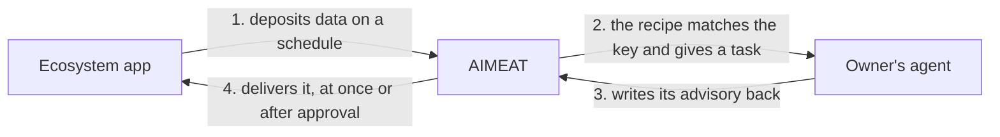

# Building an AIMEAT-compatible ecosystem application

**Audience:** anyone building or integrating an external service that connects to AIMEAT (a support
desk, a table store, a collaborative editor), and the AI you hand the build to.

**What it answers:** what AIMEAT expects from an external app so that it is AIMEAT-compatible, how it
joins, the contract it builds against today, how an owner automates the app's data with their own
agents, and a copy-paste prompt that produces a valid declaration.

> **This is the code-grounded developer spec.** It documents what is built and callable now, and it
> marks what is a design target that the node does not enforce yet. The in-code schema is the source
> of truth for the data shape: when this document and the schema disagree, the schema wins.
>
> - Identity: `aimeat/src/utils/gaii.ts` (GEAI helpers)
> - Manifest and static validation: `aimeat/src/models/ecosystem-manifest.ts` (`EcoManifestSchema`,
>   `validateEcoManifest`)
> - Event envelope and catalogs: `aimeat/src/models/ecosystem-event-schemas.ts`
> - Onboarding, data and automation routes: `aimeat/src/routes/ecosystem-apps.ts`; advisories:
>   `aimeat/src/routes/ecosystem-apps-advisories.ts`; events: `aimeat/src/routes/ecosystem-events.ts`
> - The API contract: [openapi.yaml](../openapi.yaml), tag "Ecosystem Apps"
>
> **Companion documents:** the protocol in the [Core specification](AIMEAT-RFC-v4.0-Core-full.md)
> and the [Platform specification](AIMEAT-RFC-v4.0-Platform-full.md). The agent equivalent:
> [building-an-aimeat-compatible-agent.md](building-an-aimeat-compatible-agent.md).

---

## 0. What an ecosystem app is

An **ecosystem application** is an external service that connects to AIMEAT. It lives on its own
domain, can be written in any language on any stack and runs in its own environment. AIMEAT does not
interfere with how it is built or where it runs, as long as it completes the handshake and behaves
correctly. It is modelled on an AIMEAT agent connection: an external principal beside the agent, the
**GEAI** (`eco:{app}#{owner}@{node}`, role `ecosystem`).

It is not a federation peer (node-level, approved by the operator) and not an app hosted on the node
(a browser or WebAssembly sandbox). It is a third kind of thing.

The governing principle is **peer integration**:

- Each system keeps its own user management and access control. The link is only a per-user
  correspondence marker ("this AIMEAT owner maps to this account on your side"). Neither system mints
  the other's permissions.
- **You own your raw data; the user owns the refined data.** High-frequency planes (CRDT, presence,
  realtime) stay on your side. AIMEAT keeps the distilled output in the user's own namespace or
  organism, written there with the owner's grant, the same way an agent deposits.

**Differences from an agent** (if you know the agent guide, only these change):

| Agent | Ecosystem app |
|---|---|
| Communicates over MCP | Communicates over REST through the connector tunnel, and events (MCP is not used) |
| Has a task queue | No task queue: work is driven by events and capabilities |
| Events are a secondary surface | Events are the primary surface |
| | May ship its own AIMEAT-compatible views (design target) |

You do not implement the wire protocol. You run the **AIMEAT connector** (`aimeat connect serve`) as a
sidecar and talk loopback HTTP and JSON to it, the same mechanism agents use. The connector speaks
the tunnel and tells an `eco:` principal apart by its identity, so no special mode is needed; your
service stays language-agnostic.

---

## 1. Compatibility levels (each one optional and additive)

An app that connects and declares nothing extra already works and is never penalised. The levels
mirror the agent ladder; the last column says what the node enforces today.

| Level | What the app does | Built now? |
|---|---|---|
| **0, Connected** | Completes the hello handshake, has a per-user GEAI, holds a tunnel, reads and writes within its granted scopes | ✓ Built: `ecosystem-apps.ts`; the tunnel accepts the `ecosystem` role |
| **1, Provides capabilities** | Declares `capabilities` (id and input and output schema) that agents and schedules can invoke, and the `scopes` it uses against AIMEAT | ✓ Manifest fields, static validation and capability invocation over the tunnel are built. Pricing and visibility per capability are a design target. |
| **2, Exchanges events** | Emits events that AIMEAT workflows use as triggers, and subscribes to AIMEAT events | ✓ The event envelope, the inbound and outbound catalogs and the router are built. Payload schemas per event are a design target: `emits` and `subscribes` are name lists today. |
| **3, Workflow-compatible** | Capabilities carry workflow signals (`success_signal`, `required_to_function`, `deliverable.location`), so a call or a deposit can be a chained, checked step | Design target: not in `EcoManifestSchema` yet. The grammar exists for agents (`workflow-schemas.ts`), and ecosystem capabilities will reuse it. |

An ecosystem app is AIMEAT-compatible in the full sense when it reaches level 3 on at least one
capability. Levels 0 to 2 are real and usable now.

---

## 2. Identity (level 0, built)

Your principal is a **GEAI**: `eco:{app}#{owner}@{node}` (for example
`eco:zendesk#teppo@aimeat-fi-001-genesis`), role `ecosystem`.

- **The `eco:` prefix tells it apart.** AIMEAT's `gaii.ts` does not accept `eco:` identities as agent
  GAIIs, so do not present yourself as an agent.
- `{app}` follows the agent-name character set and reserved names (`validateAppName`). One AIMEAT owner
  connecting one external service is one GEAI, with that owner's own scopes. Two users of the same
  service get two independent GEAIs.
- Registration is per node and per user, like a GAII. The same external software forms many
  independent connections, one per node. Each node pins your `public_key` at first connect
  (trust on first use); there is no verification across nodes. Every renewal of your credential is
  signed with the pinned key (section 3.3a).
- **Ownership:** the GEAI works in its own `eco:` memory namespace. `resolveIdentity()` returns the
  `eco:` subject as it is for the `ecosystem` role and does not move writes to the owner. The owner
  reads that data through the same owner aggregation that covers agents, and through the refined data
  deposited into the organism.

Helpers (source of truth): `parseGEAI`, `buildGEAI`, `isValidGEAI`, `isGEAI`, `validateAppName` and
`ECO_PREFIX` in `aimeat/src/utils/gaii.ts`.

---

## 3. How to join (built)

Joining follows agent device authorization (RFC 8628) and works in both directions: either side may
start the handshake, and the AIMEAT owner always grants the AIMEAT-side scopes. Run the connector as a
sidecar; it calls these endpoints for you.

### 3.1 `POST /v1/ecosystem-apps/hello`: start the handshake (no auth; the key is pinned)

Request body:

```jsonc
{
  "owner": "teppo",                  // required: the AIMEAT owner you are connecting to
  "app": "zendesk",                  // required: your {app} segment (validateAppName)
  "public_key": "<ed25519 pubkey>",  // required: pinned at first connect
  "display_name": "Zendesk Support", // optional
  "description": "…",                // optional
  "scopes": ["memory:read", "memory:write"],   // optional: defaults to the node's defaultEcoScopes
  "data_areas": [ … ],               // optional: consent-grant allowlist (stored at approval)
  "bound_ref": "<opaque acct ref>",  // optional: your account marker; kept on the record, not in the JWT
  "manifest": { … }                  // optional: validated at once when present (section 5)
}
```

The answer has the RFC 8628 shape: `{ device_code, user_code, verification_uri,
verification_uri_complete, expires_in, interval, validation, user_instructions }`. The owner approves
the request with its `user_code` on the **Outside apps** tab of Settings & Controls
(`/v1/profile?tab=ecosystem`). **Rate limit: 10 pending requests per owner.**

### 3.2 Owner approval (owner signed in)

- `GET /v1/ecosystem-apps/pending`: the owner lists pending hello requests.
- `POST /v1/ecosystem-apps/:userCode/approve`: the owner approves or denies, and chooses the scopes
  and data areas the GEAI may use. The status becomes active and the credential can be picked up.

### 3.3 `POST /v1/ecosystem-apps/token`: the connector polls for the credential

Poll with `{ device_code, grant_type }`. Before approval you get `authorization_pending` or
`slow_down` (the agent device-token answers). After approval you get the **GEAI JWT** once: an EdDSA
token with `sub = eco:{app}#{owner}@{node}`, `roles: ['ecosystem']`, `owner`, `node`, `scopes` and an
`eco_app` claim. `bound_ref` is not in the JWT; it stays on the stored record.

### 3.3a Renewing the credential: prove the pinned key (built, 2026-10-09)

The `public_key` you send at hello is pinned on your app record when the owner approves. A renewal
must prove that you still hold its private half; the bearer token alone does not renew.

```
POST /v1/auth/refresh
Authorization: Bearer <your current GEAI token>
{ "timestamp": "<now, ISO 8601>", "signature": "<base64 Ed25519 signature of geai + timestamp>" }
```

- The message is your GEAI followed by the timestamp, with nothing between them
  (`eco:zendesk#teppo@node-id2026-10-09T12:00:00.000Z`), signed with the private key whose public half
  you sent at hello. The timestamp must be within five minutes of the node's clock, and each signature
  is accepted once.
- No proof: `401 ECO_KEY_PROOF_REQUIRED`. Another key, a stale timestamp or a reused signature:
  `401 ECO_KEY_PROOF_INVALID`.
- **One approval carries one year of renewals.** The token from the pickup carries `auth_time`, the
  moment the owner approved, and every renewal keeps it. A year after that the renewal answers
  `401 ECO_REAPPROVAL_REQUIRED`: send hello again, and the owner approves the app again and sees its
  permissions. The renewal answer carries `reapprove_by`, so you can ask the owner before it runs out,
  and a renewed token never outlives the approval.
- Renew while your current token is still valid: an expired bearer cannot renew, and the way back is
  hello again.

**What an app built before 2026-10-09 must change.** Generate a real Ed25519 keypair if you sent a
placeholder as `public_key`, keep the private half, and sign every renewal as above. A credential
issued before this change keeps working until its next renewal; that renewal needs the signature, and
an app whose pinned key is not a real Ed25519 key connects again with hello (the owner then pins the
new key). A token issued before this change starts its one-year chain at its own issue time.

### 3.4 Owner management

- `GET /v1/ecosystem-apps`: the owner lists their connected apps.
- `DELETE /v1/ecosystem-apps/:app`: the owner disconnects an app. The node first tells the app with a
  `binding.revoked` event, then ends every credential the app holds and deletes the connection, with
  the app's automation recipe, its scheduled capability jobs and its pending advisories. What the app
  deposited stays.

Then: hold a tunnel (the `/v1/connect/tunnel` upgrade accepts the `ecosystem` role), read and write
within the granted scopes, and exchange events.

---

## 4. The manifest: the contract (built schema)

`manifest` is optional at hello: with no manifest there is no validation step. When you send one, it
is validated against **`EcoManifestSchema`**, which is what the node enforces today:

```jsonc
{
  "app": "zendesk",                  // required: must equal the hello `app`
  "origin": "https://support.example.com",   // optional: your domain
  "scopes": ["memory:read", "memory:write"], // optional: MUST be a subset of the requested scopes
  "capabilities": [                  // optional: agents and schedules invoke these over the tunnel
    {
      "id": "reply-ticket",          // required, unique across capabilities
      "inputSchema":  { "ticket_id": { "type": "string" }, "body": { "type": "string" } }, // optional
      "outputSchema": { "reply_id": { "type": "string" }, "status": { "type": "string" } } // optional
    }
  ],
  "events": {                        // optional: names only (no payload schema in the built manifest)
    "emits":      ["ticket.resolved", "csat.dropped"],
    "subscribes": ["memory.write", "offer.ordered"]
  },
  "automation": {                    // optional: hints for the owner's automation (section 7)
    "schedulable": [
      { "id": "publish-stats",       // a capability that can run on a schedule
        "produces": "feedback-stats@1",          // optional: the schema of what it deposits
        "produces_key": "feedback.stats",        // optional: the key prefix it deposits under
        "cadences": ["daily", "weekly"] }        // optional
    ],
    "advisory_sink": "deliver-advisory",         // optional: the capability that receives guidance
    "recommended_agents": [          // optional: which of the owner's agents fit this app best
      { "match_tags": ["analysis"], "why": { "en": "…", "fi": "…" } }
    ]
  },
  "setup": { "en": "…", "fi": "…" }  // optional: your own setup guide for the owner, in Markdown
}
```

- **`automation`** is a hint only. The node never requires it before an owner schedules a
  capability. `produces_key` gives the default trigger of the owner's automation recipe, and the
  owner's agents that match `recommended_agents` are marked as recommended and listed first when the
  owner picks agents.
- **`setup`** is the guide the owner sees at the top of your app's card on the Outside apps tab: what
  is needed, why and where, including the agents your app expects. Write it for the owner, in English
  and Finnish. An app that sends none gets a short general note instead.

> **Design-target fields (not in the built schema; do not rely on them being enforced):** `price`,
> `visibility`, `title` and `description` per capability, the level-3 workflow signals
> (`success_signal`, `required_to_function`, `deliverable.location`), payload schemas per event, and a
> `views` section for views the app ships. Until they land in `EcoManifestSchema` the node neither
> requires nor validates them. Including them is harmless (extra keys), but build against the fields
> above for anything you depend on today.

The published manifest lives in the GEAI's own `eco:` memory namespace, the way agents publish
`agents.{name}.offers`; the connector transmits it.

---

## 5. Compatibility validation: what runs today (static checks only)

When a `manifest` is sent at hello, `validateEcoManifest(app, requestedScopes, manifest, maxEcoScopes)`
runs, and the report of each check is returned in the hello answer (`validation.checks`), so the owner
approves an integration that is known to be well formed. All six static checks must pass for
`ok: true`:

1. **`manifest_schema`**: parses and validates against `EcoManifestSchema`.
2. **`app_name_valid`**: `m.app` is a clean `{app}` segment (no collision with a GAII or `eco:`).
3. **`app_matches_request`**: `m.app` equals the hello `app`.
4. **`declared_scopes_subset_requested`**: `manifest.scopes` is a subset of the requested scopes.
5. **`scopes_within_ceiling`**: the requested scopes stay within the node's `maxEcoScopes` ceiling.
6. **`capability_ids_unique`**: no duplicate capability ids.

> **A dynamic check is not built.** A planned step would exercise each declared capability and event
> over the tunnel before approval. Today the static checks above are the whole gate. Write your
> handlers to answer correctly regardless, because the owner approves on the assumption that you do.

---

## 6. Events: the primary surface (built)

Events go both ways, through `ecosystem-event-schemas.ts`. Envelope:
`{ version, event, timestamp, node_id, geai, data }`, where `version` is the MAJOR version of the
event type. A workflow trigger pins it, and on a major mismatch it does not fire.

- **Outbound (AIMEAT to your subscribed GEAI):** `memory.write`, `memory.delete`, `offer.ordered`,
  `workflow.step`, `binding.revoked`. The owner's grant decides what is delivered, and the owner keeps
  the subscriptions (`GET`, `POST` and `DELETE /v1/ecosystem/subscriptions`).
- **Inbound (your GEAI to AIMEAT):** an open set. Emit any event your manifest declares with
  `POST /v1/ecosystem/events` (scope `events:emit`). The initial catalog: `ticket.resolved`,
  `feedback.received`, `csat.dropped`, `table.updated`, `note.changed`. A workflow trigger of kind
  `ecosystem.event` matches on `{ app, event, version }`; consumers ignore unknown events, so a new
  event type never breaks anyone.
- The main transport is the tunnel's `deliver` frame; a signed webhook covers the time the GEAI is
  offline. Design your events to be workflow triggers, not just notifications.

---

## 7. Automation: from the app's data to the owner's agent and back (built)

This is what an owner sets up once an app is connected. The app and the owner's agents never talk to
each other: AIMEAT sits between them, and nothing crosses unless the owner configured it.



1. **The app publishes data.** A schedule of kind `eco-capability` invokes one of the app's declared
   capabilities over the tunnel on each run, and the app deposits what it produced (for example
   weekly feedback statistics under `feedback.stats.*`).
2. **The recipe gives the data to the owner's agents.** When a key matching the recipe's
   `trigger.keyGlob` is written, the node makes a task for each agent the recipe names.
3. **The agent does the work** and writes its advisory back to AIMEAT. It can also route its report
   to an organism and email the owner.
4. **AIMEAT delivers the advisory** into the app's guidance by invoking the app's `deliver-advisory`
   capability. With `require_approval: true` it waits for the owner first.

**The owner's routes** (all owner-only; an agent or an app cannot change them):

| What | Route |
|---|---|
| What the app wrote into its own namespace, newest first (at most 200) | `GET /v1/ecosystem-apps/:app/data` |
| Everything about the app's automation in one read: its scheduled capability jobs, the recipe, the owner's organisms and the pending advisories | `GET /v1/ecosystem-apps/:app/automation` |
| Run a capability on a schedule (`kind: "eco-capability"`, `app`, `capability_id`; the capability must be one the app declared) | `POST /v1/schedules` |
| The recipe: read, create or replace, remove. Body: `agents` (the owner's own agent names), `trigger.keyGlob` (defaults from the manifest's `produces_key`, else `eco.{app}.*`), `organism`, `email`, `require_approval` | `GET`, `PUT`, `DELETE /v1/ecosystem-apps/:app/automation/recipe` |
| Advisories waiting for the owner's approval | `GET /v1/ecosystem-apps/:app/advisories/pending` |
| Approve one and deliver it; reject one | `POST /v1/ecosystem-apps/:app/advisories/:id/approve`, `.../reject` |

Approving delivers the advisory over the tunnel. When the app is offline or refuses, the answer is
`202` and the advisory stays pending, so the owner can approve it again once the app is back.

**The owner's screen.** The Outside apps tab of Settings & Controls (`/v1/profile?tab=ecosystem`)
shows each connected app as a card: the app's own setup guide from its manifest, a block with a prompt
the owner copies into their own AI chat to ask about the app's data, the automation settings in one
form (what the app produces, the schedule, the agents, the organism, approve first or deliver at
once, and the trigger key under Advanced) saved with one button that writes both the schedule and
the recipe, and the latest run: when the app last published, which agents process it, and the
advisories that wait, with Approve and Reject.

**From the owner's own AI.** Because the data and the advisories live in AIMEAT, the owner asks about
them from any AI chat connected to the node over MCP, without opening the app: "Read what the feedback
app published this week and summarise the top issues", then "Save your analysis to my product
organism", and a month later "Compare it with this month's numbers: did the issues we flagged
improve?".

**Two things that stop a run.** The recipe needs at least one connected agent, or nothing processes
the data. A capability call needs the app's connector running: without it a scheduled run and a
delivery are skipped and say that the app is not reachable, rather than failing silently.

---

## 8. What to honour (the peer model)

1. **Keep your own user management and access control.** No delegated tokens, no shared permission
   minting. When an agent calls your capability, you enforce the bound account's access rules. When
   the GEAI reads or writes AIMEAT, AIMEAT enforces consent and scopes.
2. **The binding is only a marker** ("owner X maps to your account ref Y"). It carries no rights of
   its own.
3. **You own raw data; the user owns refined data.** Deposit the distilled output into the user's own
   namespace or organism (with the grant), as an agent does. Prefer references, read-through and
   display shaped by a schema over copying bulk content. Keep raw records and any realtime plane on
   your side.
4. **AIMEAT is never your data plane.** Only control, refined data, references, events and capability
   calls cross between you.
5. **No task queue.** Your work is driven by events and capabilities. Agents keep tasks; you do not.
6. **The organism is the shared place.** Ecosystem apps do not couple to each other: each couples to
   AIMEAT, and composition happens in the organism through agents.

---

## 9. Copy-paste prompt: hand this to the AI that builds the app

> Fill in the `<…>` blanks, then paste the prompt into the chat of the AI building your service. It
> produces a manifest that is valid against the built `EcoManifestSchema`, plus the loopback handler
> stubs.

```text
You are setting up an external service as an AIMEAT-compatible ECOSYSTEM APPLICATION — a NEAR-COPY of an
AIMEAT agent connection with these deltas: it is EXTERNAL (own domain, any language), communicates over
REST-over-tunnel + events (NOT MCP), has NO task queue, EVENTS are its primary surface. It attaches via
the AIMEAT connector run as a SIDECAR (loopback HTTP), so you do NOT implement the wire protocol.

Governing principle: PEER INTEGRATION, NOT DOMINATION — keep your own user management and access control;
the binding is only a per-user marker; you own your raw data; AIMEAT owns the refined data the user keeps
(deposited into the user's GHII/organism namespace with grant).

APP NAME (the {app} segment of eco:{app}#{owner}@{node}): <e.g. zendesk>
ORIGIN (your domain): <e.g. https://support.example.com>
ONE PROVIDED CAPABILITY, with its NEGATIVE scope: <e.g. "Reply to a support ticket as the bound user.
  Does NOT create/delete tickets and does NOT change billing.">
  - input fields it reads:  <e.g. ticket_id, body>
  - output fields it returns: <e.g. reply_id, status>
EVENTS YOU EMIT (workflow triggers): <e.g. ticket.resolved, csat.dropped>
AIMEAT EVENTS YOU SUBSCRIBE TO: <subset of: memory.write, memory.delete, offer.ordered, workflow.step,
  binding.revoked>
AIMEAT SCOPES YOU NEED: <e.g. memory:read, memory:write>

Produce ONE manifest (JSON) in EXACTLY this shape — only these fields are validated by the node today:

{
  "app": "<APP NAME>",
  "origin": "<ORIGIN>",
  "scopes": [ <only scopes you actually use> ],
  "capabilities": [
    { "id": "<kebab-id>",
      "inputSchema":  { <fields> },
      "outputSchema": { <fields> } }
  ],
  "events": {
    "emits":      [ <event names> ],
    "subscribes": [ <AIMEAT event names from the allowed set above> ]
  }
}

Rules you MUST follow:
- `app` MUST equal the app name you send in the hello request, and be a clean lowercase {app} segment.
- `scopes` in the manifest MUST be a subset of the scopes you request at hello, and within the node's
  ceiling — declare only what you use.
- capability ids MUST be unique.
- Communicate via REST-over-tunnel + events; do NOT add MCP and do NOT model work as AIMEAT tasks.
- Keep your own user management/access control; the binding is just a per-user marker.
- Deposit refined data into the user's GHII/organism namespace (with grant); keep raw + realtime data on
  your side.

Then ALSO produce: (a) the connector hello call (POST /v1/ecosystem-apps/hello with owner, app,
public_key, scopes, and this manifest), (b) a loopback HTTP handler for each capability that returns
schema-valid output, (c) an emitter for each event in `emits`, (d) a handler for each event in
`subscribes`. Generate an ed25519 keypair for the app and send the PUBLIC key as public_key (pinned TOFU).
```

---

## 10. Quick self-check (against what is built today)

- [ ] Hello sent with `owner`, `app` and `public_key`; the owner approved it on the Outside apps tab;
      the token picked up is a GEAI JWT with `roles:['ecosystem']` and
      `sub = eco:{app}#{owner}@{node}`.
- [ ] `public_key` is a real Ed25519 public key (base64), and every renewal at `POST /v1/auth/refresh`
      carries `{ timestamp, signature }` signed with its private half (section 3.3a); the app asks its
      owner to approve again before `reapprove_by`.
- [ ] If a `manifest` is sent, all six static checks pass (`validation.ok === true`).
- [ ] `manifest.app` equals the hello `app`; `manifest.scopes` is a subset of the requested scopes;
      capability ids are unique.
- [ ] The manifest carries a `setup` guide in English and Finnish, and `automation.schedulable` names
      the capability that publishes data, with its `produces_key`.
- [ ] Capabilities answer with schema-valid output over the tunnel; subscribed events are
      acknowledged; emitted events use the `{ version, event, …, data }` envelope.
- [ ] If the app takes advisories, its `deliver-advisory` capability accepts them.
- [ ] Refined output is deposited into the owner's namespace (with the grant); raw and realtime data
      stay on your side.
- [ ] You did not rely on design-target fields (pricing, level-3 signals, payload schemas per event,
      shipped views) being enforced: they are not yet.

---

## 11. Built and not built, at a glance

| Surface | Status | Where |
|---|---|---|
| GEAI identity (`eco:` helpers, role, resolveIdentity) | ✓ Built | `utils/gaii.ts` |
| Onboarding (hello, token, pending, approve, list, disconnect) | ✓ Built | `routes/ecosystem-apps.ts` |
| Renewal signed by the pinned key; one year per approval | ✓ Built | `services/ecosystem-refresh.ts` |
| Manifest schema and static validation, with `automation` hints and the `setup` guide | ✓ Built | `models/ecosystem-manifest.ts` |
| Event envelope, inbound and outbound catalogs, router | ✓ Built | `models/ecosystem-event-schemas.ts`, `routes/ecosystem-events.ts` |
| Tunnel accepts the `ecosystem` role; capability invocation over the tunnel | ✓ Built | tunnel upgrade and connector |
| Owner aggregation including GEAIs; a balance resolves `eco:` to the owner | ✓ Built | storage and `gaii.ts` |
| The app's data, scheduled capabilities, automation recipe and advisories | ✓ Built | `routes/ecosystem-apps.ts`, `routes/ecosystem-apps-advisories.ts`, `POST /v1/schedules` |
| The owner's Outside apps tab | ✓ Built | `aimeat/public/views/profile/ecosystem-tab.js` |
| Pricing and visibility per capability | Design target | not in the schema |
| Level-3 workflow signals on capabilities | Design target | will reuse `workflow-schemas.ts` |
| Payload schemas per event in the manifest | Design target | the manifest has name lists today |
| Dynamic handler-probing validation | Not built | static checks only |
| Views shipped by the app | Design target | not in the schema |

Build against the rows marked ✓. Treat the others as the roadmap, not the contract.
