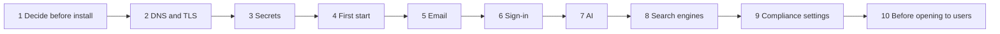

# 00 Go-live checklist

> Checked against AIMEAT node 4.2.0 (commit a829b79fa) on 2026-11-03. Maintained with the code: see the README for how.

Everything to do when an AIMEAT node goes online, in the order it must be done. It is for the person who runs the installation and for the people who supply what the installation needs: the DNS admin, the identity provider (IdP) admin, the mail admin and the data protection officer (DPO). Each item says what to do, why, which setting or tool does it, what goes wrong if it is skipped, and who provides it. The detail lives in the linked guides; this page is the order.

Who is who in the "Who" column:

| Role | Provides |
|---|---|
| IT | the server, the reverse proxy, the process manager, the secrets store, the first operator account |
| DNS admin | DNS records, TLS certificates (often with IT) |
| IdP admin | the Entra, Google, SAML or SCIM registration in the organisation's identity provider |
| Mail admin | the SMTP relay or mailbox, SPF, DKIM and DMARC records |
| DPO | the controller details, the privacy notice text, the supervisory authorities, the records of processing |

The operator is the first account created on the node; it holds the node's admin role (`docs/coding-guidelines/identity-model.md`).

Phases 1 to 3 must be complete before the node starts for the first time, because several of their values cannot be changed later without breaking data or sign-ins. Phases 5 to 9 can be done in another order, but all of them come before phase 10.

## Phase 1: Decide before install

Items 1.1 to 1.6 are read at start and cannot be changed from the admin Config page (`immutable: true` in `aimeat/src/services/config-schema.ts`); changing one later is a migration project, not a setting change. The registration mode, content access and publish gate (1.7, 1.8) can be changed at runtime (`aimeat/src/services/config-schema-visibility.ts`), but decide them before the first account exists.

| # | What | Why | Setting or tool | If skipped | Who |
|---|---|---|---|---|---|
| 1.1 | Fix the node's address (base URL) for good | The base URL is the node's published address, and the passkey relying party ID (RP ID) is derived from its host. A WebAuthn credential is bound to its RP ID ([W3C WebAuthn, RP ID](https://www.w3.org/TR/webauthn-3/#relying-party-identifier)), so a passkey registered under one domain does not work under another. The node keeps the RP ID immutable at runtime for that reason (`aimeat/src/services/config-schema.ts`, the Passkeys block) | `AIMEAT_BASE_URL`, `AIMEAT_PASSKEY_RP_ID` (default: the base URL's host, `aimeat/src/config-types-account-security.ts`) | A later domain change makes every registered passkey stop working; every person has to register a new one | IT, DNS admin |
| 1.2 | Fix the node's id | The node id is part of every person's and agent's identity (`alice@node-id`, `claude#alice@node-id`) and of the node's signing key path. The default is a development id | `AIMEAT_NODE_ID` (default `aimeat-local-001-dev`, `aimeat/.env.example`) | Records written under the old id are read as a stranger's by the boot-time seeders; see [pitfalls §87](../pitfalls.md#87-a-node-that-changed-its-id-stops-receiving-its-own-seeded-upgrades) | IT |
| 1.3 | Choose the name families | Apps, portfolios and company pages each run on their own origin under the node's name, and HTML pages run on one separate page host. Each family needs DNS and a certificate (phase 2) | `AIMEAT_APP_HOST`, `AIMEAT_APP_ORIGIN_ENABLED`, `AIMEAT_PORTFOLIO_HOST`, `AIMEAT_PORTFOLIO_ORIGIN_ENABLED`, `AIMEAT_CO_HOST`, `AIMEAT_CO_ORIGIN_ENABLED`, `AIMEAT_PAGE_HOST`. Detail: [production deployment, names and certificates](../operations/production-deployment.md#names-and-certificates) | With the app origin off, apps share the node's origin. With it on and no DNS, every app answers a 301 to a host that does not resolve (`aimeat/.env.example`, App Origin Isolation) | IT, DNS admin |
| 1.4 | Choose the storage backend | The default is in-memory storage, which loses every record at restart. PostgreSQL (`postgres-kysely`) is the production backend; SQLite is supported | `AIMEAT_STORAGE` (default `memory`, `aimeat/src/config.ts`), `DATABASE_URL`, `AIMEAT_SQLITE_PATH` | All data is lost at the first restart. A mistyped value stops the start (`aimeat/.env.example`, header) | IT |
| 1.5 | Choose the node type | `full` is the organisation node. `personal` is for one person and defaults to the local security profile. `relay` and `mirror` are restricted roles ([environment examples](../coding-guidelines/environment-configs.md)) | `AIMEAT_NODE_TYPE` (default `full`) | A `personal` node gets the local profile and its relaxed defaults | IT |
| 1.6 | Set the security profile explicitly to `public` | The profile sets the safe defaults and arms the start-time self-check. When unset, the node picks `local` for a base URL on localhost or an RFC 1918 address, and for a personal node (`aimeat/src/config-private-host.ts`). An internal node addressed by a private IP gets `local`: loopback egress allowed, app origin isolation off, and none of the public-profile warnings (anonymous mode, CORS `*`, missing data key, empty AI provider allowlist, extension install role, statistics access, powerful default scopes); only test switches such as dev mode are still reported (`aimeat/src/config-posture.ts`) | `AIMEAT_SECURITY_PROFILE=public`; `AIMEAT_BIND_HOST` (a bind address beyond loopback also forces `public`) | The node runs with the relaxed local defaults and does not warn about unsafe settings | IT |
| 1.7 | Decide who may create an account | The default mode is `open`: anyone who reaches the node can register ([organisation node sign-in, section 1](../organisation-node-sign-in.md#1-two-gates-and-why-one-is-not-enough)) | `AIMEAT_REGISTRATION_MODE`: `oauth` (staff through the IdP) or `invite` for an organisation node | Anyone who reaches the address can create an account | IT, IdP admin |
| 1.8 | Decide who sees content | The default `open` serves public content to anyone. `signed-in` serves nothing outside sign-in and the machine connections ([organisation node sign-in, section 6a](../organisation-node-sign-in.md#6a-show-the-content-to-signed-in-accounts-only)) | `AIMEAT_CONTENT_ACCESS=signed-in`, `AIMEAT_PUBLISH_GATE=agents-and-apps` (code default `off`; `aimeat init` writes `agents-and-apps`, `aimeat/.env.example`) | Published apps, public files and shared pages are readable without an account | IT, DPO |

## Phase 2: DNS and TLS

The node speaks plain HTTP on its port and never terminates TLS; a reverse proxy holds the certificates ([production deployment](../operations/production-deployment.md#what-the-node-does-and-does-not-do)).

| # | What | Why | Setting or tool | If skipped | Who |
|---|---|---|---|---|---|
| 2.1 | Give the node's own name a DNS record of its own | **The wildcard trap.** If the node's name answers only through a parent wildcard (`*.example.org`), the first name created below it (an app name, or a certificate challenge record) stops the wildcard answering for the node's name | DNS A/AAAA record. [Production deployment, step 3](../operations/production-deployment.md#names-and-certificates) | The node goes off the air when the first record below it appears | DNS admin |
| 2.2 | Create the family records: the name and the wildcard below it (`apps.example.org`, `*.apps.example.org`), for each family turned on in 1.3 | Every app has its own origin `<app>.apps.example.org`; names are one label deep | DNS records | App, portfolio or company addresses do not resolve | DNS admin |
| 2.3 | Create the page host record, if `AIMEAT_PAGE_HOST` is set | One host, served by path, no wildcard | DNS record, its own server block. [The page host](../operations/production-deployment.md#the-page-host) | HTML workspace pages are shown as text (the safe default) | DNS admin, IT |
| 2.4 | Get certificates for the node, each family and its wildcard | A wildcard certificate needs the DNS-01 challenge | Certificate authority, DNS-01 | Browsers refuse the app addresses | DNS admin, IT |
| 2.5 | Configure the reverse proxy | The proxy must pass `Host` unchanged, set `X-Forwarded-For` and `X-Forwarded-Proto`, pass WebSocket upgrades, turn off buffering on streams, and allow the node's body sizes | `AIMEAT_TRUST_PROXY` (hop count or subnet), nginx sketch in [production deployment](../operations/production-deployment.md#an-nginx-starting-point) | A rewritten `Host` makes every app request look like the node's own site; buffered streams cut chat and MCP sessions | IT |
| 2.6 | Block the node's port to everything but the proxy | Only the proxy should reach the node | Firewall. [Deployment checklist, network security](../security/deployment-checklist.md#network-security) | Clients bypass the proxy and its TLS | IT |

## Phase 3: Secrets

Set these before the first start and keep them in the organisation's secrets store. They are part of the node, together with the database and the node's key file ([backup and restore, what a node is](../operations/backup-and-restore.md#what-a-node-is)).

| # | What | Why | Setting or tool | If skipped | Who |
|---|---|---|---|---|---|
| 3.1 | Generate the data key | AES-256-GCM key that encrypts every stored secret: AI provider keys, the secrets vault, extension and MCP server secrets, two-step sign-in secrets, secret Config settings (`aimeat/.env.example`, Node Identity) | `AIMEAT_ENCRYPTION_KEY`, 64 hex characters (`openssl rand -hex 32`) | Features that store a secret answer 503; a public node logs a warning at start (`aimeat/src/config-posture.ts`). **A changed or lost key leaves every stored secret unreadable.** Set it before the first start. Added later to a node that ran on `AIMEAT_TOTP_ENCRYPTION_KEY` (as `aimeat init` sets up), it encrypts the new secrets, and the ones stored before keep opening only while the TOTP key stays set ([11 Backup and recovery](11-backup-recovery.md)) | IT |
| 3.2 | Generate the TOTP key, or rely on the data key | Two-step sign-in secrets use the data key, or this key when only this one is set. With neither, nobody can set up two-step sign-in | `AIMEAT_TOTP_ENCRYPTION_KEY` | Two-step sign-in cannot be set up (503) | IT |
| 3.3 | Set the key passphrase | Encrypts the node's identity key file and its database copy (without a passphrase the data key seals the database copy). Once the node has an identity, losing both the passphrase and the key file stops the node from starting, rather than it making a new identity (`aimeat/src/auth/node-keys.ts`) | `AIMEAT_KEY_PASSPHRASE`; key file at `AIMEAT_NODE_KEY_PATH` | The key file is written in plain text. On Docker, without a volume for the key path, a new container starts without the node's identity ([production deployment, process manager](../operations/production-deployment.md#process-manager)) | IT |
| 3.4 | Set the admin password, or let the node generate one | It opens `/v1/admin/setup`, where the first operator can be created. Unset, the node generates one at each start and writes it to the file `admin-setup-secret` (mode 0600) while the node has no owner; it is never logged (`aimeat/.env.example`, Operator / Admin). Every route that takes it shares one count of wrong passwords per address: after `AIMEAT_ADMIN_AUTH_RATE_LIMIT_MAX` (5) in `AIMEAT_ADMIN_AUTH_RATE_LIMIT_WINDOW_MS` (60 s), every admin password from that address is refused until the window ends (`aimeat/src/services/admin-password.ts`) | `AIMEAT_ADMIN_PASSWORD` (the Docker compose files refuse to start without it, [getting started](../coding-guidelines/getting-started.md#build-and-operate-a-node)) | None at runtime; the generated value is in the file | IT |
| 3.5 | Store the four values with the database backups, separately protected | A database restored under different values cannot read its own secrets or identity | Secrets store; [backup and restore](../operations/backup-and-restore.md#how-often-and-how-long) | A restore that does not work | IT |

## Phase 4: First start

| # | What | Why | Setting or tool | If skipped | Who |
|---|---|---|---|---|---|
| 4.1 | Run `aimeat validate` | Checks every value without starting the node (`aimeat/src/index.ts`, subcommand `validate`) | `aimeat validate` | A value the node does not accept is set aside and the setting runs on its default; `AIMEAT_STORAGE`, `AIMEAT_NODE_TYPE` and `AIMEAT_REGISTRATION_MODE` stop the start instead (`aimeat/.env.example`, header) | IT |
| 4.2 | Read the start log for `SECURITY` warnings | On a public profile the node logs one warning per unsafe setting and still starts (`aimeat/src/config-posture.ts`) | Process log | Unsafe settings run unnoticed | IT |
| 4.3 | Copy the one-time setup code from the start log | While the node has no operator, it prints a line that starts with `Setup code:`. The setup wizard, the registration routes and the first IdP sign-in refuse to create the first operator without it, unless both the base URL and the request are loopback; the admin-password route (`POST /v1/admin/setup/register`) asks for it too (`aimeat/src/routes/admin/setup-register.ts`). The code is twelve characters, works once, and only its SHA-256 digest stays in memory; a restart issues a new one (`aimeat/src/services/setup-code.ts`, `aimeat/src/index-start.ts`) | The start log; the wizard at `<base>/v1/setup/wizard` (`aimeat/src/routes/setup.ts`); `AIMEAT_SETUP_ALLOWED_IPS` restricts the wizard further | Without the code nobody can create the first operator. Before 2026-10-16, whoever reached a fresh public node first became its operator (`aimeat/src/services/setup-code.ts`) | IT |
| 4.4 | Create the first account; it becomes the operator | The first owner created gets the operator role. This also applies to the first sign-in through an IdP, so the code is needed there too while no operator exists (`aimeat/src/services/setup-code.ts`, WHICH ROUTES) | Setup wizard, or `/v1/admin/setup` with the admin password | Someone else's first account becomes the operator | IT |
| 4.5 | Turn on two-step sign-in (TOTP) for the operator, then require it | `AIMEAT_TWO_STEP_REQUIRED` is `off` by default; `operators` requires two-step sign-in for operator accounts and `everyone` for every account. A covered account without TOTP that signs in with a password or an emailed link gets no session: it sets up TOTP first and gets its backup codes once. A passkey or an IdP sign-in satisfies the rule (`aimeat/src/services/sign-in-policy.ts`, `aimeat/src/routes/ghii/login-two-step.ts`). The node refuses to require it while `AIMEAT_TOTP_ENABLED` is false (`TWO_STEP_NEEDS_TOTP`, `aimeat/src/services/config-admin-view.ts`). The admin Security page counts how many accounts have TOTP on (`aimeat/src/services/security-overview.ts`, `two_step_on`) | The person's account security page, then `AIMEAT_TWO_STEP_REQUIRED=operators` (or `auth.two_step_required` on the admin Config page, `aimeat_admin_config_set`); [deployment checklist, authentication](../security/deployment-checklist.md#authentication) | The operator account rests on one factor | IT (the operator) |
| 4.6 | Check health and the running build | `GET /v1/health` answers 200 even when degraded, so read `status` | `GET /v1/health`, `GET /v1/build` ([health checks](../operations/production-deployment.md#health-checks)) | A degraded storage probe goes unnoticed | IT |

## Phase 5: Email

The node sends its own mail through one SMTP server it is given. Without `AIMEAT_SMTP_HOST` the mail service is disabled (`aimeat/src/config-smtp.ts`).

| # | What | Why | Setting or tool | If skipped | Who |
|---|---|---|---|---|---|
| 5.1 | Know which messages the node sends | Registration and email verification codes (15-minute, 6-digit), sign-in links, password reset codes, invitations, access-key invitations and first-login credentials, welcome mail for accounts an install set created, notification digests, mailbox notifications on a personal node, and outbound mail an owner or agent sends (`aimeat/src/services/email.ts`, `aimeat/src/services/email-verification-start.ts`, `aimeat/src/services/email-template-reset.ts`, `aimeat/src/services/email-template-welcome.ts`, `aimeat/src/services/email-templates-digest.ts`, `aimeat/src/services/mailbox-notification.ts`) | None; this is the inventory for the mail admin | People who forget a password or are invited get nothing | Mail admin, IT |
| 5.2 | Configure the SMTP channel | Host, port, credentials, From address and TLS mode. The From default is `AIMEAT <noreply@localhost>`, which no receiving server accepts as a real sender (`aimeat/src/config-smtp.ts`) | `AIMEAT_SMTP_*` (`AIMEAT_SMTP_HOST`, `AIMEAT_SMTP_PORT`, `AIMEAT_SMTP_USER`, `AIMEAT_SMTP_PASS`, `AIMEAT_SMTP_FROM`, `AIMEAT_SMTP_REPLY_TO`, `AIMEAT_SMTP_SECURE`, `AIMEAT_SMTP_REJECT_UNAUTHORIZED`). Host, port, From and TLS are editable on the admin Config page; user and password are environment only (`aimeat/src/services/config-schema-email.ts`) | No mail leaves the node | Mail admin, IT |
| 5.3 | Publish SPF, DKIM and DMARC for the From domain | Receiving providers check that the sending server may send for the domain (SPF, [RFC 7208](https://www.rfc-editor.org/rfc/rfc7208)), that the message carries a valid domain signature (DKIM, [RFC 6376](https://www.rfc-editor.org/rfc/rfc6376)) and what the domain asks them to do with failures (DMARC, [RFC 9989](https://www.rfc-editor.org/rfc/rfc9989), which replaced RFC 7489). Large providers require them for bulk senders ([Google sender guidelines](https://support.google.com/a/answer/81126)). The node does not sign with DKIM itself (no DKIM code in `aimeat/src/`); the SMTP relay or mail provider must | DNS TXT records at the mail provider | Messages land in spam or are refused | Mail admin, DNS admin |
| 5.4 | Decide whether a new address must be confirmed | Off by default | `AIMEAT_EMAIL_CONFIRMATION_REQUIRED` | Accounts carry unconfirmed addresses | IT, DPO |
| 5.5 | Set the notification pace on personal nodes | Minimum minutes between email notifications per node | `AIMEAT_EMAIL_RATE_LIMIT_MIN` (default 30) | Default applies | IT |
| 5.5b | Decide how many reports one agent or app may mail its owner in a day | The reports an agent or app mails its owner, and the results its delivering schedules send, go only to an address the owner confirmed and count against one daily limit per sender; past it the mail is not sent and the bell still gets each one (`aimeat/src/services/notification-create.ts`, `aimeat/src/services/config-schema-email.ts`) | `AIMEAT_EMAIL_REPORTS_PER_SENDER_DAY` (default 10, 0 for no limit), also `email.reports_per_sender_day` on the admin Config page | Default applies | IT |
| 5.6 | Send a test message | The admin Email tab (`/v1/admin?tab=email`) shows the SMTP status and sends a test in the notification, verification or sign-in-link template (`POST /v1/admin/email/test`, `aimeat/src/routes/admin-features.ts`) | Admin Email tab | The first real sign-in link is the test | IT, Mail admin |
| 5.7 | Know that connected mailboxes do not carry system mail | A person can connect their own Gmail or Outlook so that mail they send leaves from their own address; that is for the person's own outbound mail only, through `POST /v1/outbound/send` ([connecting an outside account](../connecting-an-outside-account.md)). Sign-in links and verification codes always go through the node's SMTP transport (`aimeat/src/services/email.ts`, nodemailer). Connections are off by default (`AIMEAT_CONNECTIONS_ENABLED`) | None | None | IT |

## Phase 6: Sign-in

Read [organisation node sign-in](../organisation-node-sign-in.md) in full before this phase: it is the single home for Entra, SAML and SCIM.

| # | What | Why | Setting or tool | If skipped | Who |
|---|---|---|---|---|---|
| 6.1 | Register the Entra app | Platform Web, redirect URI `<base>/v1/ghii/login/entra/callback` (`aimeat/src/services/oidc-providers.ts`). Microsoft's procedure: [register an application](https://learn.microsoft.com/en-us/entra/identity-platform/quickstart-register-app) | [Organisation node sign-in, section 2](../organisation-node-sign-in.md#2-register-the-app-in-entra) | Staff cannot sign in with Microsoft | IdP admin |
| 6.2 | Set the tenant allowlist | The node compares the token's `tid` claim with the listed tenant GUIDs and refuses every other tenant, personal Microsoft accounts included. Empty, it falls back to `AIMEAT_ENTRA_OAUTH_TENANT` alone | `AIMEAT_ENTRA_OAUTH_ENABLED`, `AIMEAT_ENTRA_OAUTH_CLIENT_ID`, `AIMEAT_ENTRA_OAUTH_CLIENT_SECRET`, `AIMEAT_ENTRA_ALLOWED_TENANTS`. [Section 4](../organisation-node-sign-in.md#4-configure-the-node) | With `organizations` or `common` and no list, any Microsoft work account can sign in | IdP admin, IT |
| 6.3 | Google sign-in: leave it off on an organisation node, or register a client | Google sign-in has no domain or tenant allowlist in the node (`aimeat/src/services/oidc-providers.ts`), so under `oauth` mode any Google account can create an account ([section 6](../organisation-node-sign-in.md#6-what-the-gate-does-not-cover)). If used: a Web client with redirect URI `<base>/v1/ghii/login/google/callback`, and a consent screen ([Google OAuth for web server apps](https://developers.google.com/identity/protocols/oauth2/web-server)) | `AIMEAT_GOOGLE_OAUTH_*` (`AIMEAT_GOOGLE_OAUTH_ENABLED`, default false) | A second front door with no organisation gate | IdP admin, IT |
| 6.4 | SAML and SCIM, if the organisation provisions from its own IdP | One SSO connection per organisation; the public SAML and SCIM endpoints answer 503 until enabled. SCIM deactivation ends every credential acting in the person's name | `AIMEAT_SSO_ENABLED`, `aimeat_admin_sso_create`, `aimeat_admin_sso_scim_token`. [Section 7](../organisation-node-sign-in.md#7-saml-and-scim-the-organisations-own-identity-provider-br-04) | Leavers keep access until someone deactivates them by hand | IdP admin, IT |
| 6.5 | Passkeys | On by default; bound to the RP ID decided in 1.1. `AIMEAT_PASSKEY_EXTRA_ORIGINS` lists further origins (`aimeat/src/config-types-account-security.ts`) | `AIMEAT_PASSKEY_ENABLED`, `AIMEAT_PASSKEY_RP_NAME` | None | IT |
| 6.6 | Confirm the registration mode from 1.7 | The mode decides account creation only; existing accounts sign in under every mode | `AIMEAT_REGISTRATION_MODE` (editable at runtime) | See 1.7 | IT |
| 6.7 | Decide who may sign in with a password | `AIMEAT_PASSWORD_SIGN_IN` is `on` by default. `operators` keeps the password for operator accounts only, as the way in when the IdP fails; `off` refuses every password sign-in and every new password (403 `PASSWORD_SIGN_IN_OFF`). The node refuses to save `off` while no operator account has a passkey or an IdP link (`OPERATOR_LOCKOUT`) (`aimeat/src/services/sign-in-policy.ts`) | `AIMEAT_PASSWORD_SIGN_IN=operators` on an organisation node with an IdP; `off` only when every operator has a passkey or an IdP link | People keep passwords the IdP does not govern | IT |
| 6.7a | Decide whether wrong attempts lock an account | `AIMEAT_SIGN_IN_LOCKOUT` is `off` by default: wrong passwords and two-step codes are not counted and lock nothing, and the per-address delay and the login rate limit bound guessing. `on` locks the account after `AIMEAT_PASSWORD_LOCKOUT_ATTEMPTS` (5) for `AIMEAT_PASSWORD_LOCKOUT_MINUTES` (15), and after `AIMEAT_TOTP_MAX_FAILED` (5) for `AIMEAT_TOTP_LOCKOUT_SECONDS` (300) (`aimeat/src/services/password-check.ts`) | `on` where your policy requires an account lockout, knowing that anyone who knows a username can then keep its owner out for the lockout's length | A policy that requires a lockout is not met | IT |

## Phase 7: AI

Detail on [06 AI and models](06-ai-and-models.md).

| # | What | Why | Setting or tool | If skipped | Who |
|---|---|---|---|---|---|
| 7.1 | Choose the model source and add the key | People's content goes to the chosen provider when an AI reads it | Admin Config page, AI section; `aimeat_ai_providers`, `aimeat_ai_provider_test` | AI features do not answer | IT |
| 7.2 | Choose the processing region (OpenRouter) | The region default is `any`, and the fallback default is `us`, so a model the EU region lacks goes to the United States unless the fallback is `off` ([where AI calls are processed](../operations/openrouter-region.md#the-four-settings)) | `AIMEAT_AI_OPENROUTER_REGION`, `AIMEAT_AI_OPENROUTER_REGION_FALLBACK` | Calls may be processed outside the region the DPO assumed | IT, DPO |
| 7.3 | Assign the AI roles | Which model does which job | `aimeat_ai_roles` | Defaults apply | IT |
| 7.4 | Set the egress allowlist for AI keys | Empty allows any host, and the decrypted key is sent there; a public node warns at start (`aimeat/src/config-posture.ts`) | `AIMEAT_AI_PROVIDER_ALLOWLIST` (environment only, `aimeat/src/services/config-schema-features.ts`) | A poisoned provider address can receive a stored key | IT |

## Phase 8: Search engines and visibility

| # | What | Why | Setting or tool | If skipped | Who |
|---|---|---|---|---|---|
| 8.1 | **Internal organisation node: turn indexing off** | Indexing is on by default. `off` serves a Disallow-all `robots.txt` and sends `X-Robots-Tag: noindex, nofollow` on every response, because a Disallow rule alone does not stop a linked URL from being listed (`aimeat/src/middleware/robots-header.ts`, `aimeat/src/server-bootstrap/robots-mount.ts`; [Google on noindex](https://developers.google.com/search/docs/crawling-indexing/block-indexing)). Changeable at runtime, no restart | `AIMEAT_SEO_INDEXING=off` | The node's public pages and addresses can appear in search results | IT |
| 8.2 | Know what a signed-in-only node serves to crawlers | With `AIMEAT_CONTENT_ACCESS=signed-in`, `robots.txt` is Disallow-all whatever the indexing switch says, and content is not served without a sign-in (`aimeat/src/server-bootstrap/robots-mount.ts`). With indexing on, signed-in views such as `/v1/admin` and `/v1/chat` carry `noindex, follow`, and every non-HTML response carries `noindex` (`aimeat/src/middleware/robots-header.ts`). With indexing off, no app is indexable either, whatever its owner chose (`aimeat/src/services/app-seo.ts`) | None | None | IT |
| 8.3 | Public node only: name the site and the operator | Site name, description, social image and the Organization structured data that says who runs the node | `AIMEAT_SEO_SITE_NAME`, `AIMEAT_SEO_SITE_DESCRIPTION`, `AIMEAT_SEO_ORGANIZATION_NAME`, `AIMEAT_SEO_ORGANIZATION_URL`, `AIMEAT_SEO_SAME_AS` | The node presents itself with the software's defaults | IT |
| 8.4 | Public node only: verify ownership with the search engines | A DNS TXT record covers the app subdomains too, which a meta tag on the apex does not (`aimeat/.env.example`, SEO block). [Google Search Console](https://support.google.com/webmasters/answer/9008080), [Bing Webmaster Tools](https://www.bing.com/webmasters/help/add-and-verify-site-12184f8b) | `AIMEAT_SEO_VERIFICATION_GOOGLE`, `AIMEAT_SEO_VERIFICATION_BING`, or DNS TXT | No search console data | DNS admin, IT |
| 8.5 | Public node only: sitemaps and IndexNow | `/sitemap.xml` and `/sitemap-index.xml` list indexable pages and published apps (`aimeat/src/routes/sitemaps.ts`). IndexNow notifies engines when content changes ([IndexNow](https://www.indexnow.org/documentation)) | `AIMEAT_INDEXNOW_KEY`, `AIMEAT_SEO_INDEXNOW_AUTO`, `AIMEAT_SEO_ANNOUNCE_APPS`; `aimeat_seo_status`, `aimeat_seo_announce` | Slower discovery | IT |

## Phase 9: Compliance settings

Detail on [05 Data protection](05-data-protection.md) and [14 Compliance mapping](14-compliance-mapping.md).

| # | What | Why | Setting or tool | If skipped | Who |
|---|---|---|---|---|---|
| 9.1 | Name the operator as GDPR controller | The privacy and terms pages are filled from these values. While a required one is missing, `/v1/privacy` and `/v1/terms` answer 503 with a page that lists what is missing, so the node never names another party as controller (`aimeat/src/routes/portal.ts`, `aimeat/public/privacy.html`, `aimeat/public/terms.html`) | `AIMEAT_OPERATOR_*` (required: name, address, country, email, hosting name and location, supervisory name and URL, effective date; optional: type, business ID, security email, DPO contact, signer, policy dates, `aimeat/.env.example`, Operator info) | No privacy notice is served | DPO, IT |
| 9.2 | Name the data protection supervisory authority | The GDPR supervisory authority of the controller's establishment ([GDPR Art. 51 and 55](https://eur-lex.europa.eu/eli/reg/2016/679/oj)) | `AIMEAT_OPERATOR_SUPERVISORY_NAME`, `AIMEAT_OPERATOR_SUPERVISORY_URL` | Privacy page stays at 503 | DPO |
| 9.3 | Name the AI Act market-surveillance authority | It is a different authority from the data protection one; empty, the AI transparency statement reports it as unstated (`aimeat/.env.example`, AI transparency; [AI Act Art. 70 and 74](https://eur-lex.europa.eu/eli/reg/2024/1689/oj)) | `AIMEAT_AI_SUPERVISORY_NAME`, `AIMEAT_AI_SUPERVISORY_URL`; [AI transparency, your own supervisor](../ai-transparency.md#4-your-own-supervisor) | `GET /v1/ai-transparency` names no authority | DPO |
| 9.4 | Name the DPO contact | Printed in Annex I of a data processing agreement | `AIMEAT_OPERATOR_DPO_CONTACT`; [DPA template](../data-processing-agreement-template.md) | DPAs carry no DPO contact | DPO |
| 9.5 | Cookie banner | Off by default; needed when people add analytics tags to their pages | `AIMEAT_COOKIE_CONSENT_ENABLED`; [the cookie consent banner](../data-classification.md#the-cookie-consent-banner) | Analytics tags load without consent, and the person is warned | DPO, IT |
| 9.6 | Records of processing and the compliance register | The register records AI use cases and their risk class; the records of processing are the GDPR Art. 30 record | Admin Compliance tab (`/v1/admin?tab=compliance`), `aimeat_compliance_register_read`, `aimeat_compliance_register_write`, `aimeat_compliance_report`; [the compliance register](../data-classification.md#the-compliance-register) | No record of AI use | DPO |
| 9.7 | Data classification | Off by default; `all` turns it on for everyone. Levels decide what a person is shown, what an AI may read and what may leave a group | `AIMEAT_CLASSIFICATION`, `aimeat_classification`; [data classification](../data-classification.md#the-switch) | No level-based control on AI reads or exits | DPO, IT |

## Phase 10: Before opening to users

| # | What | Why | Setting or tool | If skipped | Who |
|---|---|---|---|---|---|
| 10.1 | Run `aimeat validate` again | Settings changed since the first start | `aimeat validate` | Drift from the reviewed configuration | IT |
| 10.2 | Read the admin Security page | Test switches, open incidents, refusals, operators, deactivated accounts, two-step count, registration mode and app isolation in one read (`aimeat/src/services/security-overview.ts`) | `/v1/admin?tab=security`, `aimeat_admin_security_overview` | Critical findings stay open | IT |
| 10.3 | Work through the security deployment checklist | The existing checklist covers network, authentication, federation, rate limits, data protection and monitoring | [Security deployment checklist](../security/deployment-checklist.md) | Gaps the checklist names | IT |
| 10.4 | Take the first backup, then restore it on a separate node | A backup is proven only by a restore | [Backup and restore, test the restore](../operations/backup-and-restore.md#test-the-restore); [11 Backup and recovery](11-backup-recovery.md) | No proven recovery path | IT |
| 10.5 | Set up monitoring and alerts | Health with `status` read, metrics (off by default, `AIMEAT_METRICS_ENABLED`), alert rules | [Observability guide](../../aimeat/docs/observability-guide.md); [10 Logging and monitoring](10-logging-monitoring.md) | Outages are found by users | IT |
| 10.6 | Record the configuration and the responsibilities | The organisation profile and the approval checklist | [templates/organization-profile.md](templates/organization-profile.md), [templates/approval-checklist.md](templates/approval-checklist.md), [15 Operations runbook](15-operations-runbook.md) | No record of what was approved | IT, DPO |

## Limits
- Two-step sign-in is not required until `AIMEAT_TWO_STEP_REQUIRED` is set; on the default `off`, each person turns TOTP on (`aimeat/src/config-types-account-security.ts`). A passkey or an IdP sign-in satisfies the requirement without the node's TOTP code; on that path MFA is the device's or the IdP's (`aimeat/src/services/sign-in-policy.ts`).
- The safe values for an organisation node are not all the defaults: storage `memory`, registration `open`, content access `open`, publish gate `off`, indexing `on`, AI provider allowlist empty, extension installs by any owner. Each must be set (`aimeat/.env.example`, `aimeat/src/config.ts`).
- A node addressed by a private IP and left without `AIMEAT_SECURITY_PROFILE` runs the local profile and logs none of the public-profile security warnings, only test switches such as dev mode (`aimeat/src/config-private-host.ts`, `aimeat/src/config-posture.ts`).
- Google sign-in has no tenant or domain gate in the node (`aimeat/src/services/oidc-providers.ts`).
- The node does not DKIM-sign its own mail; deliverability depends on the SMTP relay.
- The setup code lives in process memory only; a restart before setup issues a new one (`aimeat/src/services/setup-code.ts`).
- The OpenRouter region fallback defaults to `us`, so an EU region choice is not a guarantee until the fallback is set to `off` ([where AI calls are processed](../operations/openrouter-region.md#the-four-settings)).

## Open questions

None of its own. Every open question of the package is in the [README](README.md#open-questions).
