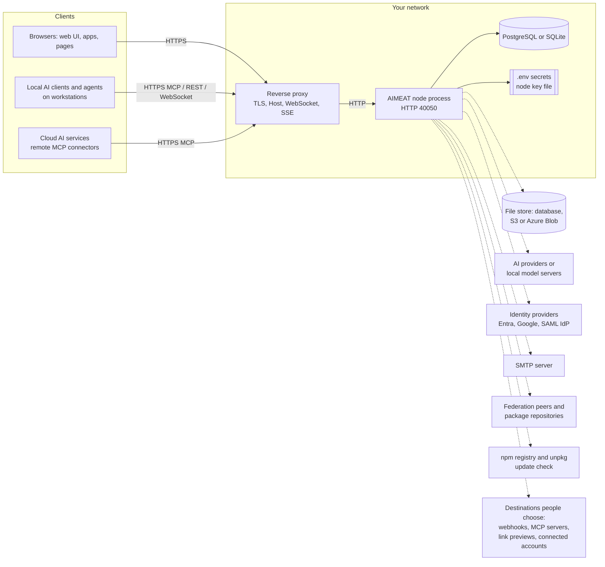

# 02 Architecture

> Checked against AIMEAT node 4.2.0 (commit f36018fcd) on 2026-11-05. Maintained with the code: see the README for how.

This page is for the architect and the network or firewall owner. It names the components a node is made of, the traffic that comes in, every outbound destination the code can reach with the setting that turns it on, the egress guards, the resource figures the repository gives, and what changes between an on-premises and a cloud installation. The outbound tables are written so that you can copy them into a firewall request. How many nodes and processes to run, and what runs beside a node, is on [18 Scope and deployment patterns](18-scope-and-deployment-patterns.md).

## Components and dependencies

| Component | Required | What it is | Source |
|---|---|---|---|
| Node process | Yes | A Node.js process (engine `>=24.22.1`), plain HTTP on `AIMEAT_PORT` (40050). With `AIMEAT_BIND_HOST` empty it listens on every address. Several processes on one PostgreSQL database are supported, as a standby or as more active processes, with `AIMEAT_NODE_PROCESSES=multiple` on every process; the default is one process ([18](18-scope-and-deployment-patterns.md#several-node-processes-on-one-database)) | `aimeat/package.json`, `aimeat/src/index.ts`, `aimeat/.env.example` |
| Reverse proxy | Yes, on any shared network | nginx, Caddy or a cloud load balancer. Holds TLS, passes `Host`, WebSocket upgrades and unbuffered streams | [Production deployment](../operations/production-deployment.md) |
| Database | Yes | PostgreSQL 16 or 17 (`AIMEAT_STORAGE=postgres-kysely`, `DATABASE_URL`), or SQLite (`AIMEAT_STORAGE=sqlite`, `AIMEAT_SQLITE_PATH`). The node warns below PostgreSQL 16 and starts | `aimeat/src/storage/providers/postgres-kysely/server-version.ts`, `aimeat/src/storage/storage-factory.ts` |
| File store | No | Stored file bytes: in the database (the default), in S3 or an S3-compatible service, or in Azure Blob (`AIMEAT_FILE_STORE`, `AIMEAT_FILE_STORE_S3_ENDPOINT`, `AIMEAT_FILE_STORE_AZURE_ACCOUNT`). A store takes a file from 1 MB up, and every video and sound; a smaller file of another kind stays in the database (`AIMEAT_FILE_STORE_MIN_MB`, `AIMEAT_FILE_STORE_KINDS`, and `takes` on a named or a person's store) | `aimeat/src/storage/blob/s3-client.ts`, `aimeat/src/storage/blob/azure-client.ts`, `aimeat/.env.example` |
| Secrets | Yes | `.env` or the process manager's environment: `AIMEAT_ENCRYPTION_KEY` encrypts stored secrets, `AIMEAT_KEY_PASSPHRASE` protects the node key | [Backup and restore](../operations/backup-and-restore.md) |
| Node key | Yes | The node's signing identity, a file (`AIMEAT_NODE_KEY_PATH`) with a copy in the database, sealed when `AIMEAT_KEY_PASSPHRASE` or `AIMEAT_ENCRYPTION_KEY` is set and plain text otherwise | [Backup and restore](../operations/backup-and-restore.md), `aimeat/src/storage/node-key-at-rest.ts` |
| Process manager | Yes | systemd unit or Docker | `aimeat/deploy/aimeat.service`, `aimeat/Dockerfile`, `aimeat/docker-compose.yml`, `aimeat/docker-compose.sqlite.yml` |
| SMTP server | No | Outbound mail (`AIMEAT_SMTP_HOST`). Without it the node sends no notification, invitation or sign-in mail; a company's own SMTP setting and connected mail accounts still send | `aimeat/src/services/email.ts`, `aimeat/src/services/company/company-smtp.ts`, [Bookkeeping](../operations/bookkeeping.md) |
| TURN server | No | Relay for voice and video between browsers (`AIMEAT_TURN_SERVER`, `AIMEAT_TURN_SECRET`), for example coturn | `aimeat/.env.example` |
| Consul | No, off by default | Central configuration for a fleet of nodes (`AIMEAT_CONSUL_ENABLED`, `AIMEAT_CONSUL_URL`) | `aimeat/src/config/consul.ts` |
| Headless browser | No | System Edge or Chrome, if installed, for on-demand screenshots, playtests and Design Book benches; `AIMEAT_SCREENSHOT_AUTO=true` adds automatic screenshots and downloads Chromium when no browser is installed | `aimeat/src/services/screenshot-capture.ts`, `aimeat/src/services/app/playtest.ts`, `aimeat/src/services/design-book/bench.ts` |

There is no Redis, message queue or search cluster. The cache is an in-process map by design (`aimeat/src/services/cache.ts`).

The Docker image runs as the unprivileged `node` user, pins its base image by digest and preloads jemalloc (`aimeat/Dockerfile`). The systemd unit runs as a dedicated user with `NoNewPrivileges=true` and `PrivateTmp=true` (`aimeat/deploy/aimeat.service`). Neither compose file keeps the node key directory on a volume: mount one or set `AIMEAT_NODE_KEY_PATH` ([Production deployment](../operations/production-deployment.md#process-manager)).

Solid lines are always present. Dotted lines exist only when the setting in the tables below turns them on.

## Inbound traffic

| What | Detail | Source |
|---|---|---|
| Port | The node: `AIMEAT_PORT` (40050), plain HTTP. Only the proxy may reach it; block it in the firewall | [Production deployment](../operations/production-deployment.md#what-the-node-does-and-does-not-do) |
| TLS | At the proxy. The node sends `Strict-Transport-Security` when `AIMEAT_BASE_URL` is `https://`, and also `X-Content-Type-Options`, `X-Frame-Options` and `Referrer-Policy`: do not add second copies at the proxy | [Production deployment](../operations/production-deployment.md#what-the-proxy-must-pass-through) |
| Names | Up to five: the node (`AIMEAT_BASE_URL`), apps (`AIMEAT_APP_HOST`, wildcard `*.apps.<domain>`), portfolios (`AIMEAT_PORTFOLIO_HOST`), companies (`AIMEAT_CO_HOST`), and one page host (`AIMEAT_PAGE_HOST`). The app origin is on by default on the `public` security profile, so the app wildcard needs DNS and a certificate (DNS-01 for a wildcard) | [Production deployment](../operations/production-deployment.md#names-and-certificates) |
| Proxy trust | `AIMEAT_TRUST_PROXY`: a hop count or the proxy's address. The node reads `Host` as sent and does not trust `X-Forwarded-Host` | [Production deployment](../operations/production-deployment.md#what-the-proxy-must-pass-through) |
| WebSocket | `/v1/realtime/ws`, `/v1/connect/tunnel` (agents' connector tunnel), `/v1/personal/tunnel` (personal nodes). The node closes an upgrade on any other path. Use a long read timeout | [Production deployment](../operations/production-deployment.md#what-the-proxy-must-pass-through), [Connector forward tunnel](../connector-forward-tunnel.md) |
| Streams (SSE and MCP) | `/v1/events`, `/v1/public/events`, `/v1/agui/...`, the chat turn, `/v1/llm/chat/completions`, `/v1/ai/stream`, `/v1/ai/speak`, and MCP at `/v1/mcp` and `/mcp`. Turn proxy buffering off and use a long read timeout | [Production deployment](../operations/production-deployment.md#what-the-proxy-must-pass-through) |
| Health | `GET /v1/health/live` and `GET /v1/health/ready` (the probes, by HTTP code), `GET /v1/health` (read `status`, it answers 200 also when degraded) and `GET /v1/build`, no sign-in | [Production deployment](../operations/production-deployment.md#health-checks) |
| Metrics | `GET /v1/metrics` for Prometheus, off by default (`AIMEAT_METRICS_ENABLED`), operator token by default (`AIMEAT_METRICS_ACCESS`) | [Observability guide](../../aimeat/docs/observability-guide.md) |
| Cloud AI clients | A remote MCP connector in a cloud AI service connects from that vendor's servers, so a node that must serve such clients must be reachable from the internet. Local clients (Claude Code, VS Code, Cursor) connect from the workstation | [Anthropic: custom connectors using remote MCP](https://support.claude.com/en/articles/11175166-get-started-with-custom-connectors-using-remote-mcp) |
| Browser-to-browser media | Browsers receive STUN servers from the node (`AIMEAT_STUN_SERVERS`, default `stun:stun.l.google.com:19302`) and contact them themselves; this is client egress, not node egress | `aimeat/src/config.ts` |

## Outbound traffic: the egress allowlist

Every outbound call whose address is not a constant in the code goes through `safeFetch`, which checks every redirect hop (`aimeat/src/utils/url-validator.ts`, gate `aimeat/scripts/check-outbound-fetch.ts`), except the call sites listed with a reason in `aimeat/security/outbound-fetch-exemptions.json` (among them federation peers, Consul and the site mirror origin). The tables group the destinations by whether a fresh node makes the call.

### A. On by default on a fresh node

| Destination | Why | Setting | Default | Source |
|---|---|---|---|---|
| `registry.npmjs.org`, `unpkg.com` | New-version check: at most every six hours, when an operator opens a page. Sends nothing about the node | `AIMEAT_UPDATE_CHECK`, `AIMEAT_UPDATE_CHECK_SOURCE` (a mirror) | On | `aimeat/src/services/node-update-check.ts`, `aimeat/src/config/update-check.ts` |
| `models.dev`, `openrouter.ai`, `raw.githubusercontent.com` | Model catalogue refresh: capabilities and prices of models. The build ships a seed, so it works without network | `AIMEAT_AI_CATALOG_REFRESH` (`weekly`, `daily`, `off`), `AIMEAT_AI_CATALOG_SOURCES` | On, weekly | `aimeat/src/services/ai/catalog/sources.ts` |
| `ec.europa.eu` (EU list of trusted lists), the trusted lists it names, and the OCSP, CRL and issuer addresses inside certificates | Signature validation, only when somebody checks a signed document | `AIMEAT_DOCSIGN_ENABLED`, `AIMEAT_DOCSIGN_ONLINE_CHECKS`, `AIMEAT_DOCSIGN_LOTL_URL` | On, on demand | `aimeat/src/services/docsign/trust-list.ts`, `aimeat/src/services/docsign/revocation.ts` |
| `api.finto.fi` | The built-in vocabulary extension `vocab-finto`, only when an app or agent calls it | Deactivate with `aimeat_extension_deactivate` | Active, on demand | `aimeat/src/data/builtin-extensions/vocab-finto.ts`, `aimeat/src/services/builtin-extension-seeder.ts` |

### B. Fixed destinations, off until configured

| Destination | Why | Setting that turns it on | Source |
|---|---|---|---|
| `openrouter.ai`, `eu.openrouter.ai` or `us.openrouter.ai` | AI calls on the node's OpenRouter key; region chosen by the operator | `AIMEAT_OPENROUTER_INSTANCE_KEY`, `AIMEAT_AI_OPENROUTER_REGION` | `aimeat/src/services/ai/openrouter-region.ts`, [Where AI calls are processed](../operations/openrouter-region.md) |
| `api.openai.com`, `api.anthropic.com`, `api.mistral.ai`, `api.x.ai`, `openrouter.ai` | AI calls through a fixed provider type, when the node or a person adds a key for it | `AIMEAT_AI_PROVIDERS`, a person's AI settings; restrict with `AIMEAT_AI_PROVIDER_TYPES` | `aimeat/src/services/ai/types.ts` |
| Local model servers (LM Studio 1234, Ollama 11434, llama.cpp 8080, or your own addresses) | AI calls to models on your own machines | `AIMEAT_AI_BUILTIN_PROVIDERS` and `AIMEAT_AI_PROVIDER_EGRESS` | `aimeat/.env.example` |
| `api.typesafe.ai` | Decision provider (typed answers with probabilities). Calls go out only when a key exists: the node's or a person's | `AIMEAT_TYPESAFE_INSTANCE_KEY`, `AIMEAT_DECIDE_BASE_URL`; off switch `AIMEAT_DECIDE_ENABLED` | `aimeat/src/services/decide/systemone-client.ts`, `aimeat/src/config/decide.ts` |
| `login.microsoftonline.com` | Microsoft Entra ID sign-in: OIDC discovery, token and key set | `AIMEAT_ENTRA_OAUTH_ENABLED` | `aimeat/src/services/oidc-providers.ts`, [Organisation node sign-in](../organisation-node-sign-in.md) |
| `accounts.google.com` and the endpoints its discovery document names | Google sign-in | `AIMEAT_GOOGLE_OAUTH_ENABLED` | `aimeat/src/services/oidc-providers.ts`, [Google discovery document](https://accounts.google.com/.well-known/openid-configuration) |
| Your Casdoor server | Casdoor sign-in | `AIMEAT_CASDOOR_OAUTH_ENABLED`, `AIMEAT_CASDOOR_OAUTH_ENDPOINT` | `aimeat/src/services/oidc-providers.ts` |
| The SAML IdP metadata URL | Read once when the operator gives a URL instead of pasting the XML | An operator's `aimeat_admin_sso_idp_metadata` call with a URL (works whether `AIMEAT_SSO_ENABLED` is on or off) | `aimeat/src/services/sso-connections.ts`, `aimeat/src/routes/admin/sso.ts` |
| `tunnistautuminen.suomi.fi` | Finnish Trust Network identity verification | `AIMEAT_FTN_ENABLED`, `AIMEAT_FTN_PROVIDER_URL` | `aimeat/.env.example` |
| Your SMTP server | Notifications, invitations, sign-in mail | `AIMEAT_SMTP_HOST`, `AIMEAT_SMTP_PORT` | `aimeat/src/services/email.ts` |
| A company's own SMTP server | Mail sent as a company. Public addresses only unless listed | `PUT /v1/companies/:id/smtp`, `AIMEAT_COMPANY_SMTP_PRIVATE_HOSTS` | `aimeat/src/services/company/company-smtp.ts` |
| `s3.<region>.amazonaws.com` or your S3 endpoint; `<account>.blob.core.windows.net` | Stored file bytes | `AIMEAT_FILE_STORE`, `AIMEAT_FILE_STORE_S3_ENDPOINT`, `AIMEAT_FILE_STORE_AZURE_ACCOUNT` | `aimeat/src/storage/blob/s3-client.ts`, `aimeat/src/storage/blob/azure-client.ts` |
| Google: `accounts.google.com`, `oauth2.googleapis.com`, `gmail.googleapis.com`, `www.googleapis.com` (YouTube) | Connected accounts: a person's Gmail or YouTube | `AIMEAT_CONNECTIONS_ENABLED`, `AIMEAT_CONNECT_GOOGLE_CLIENT_ID` | `aimeat/src/services/connections/providers-mail.ts`, `aimeat/src/services/connections/providers.ts` |
| Microsoft: `login.microsoftonline.com`, `graph.microsoft.com` | Connected accounts: a person's Outlook or Microsoft 365 mail, and their SharePoint and OneDrive | `AIMEAT_CONNECTIONS_ENABLED`, `AIMEAT_CONNECT_MICROSOFT_CLIENT_ID`, `AIMEAT_CONNECT_MICROSOFT_FILES_SITES` | `aimeat/src/services/connections/providers-mail.ts`, `aimeat/src/services/connections/providers-files.ts` |
| The tenant's SharePoint download host (`<tenant>.sharepoint.com`, or the address Graph gives) | One file of a connected SharePoint or OneDrive, fetched from the pre-authenticated address Graph answers, with no token | as above | `aimeat/src/services/connections/drive-files.ts` |
| `www.linkedin.com`, `api.linkedin.com`; `x.com`, `api.x.com`; `www.facebook.com`, `graph.facebook.com`, `graph-video.facebook.com`; `api.instagram.com`, `graph.instagram.com`; `www.reddit.com`, `oauth.reddit.com` | Connected accounts: posting to a person's own social accounts | `AIMEAT_CONNECTIONS_ENABLED` and the provider's client id (`AIMEAT_CONNECT_LINKEDIN_CLIENT_ID`, `AIMEAT_CONNECT_X_CLIENT_ID`, `AIMEAT_CONNECT_FACEBOOK_CLIENT_ID`, `AIMEAT_CONNECT_INSTAGRAM_CLIENT_ID`, `AIMEAT_CONNECT_REDDIT_CLIENT_ID`) | `aimeat/src/services/connections/providers-social.ts`, [Connecting an outside account](../connecting-an-outside-account.md) |
| `bsky.social` or a person's own Bluesky server; a person's Mastodon server | Connected accounts that need no client id | `AIMEAT_CONNECTIONS_ENABLED` | `aimeat/src/services/connections/attach.ts`, `aimeat/src/services/connections/instance.ts` |
| Federation peers | Messages, identity, catalogues and work between nodes the operator approved | Operator approval of each peer (`aimeat_admin_federation`; `AIMEAT_FEDERATION_OPEN_JOIN=false` by default), or `aimeat join`. `AIMEAT_FEDERATION_ROLE` does not block federation traffic | `aimeat/src/services/federation-helpers.ts`, `aimeat/src/config.ts`, [Running federation](../operations/federation.md) |
| Package repositories and the nodes packages came from | Pulling packages, the daily update check of installed packages | `AIMEAT_PACKAGE_FEDERATION_ENABLED` (off by default) or a repository an install set names; then a peer named in `aimeat_package_repository`, `aimeat_package_check_updates`, and the daily `package-upstream-check` job on installed packages | `aimeat/src/services/packages/peer/package-pull.ts`, `aimeat/src/mcp/packages.ts`, `aimeat/src/server-bootstrap/service-init.ts` |
| `api.indexnow.org` | Telling search engines that public pages changed | `AIMEAT_INDEXNOW_KEY` (no key, no call), `AIMEAT_SEO_INDEXNOW_AUTO` | `aimeat/src/services/indexnow.ts` |
| `api.stripe.com` | Card payments, on the seller's own Stripe key. The node has no platform key | A seller sets a key (`aimeat_commerce_psp_set`) | `aimeat/src/commerce/stripe-handler.ts` |
| The x402 facilitator (`https://x402.org/facilitator` by default) and an optional JSON-RPC address | Stablecoin settlement | `AIMEAT_X402_ENABLED`, `AIMEAT_X402_FACILITATOR_URL`, `AIMEAT_X402_RPC_URL` | `aimeat/src/commerce/x402-facilitator.ts` |
| Your e-invoice operator gateway | Finvoice delivery | `AIMEAT_FINVOICE_OPERATOR`, `AIMEAT_FINVOICE_OPERATOR_URL` | `aimeat/src/services/finance/finvoice-operator.ts` |
| Data space participants (`did:web` documents, callback addresses) | Eclipse Dataspace Protocol provider side | `AIMEAT_DATASPACE_ENABLED` | `aimeat/src/services/dataspace/did-resolve.ts` |
| Browser push services (the endpoint each browser's subscription names) | Web push notifications | `AIMEAT_VAPID_PUBLIC_KEY` and `AIMEAT_VAPID_PRIVATE_KEY` (with `AIMEAT_PUSH_ENABLED`) | `aimeat/src/services/mailbox-notification.ts` |
| `cdn.playwright.dev` | Download of the Chromium build at start when no Edge or Chrome is installed | `AIMEAT_SCREENSHOT_AUTO` | `aimeat/src/services/headless-browser-install.ts`, `aimeat/.env.example` |
| Your Consul server | Central configuration | `AIMEAT_CONSUL_ENABLED`, `AIMEAT_CONSUL_URL` | `aimeat/src/services/consul-config.ts` |
| An origin node | Mirror of another node's portal | `AIMEAT_SITE_LB_ENABLED`, `AIMEAT_SITE_LB_ORIGIN_URL` | `aimeat/.env.example` |
| The operator's store and build queue addresses | Public price list and "build it with you" requests | `AIMEAT_SITE_STORE_URL`, `AIMEAT_SITE_BUILD_QUEUE_URL` | `aimeat/src/services/build-with-you.ts` |

### C. Destinations that people and agents choose

These calls go to addresses that a signed-in person, an agent or an outside client names at run time, so no fixed list covers them. On the `public` security profile they reach public addresses only (see the guards below). If your firewall allows only the hosts in tables A and B, the features in this table stop working for any other host.

| Destination | Why | Who chooses, and the control | Default | Source |
|---|---|---|---|---|
| Any public `http(s)` address | Link previews of a pasted link (`GET /v1/unfurl`), also the preview image, proxied | Any signed-in person | On | `aimeat/src/routes/unfurl.ts` |
| The `client_id` URL of an MCP client | OAuth Client ID Metadata Documents: the node reads who the AI client is when it signs in | The AI client vendor | On | `aimeat/src/services/oauth-client-metadata.ts` |
| Outside MCP servers | A person or a group attaches another MCP server to the node | Any signed-in person in their own session; an agent or token needs `mcp:manage`, which no wildcard carries. No node setting turns it off (`aimeat_mcp_attach`, `aimeat/src/routes/mcp-servers.ts`) | Possible | `aimeat/src/services/mcp-client/transport.ts` |
| Webhook addresses | Action webhooks, agent webhooks, board subscribers, A2A push notifications (`aimeat_v2_push_set`) | The owner or agent that registers them | Possible | `aimeat/src/services/webhook-dispatcher.ts`, `aimeat/src/routes/agent-webhook.ts`, `aimeat/src/services/board-subscribers.ts` |
| Operator hooks | Actions bound to node events by the operator | The operator (`aimeat_admin_hook_set`) | None bound | `aimeat/src/services/hooks.ts` |
| Capability webhooks | Capabilities published in the capability registry | `AIMEAT_CAPABILITY_WEBHOOKS` (`disabled`, `allowlist_only`, `open`), `AIMEAT_CAPABILITY_WEBHOOK_DOMAIN_ALLOWLIST` | Disabled | `aimeat/src/services/capability-invoke.ts` |
| Extension network calls | `ctx.fetch` of an installed extension: only to the hosts its manifest declares when it declares any, else to any public address | The author declares hosts, or declares none. For the built-in `living-hooks`, each person names the hosts in their own `living-hooks.settings` record and the operator may add `allow_hosts`. Deactivate with `aimeat_extension_deactivate` | Any public host for `living-hooks` and for extensions without `network.hosts` | `aimeat/src/services/extension/ctx.ts`, `aimeat/src/data/builtin-extensions/living-hooks.ts` |
| A person's own AI provider address | Any OpenAI-compatible address a person adds | The person; restrict with `AIMEAT_AI_PROVIDER_ALLOWLIST` | Any public host | `aimeat/.env.example` |
| A person's own S3 or Azure storage | A person connects storage of their own | `AIMEAT_OWNER_FILE_STORES` (`auto`), `AIMEAT_FILE_STORE_OWNER_PRIVATE_ORIGINS` | `auto` | `aimeat/src/services/file-store/owner-file-store.ts` |
| UCP buying platforms | The profile address and order webhook an outside buying agent names at checkout | Commerce on (`AIMEAT_COMMERCE_ENABLED`) | On | `aimeat/src/services/ucp/platform-profile.ts` |
| Pages the headless browser renders | A screenshot, a playtest or a Design Book bench loads the app, which may load public resources | `AIMEAT_SCREENSHOT_EGRESS` names private origins it may also reach | Public only | `aimeat/.env.example` |

### D. At install time

`pnpm install` or `npm install` runs a postinstall script that downloads pinned browser assets and checks each against its sha256: from `unpkg.com` (the GPL ffmpeg build and DuckDB among them) and `extensions.duckdb.org` (`aimeat/scripts/vendor-libs.mjs`, `aimeat/public/lib/vendored-assets.json`). The install environment variable AIMEAT_SKIP_VENDOR=1 skips it for an offline machine. The package itself comes from the npm registry (`registry.npmjs.org`) or from a source checkout.

## Egress guards

| Guard | What it does | Source |
|---|---|---|
| SSRF guard (`safeFetch`) | Refuses private, reserved, loopback, CGNAT and link-local addresses, including the cloud metadata address 169.254.169.254. Checks every resolved address and every redirect hop, and connects only to a checked address. Drops `Authorization`, `Cookie` and `Proxy-Authorization` on a redirect that leaves the origin | `aimeat/src/utils/url-validator.ts` |
| `AIMEAT_SECURITY_PROFILE` | `public` sets the strict egress values and runs the start-up self-check. Set it explicitly | `aimeat/.env.example` |
| `AIMEAT_ALLOW_PRIVATE_EGRESS` | Loopback for user-influenced fetches. `false` on `public`. RFC 1918 and link-local stay blocked whatever it says | `aimeat/.env.example` |
| `AIMEAT_AI_PROVIDER_ALLOWLIST` | Hosts an AI provider address may name, so a stored AI key cannot be sent elsewhere. Empty means any host | `aimeat/.env.example` |
| `AIMEAT_AI_PROVIDER_TYPES` | Which of the five fixed AI provider types are allowed. Empty allows all five | `aimeat/.env.example` |
| `AIMEAT_AI_PROVIDER_EGRESS`, `AIMEAT_DECIDE_PROVIDER_EGRESS` | Exact private origins of your own model servers, for the node's own providers only | `aimeat/.env.example` |
| `AIMEAT_SCREENSHOT_EGRESS` | Exact private origins a rendered page may reach | `aimeat/.env.example` |
| `AIMEAT_COMPANY_SMTP_PRIVATE_HOSTS` | Private mail servers a company's own SMTP setting may name | `aimeat/.env.example` |
| `AIMEAT_FILE_STORE_OWNER_PRIVATE_ORIGINS` | Private origins a person's own storage may be at | `aimeat/.env.example` |
| `AIMEAT_DATASPACE_CALLBACK_ORIGINS` | Private origins a data space callback may be at | `aimeat/.env.example` |
| `AIMEAT_CAPABILITY_WEBHOOK_DOMAIN_ALLOWLIST` | Domains capability webhooks may call in `allowlist_only` mode | `aimeat/.env.example` |
| Federation carve-out | Calls to peers go to operator-approved addresses and may reach private networks, so that nodes inside one network can federate. Each such call site carries a written reason | `aimeat/scripts/check-outbound-fetch.ts`, `aimeat/security/outbound-fetch-exemptions.json` |

## Resources and scaling

| Item | Figure in the repository | Source |
|---|---|---|
| V8 heap ceiling, systemd | 4096 MB (`--max-old-space-size=4096`) | `aimeat/deploy/aimeat.service` |
| Memory limits, systemd | `MemoryHigh=6G`, `MemoryMax=8G` | `aimeat/deploy/aimeat.service` |
| V8 heap ceiling, Docker | 2048 MB; keep it under the container's memory limit | `aimeat/Dockerfile` |
| Measured resident memory | 250 to 450 MB steady state with jemalloc, in one recorded trace | `aimeat/Dockerfile` |
| Database versions tested | PostgreSQL 16 and 17 | `aimeat/src/storage/providers/postgres-kysely/server-version.ts` |
| Restart policy | Restart after 5 s; stop after five starts in five minutes; 30 s stop timeout. On a stop signal the node refuses new connections, answers readiness 503, gives requests in flight up to 5 s, writes its buffers and exits 0 ([production deployment](../operations/production-deployment.md#process-manager)) | `aimeat/deploy/aimeat.service`, `aimeat/src/server-bootstrap/drain.ts` |

The repository documents no minimum CPU, memory or disk size.

**A node grows up first, and out by more nodes.** One process serves a node in the shape the guides describe. Several processes on one PostgreSQL database are supported too, as a standby or as more active processes, because the processes share what they must in the database: a scheduled job fires once (`aimeat/src/services/scheduler-fire-claim.ts`), a once-per-node start step runs once (`aimeat/src/services/once-only-step.ts`), the processes take one node key, the short sign-in steps, the replay caches of signed requests and the per-account limits are kept in the database (`aimeat/src/services/ephemeral-claims.ts`), live updates and cache clears reach every process over the event bus (`aimeat/src/services/bus-relay.ts`), and AI jobs, workflow runs and sweeps run under leases (`aimeat/src/services/process-lease.ts`), which hold across processes when `AIMEAT_NODE_PROCESSES=multiple` is set on every process. What stays in each process is listed with its consequence on [18 Scope and deployment patterns](18-scope-and-deployment-patterns.md#several-node-processes-on-one-database); in short:

- the request rate limiters and the node-key spending hold are per process (`aimeat/src/middleware/rate-limit.ts`, `aimeat/src/services/ai/node-key-hold.ts`);
- a request answered through an agent's or a personal node's tunnel goes through the process the tunnel connected to (`aimeat/src/services/connect-tunnel.ts`, `aimeat/src/services/personal-tunnel.ts`).

For availability, use a process manager restart, a second process as a standby or as a second active process, separate nodes to keep one outage small, a tested restore and, on PostgreSQL, the database's own high-availability features ([18](18-scope-and-deployment-patterns.md#availability)).

## On premises and in the cloud

| Subject | On premises | In a cloud account | Source |
|---|---|---|---|
| Private services | The SSRF guard blocks private addresses. Name your own model servers, mail servers and storage in the matching setting from the guard table | The same, and the cloud metadata address is always blocked | `aimeat/src/utils/url-validator.ts` |
| File bytes | In the database by default, or an S3-compatible service inside the network (MinIO, SeaweedFS) | In the database, or S3 or Azure Blob in your account | `aimeat/.env.example` |
| Cloud AI clients | A node that only your internal network reaches serves browsers and local AI clients. Remote connectors of cloud AI services cannot reach it | Reachable when the proxy is public | [Anthropic: custom connectors using remote MCP](https://support.claude.com/en/articles/11175166-get-started-with-custom-connectors-using-remote-mcp) |
| No internet egress | Set `AIMEAT_UPDATE_CHECK=false`, `AIMEAT_AI_CATALOG_REFRESH=off`, `AIMEAT_DOCSIGN_ONLINE_CHECKS=false`, deactivate `vocab-finto`, install with AIMEAT_SKIP_VENDOR=1, and use local models through `AIMEAT_AI_PROVIDER_EGRESS` | Usually not needed | `aimeat/.env.example` |
| Federation | Peers inside the network are reachable through the federation carve-out | Peers over the internet; `https://` peer addresses are required on a public node from 4.0.0 | [Upgrading](../operations/upgrading.md#what-else-changes-in-400) |

## Limits

- Several active node processes divide the request rate limits and the AI key hold, which stay per process, and a request through a tunnel works only on the process holding it. The project records no test of several processes behind a load balancer ([18](18-scope-and-deployment-patterns.md#limits)).
- The repository documents no minimum CPU, memory or disk size; the only figures are the heap ceilings and memory limits in `aimeat/deploy/aimeat.service` and `aimeat/Dockerfile` and one measured trace.
- With `AIMEAT_STORAGE` unset, the node runs on an in-memory database and loses all data at restart; `aimeat validate` warns but the node starts (`aimeat/src/utils/env-validator.ts`, `aimeat/src/storage/storage-factory.ts`).
- With `AIMEAT_BIND_HOST` empty the node listens on every address; the firewall must keep the port closed to everything but the proxy.
- Two outbound calls are on by default on a fresh node: the new-version check to `registry.npmjs.org` and `unpkg.com`, and the weekly model catalogue refresh from `models.dev`, `openrouter.ai` and `raw.githubusercontent.com`.
- Link previews let any signed-in person make the node fetch any public address, and the node reads the `client_id` URL that any MCP client presents; a host-only egress allowlist breaks these features for hosts not listed.
- The code has no support for an outbound HTTP proxy; no proxy agent is configured for the node's own fetch calls.
- Neither compose file keeps the node key on a volume, and the Docker image's `HEALTHCHECK` (`/v1/health/ready`) asks 127.0.0.1, so a node bound to another address needs its own ([Production deployment](../operations/production-deployment.md#process-manager)).
- Calls to OpenRouter carry `HTTP-Referer: https://aimeat.io` and `X-Title: AIMEAT` (`aimeat/src/services/ai/adapters/sdk.ts`, `aimeat/src/services/openrouter.ts`): OpenRouter sees the software name, not the organisation.
- The default STUN server handed to browsers is Google's (`stun:stun.l.google.com:19302`, `aimeat/src/config.ts`); change `AIMEAT_STUN_SERVERS` if browsers must not contact it.
- No Docker image is published by the project; the image is built from `aimeat/Dockerfile`.

## Open questions

- OPEN: What are the minimum and recommended CPU, memory and disk sizes for a node of a given number of people and agents? The maintainer named in `.github/SECURITY.md` can answer; no sizing test is in the repository.
- OPEN: Does the node work through an outbound HTTP proxy, for example with Node's `NODE_USE_ENV_PROXY` and `HTTPS_PROXY`? Nothing in the repository shows a test; the maintainer can answer.