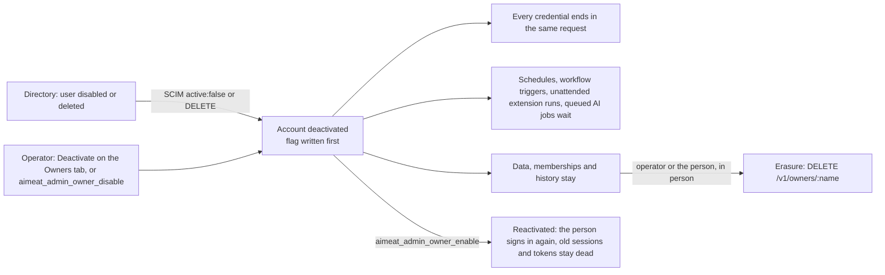
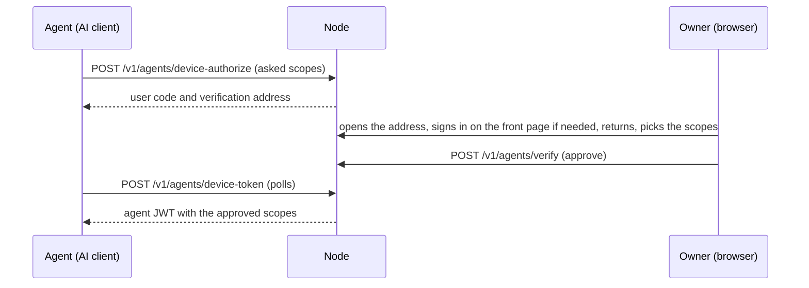

# 04 Identity and access

> Checked against AIMEAT node 4.3.1 (commit d76b3dac5) on 2026-11-13. Maintained with the code: see the README for how.

This page answers how people, AI agents and apps sign in to a node, who may get an account, what each role may do, and what happens when a person leaves. It is for the identity and access management owner and the security officer. The setup steps for Entra, SAML and SCIM stay in [Organisation node sign-in](../organisation-node-sign-in.md); this page says what to decide and what the code does.

## Principal types

| Principal | Identity form | How it authenticates | Source |
|---|---|---|---|
| Person (GHII, a human identity) | `alice@node-id` | Password, passkey, sign-in link, an outside identity provider (OIDC or SAML) | [Identity model](../coding-guidelines/identity-model.md) |
| AI agent (GAII) | `claude#alice@node-id` | Device authorization (RFC 8628) or MCP OAuth 2.1, approved by its owner | `aimeat/src/routes/agents/device-auth.ts`, `aimeat/src/mcp/oauth.ts` |
| Ecosystem app (GEAI) | `eco:app#alice@node-id` | Hello, owner approval, token, with its key pinned at first contact | [Building an ecosystem app](../building-an-aimeat-compatible-ecosystem-app.md) |
| Hosted app | an app on `<app>.apps.<host>` | A scoped app grant the owner approves (PKCE code flow) | `aimeat/src/routes/app-grants.ts` |
| Visitor from another node | `alice@home-node`, role `federated` | Signed in on its home node; off by default (`AIMEAT_FEDERATION_AUTH_POLICY=disabled`) | `.claude/rules/security.md` |
| Outside party | `party:alice/name@node-id` | A key or short party token; reads only the data packages shared with it by name | [Identity model](../coding-guidelines/identity-model.md) |
| Incoming webhook (an outside program writing in) | `receiver:alice/name@node-id` | Its own API key (a random value with the prefix that marks an incoming webhook's API key) on `/v1/receive/alice/name` only; writes into exactly one key, key prefix or row space of its owner; refused 401 on every other route | `aimeat/src/services/receivers/verify.ts`, `aimeat/src/auth/middleware.ts` |

## Sign-in methods

| Method | Default | Settings | What IT decides | Source |
|---|---|---|---|---|
| Password | On for everyone (`AIMEAT_PASSWORD_SIGN_IN=on`) | `AIMEAT_PASSWORD_SIGN_IN` (`on`, `operators`, `off`), `AIMEAT_SIGN_IN_LOCKOUT` (`off`), `AIMEAT_PASSWORD_LOCKOUT_ATTEMPTS` (5) and `AIMEAT_PASSWORD_LOCKOUT_MINUTES` (15) when the lockout is on, `AIMEAT_LOGIN_RATE_LIMIT_MAX` | Whether people sign in locally at all: `operators` keeps the password for operator accounts only, `off` for nobody (see below). Whether wrong attempts lock an account: no by default (see below). | `aimeat/src/utils/password-validation.ts`, `aimeat/src/services/password.ts`, `aimeat/src/services/sign-in-policy.ts` |
| Passkey (WebAuthn) | On | `AIMEAT_PASSKEY_ENABLED`, `AIMEAT_PASSKEY_RP_ID`, `AIMEAT_PASSKEY_EXTRA_ORIGINS` | The domain, before the first passkey (see below). | `aimeat/src/routes/passkeys.ts`, `aimeat/src/config/types-account-security.ts` |
| Two-step sign-in (TOTP) | Available, armed by each person; required for nobody (`AIMEAT_TWO_STEP_REQUIRED=off`) | `AIMEAT_TWO_STEP_REQUIRED` (`off`, `operators`, `everyone`), `AIMEAT_TOTP_ENABLED`, `AIMEAT_TOTP_MAX_FAILED` (5) and `AIMEAT_TOTP_LOCKOUT_SECONDS` (300) when the lockout is on, `AIMEAT_TOTP_BACKUP_CODE_COUNT` (10) | Who must use it: operator accounts or every account (see below). | `aimeat/src/config/types-account-security.ts`, `aimeat/src/services/sign-in-policy.ts` |
| Sign-in link by email | Per account: on once the person has proved an address through email verification or attach-email, off for accounts created by SCIM, SAML or OIDC; no node-wide switch | Rate limit 5 requests per IP address per 10 minutes | Whether email delivery is configured. | `aimeat/src/services/login-link.ts`, `aimeat/src/routes/ghii/web-verify.ts`, `aimeat/src/routes/ghii/login-link-second-factor.ts` |
| Microsoft Entra ID (OIDC) | Off | `AIMEAT_ENTRA_OAUTH_ENABLED`, `AIMEAT_ENTRA_OAUTH_TENANT`, `AIMEAT_ENTRA_ALLOWED_TENANTS`, `AIMEAT_ENTRA_LINK_DOMAINS` | Tenants allowed, domains whose addresses count as verified. | `aimeat/src/services/oidc-providers.ts` |
| Google (OIDC) | Off | `AIMEAT_GOOGLE_OAUTH_ENABLED` and client settings | Whether any Google account may sign in (there is no domain gate). | `aimeat/src/services/oidc-providers.ts` |
| Casdoor (OIDC) | Off | `AIMEAT_CASDOOR_OAUTH_ENABLED`, `AIMEAT_CASDOOR_LINK_DOMAINS` | Only when the organisation runs Casdoor. | `aimeat/src/services/oidc-providers.ts` |
| SAML 2.0 | Off | `AIMEAT_SSO_ENABLED`, connections managed at runtime | The IdP, the email domains of each connection. | `aimeat/src/routes/saml-login.ts`, `aimeat/src/services/saml-sp.ts` |
| SCIM 2.0 provisioning | Off | Same switch; a token per connection | Whether the directory pushes joiners and leavers. | `aimeat/src/routes/scim.ts`, `aimeat/src/services/scim-users.ts` |

## Who may get an account: registration modes

`AIMEAT_REGISTRATION_MODE` decides account creation only. Existing accounts sign in under every mode ([Organisation node sign-in](../organisation-node-sign-in.md), section 1).

| Mode | Password registration | First sign-in through a provider | Invitation |
|---|---|---|---|
| `open` (default) | yes | yes | yes |
| `oauth` | no | yes | yes |
| `invite` | no | no | yes |
| `closed` | no | no | no |

- An invalid value stops the node from starting, because the default is not a safe fallback (`aimeat/.env.example`).
- An operator can change the mode at runtime with `PUT /v1/admin/config` and `registration.mode` ([Organisation node sign-in](../organisation-node-sign-in.md), section 4).
- Under `oauth` and `invite`, any member can create an invitation, and the invited person gets an account with a password ([Organisation node sign-in](../organisation-node-sign-in.md), section 6), unless `AIMEAT_PASSWORD_SIGN_IN` is `operators` or `off`: then an invitation that sets a password is refused (403 `PASSWORD_SIGN_IN_OFF`, `aimeat/src/routes/invite-accept.ts`).
- For an organisation node: `oauth` plus the Entra tenant allowlist, or `invite` when every person is named by hand. Pair it with `AIMEAT_CONTENT_ACCESS=signed-in` so that a visitor without an account sees nothing ([Organisation node sign-in](../organisation-node-sign-in.md), section 6b).

## Organisation sign-in: OIDC, SAML and SCIM

### Microsoft Entra ID (OIDC)

- The node checks the `tid` claim of the verified ID token against `AIMEAT_ENTRA_ALLOWED_TENANTS` on every sign-in, not only the first. Removing a tenant locks its people out and keeps their data (`aimeat/src/services/oidc-providers.ts`, [Organisation node sign-in](../organisation-node-sign-in.md), section 6).
- The node asks for `openid`, `profile` and `email` only: no Microsoft Graph permission ([Organisation node sign-in](../organisation-node-sign-in.md), section 3).
- `AIMEAT_ENTRA_ALLOWED_TENANTS` is environment-only. The tenant (`AIMEAT_ENTRA_OAUTH_TENANT`) and the Entra switch can be changed on the Config page and take effect at restart (`aimeat/src/services/config/schema-access.ts`). Without an allowlist, the tenant alone is the gate, so an operator can widen Entra sign-in without a deploy; set the allowlist, or seal those settings (below), when that must take a deploy ([Organisation node sign-in](../organisation-node-sign-in.md), section 4).
- A guest in the organisation's own tenant carries that tenant's `tid` and passes the gate ([Organisation node sign-in](../organisation-node-sign-in.md), section 6).

### Google (OIDC)

- The node maps `sub`, `email` and `email_verified`. It has no setting to restrict sign-in to one Google Workspace domain (`aimeat/src/services/oidc-providers.ts`). On an organisation node, leave it off, or use `invite` mode so that only invited people get accounts.

### SAML 2.0

| Property | Behaviour | Source |
|---|---|---|
| Library | `@node-saml/node-saml`; the node does no XML signature work of its own | `aimeat/src/services/saml-sp.ts` |
| Signature | A signed assertion is required; the outer Response need not be signed | `aimeat/src/services/saml-sp.ts` |
| Checks before any account is read | Signature, Audience, InResponseTo, validity window | `aimeat/src/routes/saml-login.ts` |
| Browser binding | An SP-initiated round finishes only in the browser that started it | `aimeat/src/routes/saml-login.ts` |
| IdP-initiated sign-in | Refused unless the connection allows it (`allow_idp_initiated`) | `aimeat/src/services/sso-connections.ts` |
| Account mapping | NameID, then a SCIM `externalId`, then a verified email inside the connection's own domains, then a new account under the registration mode | `aimeat/src/routes/saml-login.ts` |
| Hidden connections | A connection can be hidden from the public sign-in dialog | `aimeat/src/services/sso-connections.ts` |
| AuthnRequest signing, encrypted assertions | Not supported: the SP metadata carries no signing or decryption certificate | `aimeat/src/services/saml-sp.ts` |
| Single Logout | Not found in the code | `aimeat/src/routes/saml-login.ts` |

### SCIM 2.0

- One bearer token per SSO connection, shown once; only its SHA-256 hash is stored. The token works only on its own connection's path; a JWT or personal access token on the SCIM endpoint answers 401 (`aimeat/src/routes/scim.ts`).
- Users only. Groups are not declared, so group-based role mapping is not available (`aimeat/src/services/scim-users.ts`).
- A connection reads and writes only the accounts it manages (`managedBy`). It adopts an existing account only when that account's locally verified email is in the connection's domains (`aimeat/src/services/scim-users.ts`).
- `active: false` and DELETE deactivate the account; they never erase it. A connection can never deactivate an operator account (`aimeat/src/services/scim-users.ts`).
- Entra's provisioning URL needs the `?aadOptscim062020` flag ([Organisation node sign-in](../organisation-node-sign-in.md), section 7).

### Who changes the SSO setup

- Connections are managed by an operator on the admin Organisation sign-in tab, over `/v1/admin/sso/connections`, or with `aimeat_admin_sso_list`, `aimeat_admin_sso_get`, `aimeat_admin_sso_create`, `aimeat_admin_sso_update`, `aimeat_admin_sso_delete`, `aimeat_admin_sso_idp_metadata` and `aimeat_admin_sso_scim_token` (`aimeat/src/mcp/admin-sso.ts`).
- `AIMEAT_SSO_CONNECTIONS_LOCKED=true` refuses every connection write with 403. Sealing `AIMEAT_SEALED_CONFIG_KEYS=sso.enabled,sso.connections_locked` freezes the SAML and SCIM setup only (`aimeat/.env.example`). To make "who may sign in" a deploy decision, also seal `registration.mode`, `auth.google_enabled`, `auth.entra_enabled`, `auth.entra_tenant` and `auth.entra_link_domains`.

## Leavers: deactivation and erasure

Incoming webhook API keys and outside party keys are not revoked: they are refused while the account is deactivated and work again on reactivation, as schedules do. To end one for good, delete the incoming webhook or the party, or have the operator stop the incoming webhook.

| What | On deactivation | Source |
|---|---|---|
| Browser sessions, agents' device tokens, ecosystem app tokens | Revoked | `aimeat/src/services/owner-lifecycle.ts` |
| Personal access tokens | Revoked | `aimeat/src/services/owner-lifecycle.ts` |
| App grants | Revoked | `aimeat/src/services/owner-lifecycle.ts` |
| MCP OAuth tokens | Refused at every request; refresh tokens deleted | `aimeat/src/services/owner-lifecycle.ts` |
| Live connector tunnels | Closed, on every process of the node | `aimeat/src/services/owner-lifecycle.ts`, `aimeat/src/services/connect-tunnel/cross-process.ts` |
| New sign-in | 403 `ACCOUNT_DISABLED` on every method, SAML included | `aimeat/test/e2e-owner-deactivation.ts`, `aimeat/src/routes/saml-login.ts` |
| Schedules, workflow triggers, unattended extension runs | Skipped with a log line, kept | `aimeat/src/services/owner-lifecycle.ts` |
| AI jobs already queued, and jobs a restart or another process takes up | Wait in the queue with a sentence that names the deactivation; nothing is paid or written; they run after reactivation | `aimeat/src/services/ai-jobs/run-gate.ts` |
| Incoming webhook API keys | Refused with 403 `ACCOUNT_DISABLED` on every call; nothing is written, read or deleted. The incoming webhook is kept and the API key works again on reactivation | `aimeat/src/services/receivers/verify.ts` |
| Outside party keys and tokens, share links, app party sign-ins | Refused with 403 `ACCOUNT_DISABLED`; nothing shared can be read. The party is kept and its key works again on reactivation | `aimeat/src/services/parties/verify.ts`, `aimeat/src/services/parties/invite.ts`, `aimeat/src/services/app-parties/service.ts` |
| Webhooks to the person's agents | Not sent, nothing counted against the webhook; delivery resumes on reactivation | `aimeat/src/services/webhook-dispatcher.ts` |
| Data, organism memberships, history | Kept | [Organisation node sign-in](../organisation-node-sign-in.md), section 7 |
| Other federated nodes | The federation attestation refuses the account | `aimeat/test/e2e-owner-deactivation.ts` |

- Each deactivation and reactivation by an operator writes an operator trail: a usage row, a log line and a line on the person's feed (`aimeat/src/services/owner-lifecycle.ts`).
- Erasure is a separate, final act. The person, or an operator, both in person, call `DELETE /v1/owners/:name` (`aimeat/src/routes/owners.ts`). An organism the person owned passes to an admin or member, or is left without a seated owner when there is nobody (`aimeat/src/services/owner-erasure.ts`).
- AI jobs of the person and their agents that are still queued, running, or waiting for a deactivated account stop at the erasure. Nothing more is paid for them, and no job record, answer or job log is written for the erased account, so a later account with the same name finds none (`aimeat/src/services/ai-jobs/service.ts`, `aimeat/src/services/ai-jobs/run-gate.ts`).

## Organism code keys

- An owner of an organism can make a code key: the node makes an account whose password is the code that owner chose, so that owner knows it until the holder signs in. The holder's first sign-in replaces the code with a new password, whichever method it is: password, passkey, sign-in link by email, or an identity provider (`aimeat/src/services/owner-session.ts`, `aimeat/src/services/key-credentials.ts`).
- The new password is shown to the browser that completed the first sign-in. After a password or passkey sign-in it is in the sign-in answer, and the node does not mail it at that sign-in. An address that was verified before the first sign-in never gets it, because the person who minted the key could have verified an address of their own. When the account had no verified address, the node keeps the password sealed and mails it once to the address the holder verifies later, with a code asked for after the first sign-in, unless the password has changed by then (`aimeat/src/services/key-credentials.ts`). After a sign-in link or an identity provider, the code stops working at once and the new password is shown once to that browser session, never mailed (`aimeat/src/routes/ghii/key-credentials-screen.ts`). On the same screen the holder can add a passkey and confirm an email address of their own (`aimeat/src/static/sdk-libs/auth/modal-key-credentials.js`).
- Confirming an email address with the code before the first sign-in (`POST /v1/ghii/verify-email`, or `GET /v1/ghii/magic-link/verify` after it) gives out the account's app agent key without counting as the first sign-in. The first sign-in, by any method, rekeys that agent: the key and every token issued with it before stop working, and the screen and the sign-in answer say so (`agent_keys_ended`). The agent and its permissions stay (`aimeat/src/services/key-credentials.ts`).
- A code key acts only on the account it made. Erasing that account closes the key, and an account registered later with the same name is not listed, cancelled or given a new password by the old key (`aimeat/src/services/owner-erasure.ts`, `aimeat/src/routes/organisms/workspace-access.ts`).

## Passkeys and the domain

- The relying party ID (RP ID) is the host of `AIMEAT_BASE_URL` unless `AIMEAT_PASSKEY_RP_ID` names another (`aimeat/src/config/types-account-security.ts`).
- The RP ID is immutable at runtime (`immutable: true` in `aimeat/src/services/config/schema.ts`). A passkey is bound to its RP ID for good: changing the node's domain makes every registered passkey unusable ([WebAuthn Level 3, RP ID](https://www.w3.org/TR/webauthn-3/#rp-id)).
- Decide the node's final domain before the first person registers a passkey. Set `AIMEAT_PASSKEY_RP_ID` to a parent domain only when keys must also work on other subdomains of it.
- A passkey is a sign-in method of its own, not a second factor after the password; the node asks no TOTP code after a passkey (`aimeat/src/routes/passkeys.ts`).

## Two-step sign-in (TOTP): where it is asked

| Sign-in path | Is the TOTP code asked when the account has armed it? | Source |
|---|---|---|
| Password | Yes | `aimeat/src/services/password-check.ts` |
| Sign-in link by email | Yes | `aimeat/src/routes/ghii/login-link-second-factor.ts` |
| First OIDC or SAML sign-in that matches the account by email | Yes, once; the provider identity is linked only after a correct code | `aimeat/src/routes/ghii/login-link-second-factor.ts` |
| Later OIDC or SAML sign-ins | No: the identity provider is the factor | [Organisation node sign-in](../organisation-node-sign-in.md), section 7 |
| Passkey | No: the device is the factor | `aimeat/src/routes/passkeys.ts` |
| Admin key sign-in on `/v1/admin` | Removed in 4.0.0: refused (410) for every account | `aimeat/src/routes/admin.ts` |

- The secret is encrypted with `AIMEAT_ENCRYPTION_KEY` (or `AIMEAT_TOTP_ENCRYPTION_KEY`, or `AIMEAT_ENCRYPTION_KEY_1` when the data key is being replaced and the second key is current); with none, nobody can arm TOTP (`aimeat/.env.example`, [Key rotation](../operations/key-rotation.md)).
- **Recovery.** A person removes their own factor with a current code or a backup code. An operator can remove another person's factor without a code (`DELETE /v1/admin/owners/:name/totp`, `aimeat_admin_totp_reset`); the password still stands, the person gets an account event naming the operator, and the node logs a warning. An operator cannot reset their own factor: another operator or a backup code does it (`aimeat/src/services/totp-recovery.ts`).

## Requiring two-step sign-in, limiting password sign-in

Two settings decide the sign-in policy. Both can be changed while the node runs: on the admin Config page, with `PUT /v1/admin/config` or with `aimeat_admin_config_set` (`aimeat/.env.example`, `aimeat/src/services/config/schema-access.ts`).

| Setting | Values | What it does | Source |
|---|---|---|---|
| `AIMEAT_TWO_STEP_REQUIRED` (Config `auth.two_step_required`) | `off` (default), `operators`, `everyone` | Who must use two-step sign-in: nobody, accounts with the operator role, or every account | `aimeat/src/services/sign-in-policy.ts` |
| `AIMEAT_PASSWORD_SIGN_IN` (Config `auth.password_sign_in`) | `on` (default), `operators`, `off` | Who may sign in with a password: everyone, operator accounts only, or nobody | `aimeat/src/services/sign-in-policy.ts` |

The sign-in dialog's headline and the line under it can be the operator's own words per language (`AIMEAT_SIGN_IN_TITLE_EN|FI|ES` and `AIMEAT_SIGN_IN_LINE_EN|FI|ES`, Config `auth.sign_in_title_*` and `auth.sign_in_line_*`; empty by default). They are display text only: plain text of one line, at most 200 characters, escaped before display, and they change no sign-in rule (`aimeat/src/services/config/schema-access.ts`, `aimeat/src/static/sdk-libs/auth/modal.js`).

**Required two-step sign-in.**

- A covered account without TOTP that signs in with a password or an emailed link gets no session. The password route answers 403 `TWO_STEP_SETUP_REQUIRED` with a setup token; the emailed link opens the enrolment step of the sign-in dialog. The token lasts 10 minutes, is bound to one account and works once; only its SHA-256 hash is stored (`aimeat/src/services/two-step-setup.ts`).
- The person enrols at `POST /v1/ghii/login/two-step/start` and `POST /v1/ghii/login/two-step/finish`. Finish checks the first code, arms TOTP, gives the backup codes once and signs the person in (`aimeat/src/routes/ghii/login-two-step.ts`).
- A passkey sign-in and an identity provider sign-in (OIDC or SAML) satisfy the rule; on those paths the factor is the device or the identity provider's MFA (`aimeat/src/services/sign-in-policy.ts`).
- A session refresh of a covered account with no TOTP, no passkey and no identity provider link is refused, so the person signs in again and enrols (`aimeat/src/services/owner-session.ts`).
- Agents, ecosystem apps and visitors from another node are not covered (`aimeat/src/services/sign-in-policy.ts`). When this node is the home node of a federated sign-in, it refuses a covered account without TOTP (`aimeat/src/routes/federation-auth.ts`).
- The rule needs TOTP on: a save that leaves it required while `AIMEAT_TOTP_ENABLED` is false is refused with 409 `TWO_STEP_NEEDS_TOTP`, whichever of the two settings the save changes. Set that way from the environment, the node starts and logs a `SECURITY` warning (`aimeat/src/services/config/admin-view.ts`, `aimeat/src/index-start.ts`).

**Password sign-in.**

- `off` refuses with 403 `PASSWORD_SIGN_IN_OFF` every local password sign-in, password registration, invitation with a password, organism code key, password reset and password change. The sign-in dialog then shows no password form (`aimeat/src/services/sign-in-policy.ts`, `aimeat/src/routes/ghii/recovery.ts`, `aimeat/src/static/sdk-libs/auth/modal.js`).
- `operators` keeps the password for operator accounts, as the way in when the other methods fail. The node checks the password first and the role after, and a non-operator gets the same `PASSWORD_SIGN_IN_OFF`, so the answer does not tell the role (`aimeat/src/services/sign-in-policy.ts`).
- The first operator still gets a password, through the setup wizard or `POST /v1/admin/setup/register` (`aimeat/src/services/sign-in-policy.ts`, `aimeat/src/routes/admin/setup-register.ts`).
- Saving `off` is refused with 409 `OPERATOR_LOCKOUT` while no operator account has a passkey or an identity provider link. Set that way from the environment, the node starts and logs a `SECURITY` warning (`aimeat/src/services/sign-in-policy.ts`, `aimeat/src/index-start.ts`).

**Lockout after wrong attempts.** `AIMEAT_SIGN_IN_LOCKOUT` (Config `auth.sign_in_lockout`) is `off` by default.

- `off`: wrong passwords and wrong two-step codes are not counted and lock no account, and a lock stored while it was on no longer holds. A person cannot be kept out by someone guessing at their username. Guessing is bounded per address by the growing delay and the login rate limit (`aimeat/src/middleware/login-tarpit.ts`, `AIMEAT_LOGIN_RATE_LIMIT_MAX`), not per account: guesses from many addresses at one account are not stopped by a count.
- `on`: `AIMEAT_PASSWORD_LOCKOUT_ATTEMPTS` wrong passwords lock the account for `AIMEAT_PASSWORD_LOCKOUT_MINUTES` (429 `PASSWORD_LOCKED`), and `AIMEAT_TOTP_MAX_FAILED` wrong codes for `AIMEAT_TOTP_LOCKOUT_SECONDS` (429 `TOTP_LOCKED`) (`aimeat/src/services/password-check.ts`).
- An organisation whose policy requires an account lockout sets it `on`.

**Who changes them.** A change that weakens any of these settings is refused to an AI credential with 403 `PERSON_REQUIRED`; the operator makes it signed in in person. A change that tightens works from an AI too, for example with `aimeat_admin_config_set`. The same rule refuses an AI the removal of a saved value of these settings (`DELETE /v1/admin/config/:path`). Each setting's row in the Config schema carries the rule. The admin Config API, its MCP tool and the reset apply it. The Consul import (`POST /v1/admin/consul/import`) applies it to an AI credential too: a Consul value that would weaken one of these settings is not imported, and the answer names it in `held_back`; the operator in person imports every value. An import with `aimeat config import` at the server does not apply it, because the values come from the operator's own configuration and no AI credential runs it (`aimeat/src/services/config/strictness.ts`, `aimeat/src/services/config/admin-view.ts`, `aimeat/src/services/sign-in-policy.ts`, `aimeat/src/services/consul-config.ts`).

## First-run setup

- While the node has no operator, it prints a one-time setup code in its start log. Every route that would create the first operator asks for it, unless the base URL is loopback and the request comes from this machine with no forwarding header (`aimeat/src/services/setup-code.ts`): the setup wizard, self-registration, an identity provider's first sign-in, and `POST /v1/admin/setup/register`, which asks for the admin password and the code (`aimeat/src/routes/admin/setup-register.ts`).
- The code has 60 bits of randomness; only its SHA-256 digest is kept in memory; it is used once; a restart issues a new one while the node still has no operator (`aimeat/src/services/setup-code.ts`).
- `AIMEAT_SETUP_ALLOWED_IPS` can also limit the setup to named addresses (`aimeat/.env.example`).
- The admin setup page `/v1/admin/setup` is opened with `AIMEAT_ADMIN_PASSWORD`, or with a random secret the node writes to a file (mode 0600) while it has no owner and deletes after. It answers 410 once an operator exists, unless `AIMEAT_ADMIN_SETUP_OPEN_AFTER_FIRST_OPERATOR=true`, which is for test nodes only (`aimeat/.env.example`).

## Roles and what they may do

The node has one account role above a person, `operator`. There is no separate `admin` role on the node. Inside an organism the roles are creator, admin and member, and on a workspace `viewer` or `contributor`.

| Action | Operator | Owner (person) | Organism creator or admin | Organism member | Agent (GAII) | Ecosystem app (GEAI) | Hosted app grant |
|---|---|---|---|---|---|---|---|
| Change node configuration, SSO, sealed keys excepted | yes | no | no | no | only with `operator:admin` ticked by an operator | no | no |
| Deactivate, reactivate, reset TOTP of another account | yes | no | no | no | only with `operator:admin` | no | no |
| Grant or revoke the operator role | yes (not the last operator, not self) | no | no | no | only with `operator:admin` | no | no |
| Read and write own memory, files, apps | yes | yes | yes | yes | within its scopes | within its scopes and data areas | within the granted scopes |
| Change password, recovery address, second factor, passkeys | own account | own account | own account | own account | only with `account:security`, an exact tick | no | never |
| Invite and remove organism members, grant workspace roles | as owner of the organism | as owner of the organism | yes | no | with `organism:invite`, where its owner may | no | no |
| Read a workspace | as granted | as granted | yes | as granted (`viewer`, `contributor`) | its owner's grants, within its scopes and clearance | as scoped | as scoped |
| Publish an app | yes | yes | yes | yes | with `app:write` | within its scopes | not with `app:write`, which an app cannot ask |
| Approve an agent | own agents | own agents | own agents | own agents | a sibling, never with more scopes than its own | no | no |

Sources: `aimeat/src/auth/middleware.ts` (role order operator, owner, agent or ecosystem), `aimeat/src/routes/admin/monitoring.ts` (operator grant and revoke), `aimeat/src/auth/account-security.ts` (account security doors), `aimeat/src/services/workspace/roles.ts` (workspace roles go to the person and their agents), `aimeat/src/services/app/grant-vocabulary.ts` (what an app may ask), `aimeat/src/utils/scope-coverage.ts` (words outside every wildcard).

## Agent identities

- **Approval.** No agent is created implicitly. The owner approves each one and picks its scopes ([Identity model](../coding-guidelines/identity-model.md)). With `AIMEAT_SAME_OWNER_AUTO_APPROVE=true` (the default), a request made by the same owner's own session or one of their agents is approved without a second press; never across owners and never with more scopes than the approver holds (`aimeat/.env.example`).
- **Scopes.** Defaults come from `AIMEAT_DEFAULT_AGENT_SCOPES` and the ceiling from `AIMEAT_MAX_AGENT_SCOPES` (`aimeat/.env.example`). The consent screens offer read only, standard, full and custom (`aimeat/public/views/profile/agents/scope-model.js`). "Full" is `*`, which never carries the words outside the wildcard: `account:security`, `secrets:manage`, `mcp:manage`, `publish:public`, `operator:admin` and the other own-tick words (`aimeat/src/utils/scope-coverage.ts`). On a node sold from the store (`site.purchase_plan` set), an agent gets every word the node's tools ask for when it is approved, whatever it asked for, and every agent that already exists gets them once, when the plan is set or when the node starts (an agent that another agent approves through device authorization gets only the words its approver holds). A token an agent signs in with copies the words on its record and never adds one. The words given leave out those words, `agent:write`, `commerce:sell`, `exchange:beneficiary`, `organism:invite`, `consent:manage` and the words that hold a task for the owner (`TASK_START_FLOOR`: `commerce:buy`, `exchange:write`, `connections:use`, `outbound:send`, `messages:send-as-owner`, `messages:delete-as-owner`, `memory:purge`; `aimeat/src/services/agent/task-rules.ts`). Those stay with the owner, who can give one per agent; an agent holding one waits for the owner before each task. The Agents page shows the result, and a word the owner then takes away stays away (`aimeat/src/services/place-agent-scopes.ts`). A node without a purchase plan does not do this. Calling an app tool asks `exchange:invoke`; opening a paid contract asks `exchange:write`, which also covers `exchange:invoke` (`aimeat/src/utils/scope-coverage.ts`).
- **MCP scope filter.** `AIMEAT_MCP_ENFORCE_SCOPES=true` (default, immutable at runtime) hides and refuses every MCP tool the agent holds no scope for (`aimeat/src/services/config/schema-access.ts`).
- **Clearance.** When classification is on, an agent reads content only up to its clearance. `AIMEAT_AGENT_CLEARANCE_DEFAULT` (`classification.agent_clearance_default`) sets it for new agents; empty means no limit, which is the default. An approving agent passes on no looser clearance than its own (`aimeat/src/routes/agents/device-auth-approve.ts`).
- **The owner sees what their agents hold.** A record an agent stored is its owner's. The reverse is not true: an agent reading its owner's private data goes through the ordinary visibility and consent checks (`.claude/rules/security.md`).
- **Removal.** Deleting an agent revokes its sessions before the agent is removed, and closes its MCP sessions (`aimeat/src/routes/agents/management.ts`). An operator lists every agent on the node with `aimeat_admin_agents`.
- **One path, one set of callers.** Where two writing verbs of one route path admit different callers, the owner's agent gets the looser of the two, and no app, ecosystem app or visitor from another node gains anything (decision of 2026-11-05). So an agent holding `agent:write` may forget a connector computer that is not connected, as it may rename one (`aimeat/src/routes/agents-v2/connectors.ts`); an agent holding `messages:send` may edit a contact card, as it may remove one (`aimeat/src/routes/contacts.ts`); an agent holding `consent:groups` may change a group member's permissions, as it may remove the member (`aimeat/src/routes/sharing-groups.ts`); and a task's own agent may delete its task when the task is not running (`aimeat/src/routes/agent-tasks/lifecycle.ts`). `pnpm check:verb-parity` lists every path whose verbs still differ, with the reason (`aimeat/security/verb-parity-baseline.json`).

### Actions that need the person in person

An agent or app that tries these is refused with `PERSON_REQUIRED` or the account security refusal, whatever scopes it holds.

| Action | Source |
|---|---|
| Raising an agent's clearance or removing its limit (an agent may only lower it) | `aimeat/src/services/agent/clearance.ts` |
| Letting an agent add permissions to other agents (`agent:permissions-add`) | `aimeat/src/services/agent/scope-add.ts` |
| Turning classification off, or from `all` to `owner` | `aimeat/src/services/handbooks/admin.ts` |
| A classification exception for one item | `aimeat/src/services/classification/exception-admin.ts` |
| Password, recovery address, second factor, passkeys, export and erasure of the account (an agent only with the exact `account:security` tick; an app never) | `aimeat/src/auth/account-security.ts`, `aimeat/src/routes/owners.ts` |
| Attaching a local `stdio` MCP server (operator only) | `aimeat/.env.example` |

## Tokens and sessions

| Credential | Lifetime | Setting | Revocation | Source |
|---|---|---|---|---|
| Person's access token | 900 s | `AIMEAT_ACCESS_TTL` | Ends with its session | `aimeat/src/services/config/schema-access.ts` |
| Person's refresh cookie | 30 days idle, 90 days at most | `AIMEAT_REFRESH_IDLE_DAYS`, `AIMEAT_REFRESH_ABSOLUTE_DAYS` | `DELETE /v1/auth/sessions/:id`, `DELETE /v1/auth/sessions/others`, `DELETE /v1/auth/sessions` | `aimeat/src/routes/auth.ts` |
| Agent token (device authorization) | 90 days | `AIMEAT_AGENT_JWT_TTL` | Agent delete or rekey; owner deactivation | `aimeat/src/routes/agents/management.ts` |
| Ecosystem app token | 90 days | `AIMEAT_ECO_JWT_TTL` | Owner management, owner deactivation | [Building an ecosystem app](../building-an-aimeat-compatible-ecosystem-app.md) |
| Other node-issued JWTs (setup, admin sign-in, some legacy mints) | 3600 s | `AIMEAT_JWT_TTL` | `POST /v1/auth/revoke` | `aimeat/src/config.ts` |
| Personal access token | None unless `expires_in` is given | per token | `DELETE /v1/access/tokens/:id`; revoking it ends its exchanged JWT at the next request | `aimeat/src/routes/access-tokens.ts` |
| MCP OAuth access and refresh tokens | per MCP client | per client | `POST /v1/mcp/token/revoke`, agent removal | `aimeat/src/mcp/oauth.ts` |
| SCIM token | Until replaced | per connection | `aimeat_admin_sso_scim_token` issues a new one | `aimeat/src/routes/scim.ts` |
| Incoming webhook API key | 365 days by default, at most 730 | `expires_days` per incoming webhook | `POST /v1/receivers/:name/rotate` (the old API key works for 15 minutes unless `overlap_minutes` is 0), pause, delete; the operator's stop `POST /v1/admin/receivers/:owner/:name/stop` (the operator's start returns the incoming webhook to the state the stop replaced, so the owner's pause stays). Refused while the owner's account is deactivated. Not ended when the agent or ecosystem app that made it, or that changed its API key and so holds the working one, is deleted: the owner is told and pauses it | `aimeat/src/services/receivers/manage.ts`, `aimeat/src/services/receivers/makers.ts` |

- Every access JWT the node issues is EdDSA. Each kind of token (a session, a download address, a share link, an app grant and the others) is signed with its own key, derived from the node's Ed25519 key for that kind alone and named in the token's header, so a token of one kind does not verify as another (`aimeat/src/auth/node-signer.ts`). A token issued before 2026-11-04 was signed with the node key itself and keeps working until it expires. Personal access tokens, SCIM tokens and refresh tokens are opaque random values stored as SHA-256 hashes (`aimeat/src/routes/access-tokens.ts`, `aimeat/src/routes/scim.ts`).
- Token revocations persist in the database. Each process caches the answer for 60 seconds and marks a token it revokes itself at once (`aimeat/src/auth/jwt.ts`).
- A password reset ends every sign-in session of the person; a password change ends every one but the current session; the person's agents keep theirs (`aimeat/src/routes/ghii/recovery.ts`).
- A reset code and a username reminder go only to an address the account proved with a code. One exception: an account made from an emailed invitation, whose invited address was never confirmed, gets them at that invited address, and a reset made with that code confirms the address. The exception needs an emailed invitation link to exactly that address accepted by that same account after it was made, so an address written onto the account later (an agent may write one) never qualifies, and neither does an organism code key, whose minter chose the address. The developer accepted one risk on 2026-11-12: an inviter who invites an address they control and passes the link to someone else can reset the password of the account that person makes, as long as its address stays unconfirmed. Opening the invitation link does not confirm the address, because the inviter may be given the link; the accept page asks for the code mailed to the address instead (`aimeat/src/services/recovery-address.ts`, `aimeat/src/routes/invite-accept.ts`).
- Personal access tokens are created by the owner only, may carry full owner or operator access when the owner chooses it, and are stored as hashes (`aimeat/src/routes/access-tokens.ts`).
- An incoming webhook's API key is made when the owner creates or approves the incoming webhook (in the code and the routes, a receiver), shown once and stored as its SHA-256. It is never a session: the auth middleware recognises the API key's prefix (`RECEIVER_KEY_PREFIX` in `aimeat/src/services/receivers/contract.ts`) and refuses it on every route but the webhook's own address, and the API key is refused in a query string. An agent makes one only with `receivers:manage`, which no wildcard carries; without it the agent proposes and the owner approves in person. Who may make incoming webhooks is `AIMEAT_RECEIVERS_MODE` (`auto`, `off`, `operator`, `self`); `auto` asks the operator on a node with `AIMEAT_CONTENT_ACCESS=signed-in` and lets the owner decide elsewhere. Five wrong API keys for one incoming webhook within an hour open a security incident (`aimeat/src/services/receivers/verify.ts`, `aimeat/src/services/receivers/policy.ts`).

## Admin credentials

- The first operator is created through the setup code flow above. An operator gives the operator role to another account and takes it back (`POST /v1/admin/roles/grant`, `POST /v1/admin/roles/revoke`); the last operator and the operator themselves cannot be revoked, and each change is recorded (`aimeat/src/routes/admin/monitoring.ts`).
- An agent of an operator account acts as operator only for the exact words the operator ticks for it, such as `operator:admin` (`aimeat/src/services/operator-principal.ts`). An agent holding `operator:admin` passes every operator REST route and MCP admin tool, by design (`aimeat/src/auth/operator-gate.ts`).
- Turn on TOTP or a passkey for every operator account ([Deployment checklist](../security/deployment-checklist.md)), and set `AIMEAT_TWO_STEP_REQUIRED=operators` so that the node enforces it (`aimeat/src/services/sign-in-policy.ts`).

## Limits

- Two-step sign-in is required for nobody until `AIMEAT_TWO_STEP_REQUIRED` is set; the default is `off` (`aimeat/src/config/types-account-security.ts`).
- After the first linked OIDC or SAML sign-in, the node asks no TOTP code, and such a sign-in satisfies a required two-step rule; MFA on that path is the identity provider's, and the node does not check it.
- Passkey sign-in skips TOTP by design: the device is the factor.
- No code path was found that limits one account the directory manages to its SSO connection while others keep a password. Such an account gets no emailed sign-in link unless the person later attaches and verifies an address, but it can get a password through the reset flow while `AIMEAT_PASSWORD_SIGN_IN` is `on`, because its directory-vouched address is recorded as verified. `operators` or `off` refuses that reset node-wide for non-operators (`aimeat/src/routes/ghii/recovery.ts`). The emailed sign-in link has no node-wide switch.
- Google sign-in has no domain gate: when it is on, any Google account can sign in, and under `open` or `oauth` mode it creates an account.
- Under `oauth` and `invite`, every member can create invitations, and invited people get password accounts from any tenant or none, unless `AIMEAT_PASSWORD_SIGN_IN` is `operators` or `off`.
- SAML: no Single Logout, no signed AuthnRequests, no encrypted assertions.
- SCIM: Users only, no Groups; roles and organism membership are not mapped from directory groups.
- Password strength is fixed in code (at least 8 characters, upper case, lower case, a digit, a list of 20 common passwords refused); it cannot be configured and is not checked against breached-password lists.
- The passkey RP ID cannot change at runtime; moving the node to a new domain makes every passkey unusable.
- A personal access token has no expiry unless its owner sets one, and may carry full owner or operator access.
- Agent and ecosystem app tokens last 90 days by default.
- `AIMEAT_SAME_OWNER_AUTO_APPROVE` is true by default: an owner's agent can register a sibling agent without a second press, within its own scopes.
- An operator cannot reset their own TOTP. On a node with one operator who has lost both the device and the backup codes, no reset path was found in the product.
- A token revocation is known at once in the process that made it; another node process can take up to 60 seconds to see it (`aimeat/src/auth/jwt.ts`).
- An operator's agent holding `operator:admin` can do what the operator can do on the admin routes, granting the operator role to another account included.
- No node key rotation procedure was found (see 03). The token keys are derived from the node key, so a new node key ends every token issued before it ([Key rotation](../operations/key-rotation.md)).

## Open questions

- OPEN: Is there a supported way to stop an SSO-managed account from signing in with an emailed sign-in link, so that it signs in only through its identity provider? `AIMEAT_PASSWORD_SIGN_IN` covers the password; the link has no switch. The maintainer named in `.github/SECURITY.md` can answer.
- OPEN: What is the supported recovery when the only operator of a node loses both the TOTP device and the backup codes? The maintainer can answer.
- OPEN: Which scopes does a new agent created on the MCP OAuth consent page start with when the owner keeps the preselected choice: `AIMEAT_DEFAULT_AGENT_SCOPES` or another set? The maintainer can answer; `aimeat/public/oauth-consent.html` holds the page.
- OPEN: Can an organisation's IdP group membership be mapped to organism membership or to the operator role in any way other than one organism per SSO connection? The maintainer can answer.
