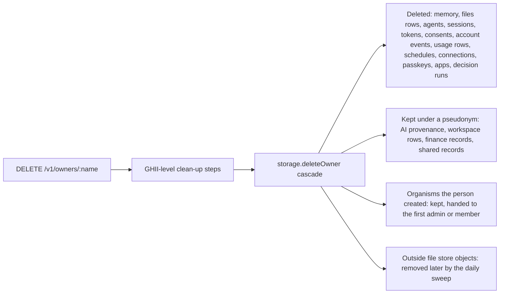

# 05 Data protection

> Checked against AIMEAT node 4.3.1 (commit def156c0e) on 2026-11-13. Maintained with the code: see the README for how.

This page is for the DPO, the security officer and the database administrator. It answers: which data the node keeps, where it keeps it, whether it is personal data, how long it stays and how it is deleted; what the node encrypts itself and what it leaves to the operator; how data classification works and how to set it for an organisation; what the GDPR export and the account deletion do; and which data leaves the operator's own systems.

## Data inventory

"Table" names are the PostgreSQL tables of the production backend (`aimeat/src/storage/providers/postgres-kysely/migrations/0001_base_schema.sql` and later migrations); the SQLite backend has the same data under snake_case names (`aimeat/src/storage/providers/sqlite/schema.ts`). A GHII is a person's account identity (`alice@node-id`); a GAII is an AI agent acting for that person ([identity model](../coding-guidelines/identity-model.md)).

| Data | Where it is stored | Personal data | Retention | How it is deleted | Source |
|---|---|---|---|---|---|
| Accounts and profiles | `Owner`, `Ghii`, `Passkey`, `EmailVerification` | yes | no time limit. An operator can disable an account; that is reversible and deletes nothing | account deletion (below) | `aimeat/src/storage/providers/postgres-kysely/migrations/0047_owner_lifecycle.sql`, `aimeat/src/services/owner-erasure.ts` |
| Memory records (a person's stored knowledge, one key per record) | `Memory`, `MemoryVersion` | yes, by content | no time limit. A record may carry its own TTL; a job deletes expired records every 5 minutes | the person deletes; a deleted record leaves every read at once and stays restorable for `AIMEAT_MEMORY_DELETE_GRACE_DAYS` (default 7, `0` removes it at the next hourly sweep), then an hourly sweep removes it. Restore: `aimeat_memory_restore`. A person's contexts (`context.`) and their ontology modules (`vocab.ctx.`) keep the version each write replaces in `MemoryVersion`, the newest 50 per record, readable by the person and their agents with `memory:read-as-owner` (`aimeat_memory_history`); the sweep that removes a deleted record removes its earlier versions with it | `aimeat/src/storage/providers/postgres-kysely/migrations/0067_memory_delete_grace.sql`, `aimeat/src/services/memory-bin-sweep.ts`, `aimeat/src/services/core-jobs.ts`, `aimeat/src/services/context/history-keys.ts` |
| Workspace documents (shared documents inside an organism, the node's unit for a group of people and agents) | `Memory`, one record per document plus a copy per published version | yes, by content | `AIMEAT_WS_MAX_VERSIONS` versions per document (default 20, `0` keeps all) | the writer deletes; a job compacts old versions | `aimeat/src/services/workspace-versions.ts` |
| Workspace rows (table-like data in a workspace) | `WorkspaceRow`, `WorkspaceRowRevision` | yes, by content | no automatic retention found | `aimeat_workspace_rows_delete` (one row, or every row before a date; needs `memory:purge`, cannot be undone). Deleting the workspace or the organism removes its rows and their kept revisions too. On account deletion the rows stay and the person's name is replaced with a pseudonym | `aimeat/src/storage/providers/postgres-kysely/migrations/0113_workspace_row_revisions.sql`, `aimeat/src/storage/erased-account-records.ts`, `aimeat/src/routes/organisms/workspace-ops.ts`, `aimeat/src/storage/providers/postgres-kysely/methods/organisms.ts` |
| Files | `StorageFile` (bytes in the database by default), or an S3 or Azure Blob store the operator configures (the row then holds a reference). A store takes a file from its size limit up and the kinds it names (default 1 MB, video and audio); a smaller file of another kind stays in the database, and one a store holds and no longer takes is moved back daily (`aimeat/src/storage/blob/store-takes.ts`, `aimeat/src/services/file-store/file-store-return.ts`) | yes, by content | no time limit | the person deletes (`aimeat_storage_delete`); account deletion removes the rows; a daily sweep removes objects in an outside store that no row names any more | `aimeat/src/storage/blob/file-store-wrap.ts`, `aimeat/src/services/file-store/file-store-sweep.ts` |
| Messages and DMs | `DirectMessage`, `Conversation`, `AgentMessage`, `MailboxItem`, `OutboundMessage`, `BoardPost` | yes | no general retention. Delivery to another node stops after `AIMEAT_MESSAGE_RETRY_TTL_HOURS` (default 168). Visitor conversations from a public intake form end after their own `ttl_days`. Board posts with a TTL are pruned | the person deletes from their own mailbox; on account deletion their copies go and the other side keeps its own copy | `aimeat/src/services/intake-thread-retention.ts`, `aimeat/src/services/core-jobs.ts` |
| Account events (the per-person audit feed) | `AccountEvent`, `AccountEventArchive` | yes | the live table keeps the last `AIMEAT_ACCOUNT_EVENT_WINDOW` events per person (default 100); older ones move to the archive, which no job prunes | account deletion | `aimeat/src/config/data-access.ts`, `aimeat/src/services/account-events.ts` |
| Operator trail (operator actions in another person's account, settings changes) | usage rows in the operator's own stream, and a log line | yes (operator identity) | as AI usage records | as AI usage records | `aimeat/src/routes/admin/config.ts` |
| AI usage records (every model call: who, which model, cost) | `UsageCall`, `UsageCallArchive`, `UsageRollup`, `AgentUsageEvent`, `AgentUsageEventArchive`, `AgentUsageDaily` | yes | raw rows move to the archive after `AIMEAT_USAGE_HOT_DAYS` (default 90); hourly figures stay `AIMEAT_USAGE_HOUR_ROLLUP_DAYS` (default 30). Nothing deletes a call record on a schedule | account deletion; an operator prunes the archive before a date with `POST /v1/admin/usage/archive/prune` | `aimeat/src/services/usage/archive-job.ts`, `aimeat/src/routes/admin/usage.ts` |
| AI provenance records (which model made which content, EU AI Act Article 50) | `AiProvenance` | yes (principal) | no prune job found | on account deletion the rows stay with the owner and principal replaced by a pseudonym | `aimeat/src/storage/providers/postgres-kysely/methods/owner-cascade.ts`, [AI transparency](../ai-transparency.md) |
| Agent activity | `AgentActivity` | yes (agent of a person) | no prune job found | deleted per agent on account deletion | `aimeat/src/storage/providers/postgres-kysely/methods/identity-erasure.ts` |
| Consent records (what a person allowed an agent or app to read) | `Consent`, `ConsentAudit`, `ContactConsent` | yes | expired consents end by a job; consent audit rows are deleted after `AIMEAT_CONSENT_AUDIT_RETENTION_DAYS` (default 365, `0` keeps them) | the person revokes (`aimeat_consent_revoke`); account deletion | `aimeat/src/config/data-access.ts`, `aimeat/src/services/consent.ts` |
| Classification audit (reads of classified content) | `ClassificationAudit` | yes | the policy's audit retention, default 365 days, pruned daily | account deletion; rows where the person read someone else's content get a pseudonym | [Data classification](../data-classification.md), `aimeat/src/services/classification/defaults.ts` |
| Decision runs (System 1 decision model answers) | `AiDecision` | yes; known identifier patterns are replaced before sending | `AIMEAT_DECIDE_RETENTION_DAYS` (default 365), pruned daily | account deletion | `aimeat/src/services/decide/prune-job.ts`, `aimeat/src/config/decide.ts` |
| Run logs | execution log and daily AI job logs | yes | `AIMEAT_EXECUTION_LOG_RETENTION_DAYS` (default 30), `AIMEAT_AI_JOB_LOG_RETENTION_DAYS` (default 30) | job | `aimeat/.env.example` |
| Sessions and tokens | `Session`, `OAuthRefreshToken`, `PersonalAccessToken`, `RevokedToken`, `DeviceAuth` | yes | owner session access token `AIMEAT_ACCESS_TTL` (900 s); agent tokens `AIMEAT_AGENT_JWT_TTL` and ecosystem app tokens `AIMEAT_ECO_JWT_TTL` (90 days each); other JWTs `AIMEAT_JWT_TTL` (3600 s) (`aimeat/src/config.ts`); refresh idle `AIMEAT_REFRESH_IDLE_DAYS` (30) and absolute `AIMEAT_REFRESH_ABSOLUTE_DAYS` (90). Tokens are stored as hashes. Expired device codes are deleted every 5 minutes; unused MCP client registrations after `AIMEAT_MCP_UNUSED_CLIENT_DAYS` (30) | revocation sets a flag; account deletion removes them | `aimeat/src/storage/providers/postgres-kysely/methods/sessions.ts`, `aimeat/.env.example` |
| Node keys (the node's Ed25519 signing key) | `NodeKey` (a copy, encrypted when `AIMEAT_KEY_PASSPHRASE` or `AIMEAT_ENCRYPTION_KEY` is set) and a key file (`AIMEAT_NODE_KEY_PATH`) | no | life of the node | operator | `aimeat/src/storage/node-key-at-rest.ts` |
| Encrypted secrets (AI provider keys, connected mail account tokens, SMTP and payment secrets, file store credentials) | memory records under reserved prefixes, encrypted | yes (they open a person's accounts) | until the person or operator removes them | the person or operator; account deletion | `aimeat/src/services/encryption.ts`, `aimeat/src/services/ai/provider-store.ts`, `aimeat/src/services/connections/credential.ts` |
| Compliance documents (records of processing, DSR requests, breaches, DPIAs, balancing tests, trial marks, agreements) | memory records of the node's system identity | yes | no time limit | operator | `aimeat/src/services/compliance/docs.ts`, `aimeat/src/services/compliance/agreements.ts` |
| Backups | not made by the node. The operator backs up the database, `.env` and the key file | yes | the operator's backup policy | the operator. Deleted data stays in older backups until they expire | [Backup and restore](../operations/backup-and-restore.md), [11 Backup and recovery](11-backup-recovery.md) |

## Encryption

### In transit

| Link | What the node does | What the operator does | Source |
|---|---|---|---|
| Browser, AI client or agent to the node | listens on plain HTTP on every address unless `AIMEAT_BIND_HOST` names one (set `127.0.0.1` when the proxy is on the same host); sends HSTS when `AIMEAT_BASE_URL` is `https://` | terminates TLS at a reverse proxy; sets `AIMEAT_TRUST_PROXY` | [Production deployment](../operations/production-deployment.md), `aimeat/src/config/runtime.ts`, `aimeat/.env.example` |
| Node to PostgreSQL | passes `DATABASE_URL` to the PostgreSQL driver as given; no AIMEAT setting for TLS | puts TLS options in the connection string, or keeps the database on the same host or a private network | `aimeat/src/storage/providers/postgres-kysely/index.ts` |
| Node to AI providers | an address outside the machine must be `https`, except an origin the operator lists in `AIMEAT_AI_PROVIDER_EGRESS`, which may be plain `http`; the fixed vendor types use their official `https` address | chooses providers | `aimeat/src/services/ai/providers.ts`, [06 AI and models](06-ai-and-models.md) |
| Node to other nodes (federation) | every federation message is signed with the node's Ed25519 key | decides whether to federate | [Federation](../operations/federation.md) |
| Node to SMTP | sends through `AIMEAT_SMTP_HOST`:`AIMEAT_SMTP_PORT` (587). STARTTLS is used when the server offers it and is not required; `AIMEAT_SMTP_SECURE=true` uses TLS from the first byte | chooses a relay that requires TLS, or sets `AIMEAT_SMTP_SECURE=true` with port 465 | [Bookkeeping and email](../operations/bookkeeping.md), `aimeat/src/config/smtp.ts`, `aimeat/src/services/email.ts` |

### At rest

| What | Encrypted by the node | Algorithm and key | Source |
|---|---|---|---|
| AI provider keys, the secrets vault, extension and MCP server secrets, OAuth tokens of connected mail accounts, SMTP passwords, payment provider secrets, file store credentials, secret Config settings, TOTP secrets | yes | AES-256-GCM with a 12-byte random IV. Secret Config settings, extension secrets, file store credentials and MCP transport secrets are also bound to their storage location as additional data; AI provider keys, connected-account tokens, payment secrets, company SMTP passwords, MCP server credentials and the secrets vault are not. Key: `AIMEAT_ENCRYPTION_KEY`, else `AIMEAT_TOTP_ENCRYPTION_KEY`; while the data key is being replaced, also `AIMEAT_ENCRYPTION_KEY_1`, and each value opens with the key its id names. Without any, features that store a secret answer 503 and store nothing | `aimeat/src/services/encryption.ts`, `aimeat/src/services/owner-secrets.ts`, `aimeat/src/services/config/at-rest.ts`, `aimeat/src/services/extension-secrets.ts`, `aimeat/src/services/ai/provider-store.ts`, `aimeat/src/services/connections/credential.ts` |
| The node's private key in the database | yes, when `AIMEAT_KEY_PASSPHRASE` or `AIMEAT_ENCRYPTION_KEY` is set; plain text when neither is | AES-256-GCM; key from `AIMEAT_KEY_PASSPHRASE` (PBKDF2-SHA512, 100 000 rounds), else from the current data key (while the data key is being replaced, it opens under either data key, and the re-encrypt job seals it again with the current one). Without a key that opens it and no matching key file, the node refuses to start | `aimeat/src/storage/node-key-at-rest.ts` |
| Passwords | hashed, not encrypted | scrypt (N=32768, r=8, p=1), 16-byte salt | `aimeat/src/services/password.ts` |
| Refresh tokens and personal access tokens | hashed | hash only stored | `aimeat/src/storage/providers/postgres-kysely/methods/oauth.ts`, `aimeat/src/storage/providers/postgres-kysely/methods/pat.ts` |
| Memory records, workspace documents and rows, messages, files, logs | **no** | the operator's database, disk or object store encryption | none in the node |

Lose `AIMEAT_ENCRYPTION_KEY` and every stored secret is unreadable. Never change its value on a live node; to replace it, add a second key and run the re-encrypt job, which reseals every stored secret and never changes or deletes one it cannot open ([Key rotation](../operations/key-rotation.md), [07 Security](07-security.md)).

## Data classification

Off by default. Summary of [Data classification](../data-classification.md), which stays the single home for the detail.

| Item | Behaviour | Source |
|---|---|---|
| The switch | `AIMEAT_CLASSIFICATION`: `off` (default, nothing is checked), `owner` (each person and each organism turns it on for their own content), `all` (on for everyone). Only an operator changes it; turning it down needs the operator in person, an AI credential is refused (`PERSON_REQUIRED`) | `aimeat/src/services/classification/defaults.ts` |
| Levels | four shipped levels: Public, Internal (the default for new content), Confidential, Highly confidential. A level decides whether a person is shown the content, whether an AI may read it, whether reads are audited, whether it may leave its group (another organism or another node), and whether lowering it needs a reason | `aimeat/src/services/classification/levels.ts` |
| Local model only | a level with `externalAi: refused` lets an AI read it only through a model whose reference is `local:<model>`. An AI call with any other model is refused (`CLASSIFIED`); an agent sees the content only when its runtime report says `llm: "local"` (`aimeat_agent_runtime_report`), a claim the node records and cannot check. No exception opens it | `aimeat/src/services/classification/external-ai.ts` |
| What counts as local | a provider of type `local`: an address on loopback, or an origin the operator listed in `AIMEAT_AI_PROVIDER_EGRESS`. So an internal GPU host the operator lists counts as local (see [06 AI and models](06-ai-and-models.md)) | `aimeat/src/services/ai/providers.ts` |
| Security class packs | two packs the operator switches on: Finnish TL (TL IV to TL I) and NATO (RESTRICTED to COSMIC TOP SECRET). Every class: local model only, every use audited, never leaves its organism. The two highest classes need the operator's acknowledgement that the node is not an accredited system | `aimeat/src/data/classification-packs.ts` |
| Data domains | a record of processing that names health, biometric, defence or export-controlled data raises the containers it covers to a floor level and refuses an outside model for them | `aimeat/src/data/compliance-domains.ts` |
| Where enforced | one reader component answers show, use for AI and leave; federation exits ask the egress check | `aimeat/src/services/classification/reader.ts`, `aimeat/src/services/classification/egress.ts` |
| For an AI | `aimeat_classification` | `aimeat/src/tool-catalog/definitions/classification.ts` |

**Recommended setting for an organisation:** `all`, so that no person or team opts out; keep Internal as the default label; switch on the TL or NATO pack only up to the class the organisation is cleared to hold, and only after deciding that the node is not used for anything above it; give every class that must not reach a cloud model `externalAi: refused` and provide a local model for it. Turn it on before people start writing, because content written while it is off carries no label until a rule or a scan gives it one.

## Retention and deletion

The retention settings an operator decides at adoption. Everything else in the inventory above has no time limit and stays until a person, an operator or the account deletion removes it.

| Setting | Default | What it decides |
|---|---|---|
| `AIMEAT_MEMORY_DELETE_GRACE_DAYS` | 7 | how long a deleted memory record can be restored |
| `AIMEAT_WS_MAX_VERSIONS` | 20 | versions kept per workspace document |
| `AIMEAT_USAGE_HOT_DAYS` | 90 | when AI usage rows move to the archive (never deleted by a job) |
| `AIMEAT_USAGE_HOUR_ROLLUP_DAYS` | 30 | hourly usage figures |
| `AIMEAT_CONSENT_AUDIT_RETENTION_DAYS` | 365 | consent audit rows |
| `AIMEAT_ACCOUNT_EVENT_WINDOW` | 100 | live account events per person (older ones are archived, not deleted) |
| `AIMEAT_DECIDE_RETENTION_DAYS` | 365 | decision runs |
| `AIMEAT_EXECUTION_LOG_RETENTION_DAYS` | 30 | run execution log |
| `AIMEAT_AI_JOB_LOG_RETENTION_DAYS` | 30 | AI job logs |
| `AIMEAT_MESSAGE_RETRY_TTL_HOURS` | 168 | retries of a message to another node |
| `AIMEAT_REPLICATION_QUEUE_TTL_HOURS` | 72 | federation replication queue |
| classification policy audit retention | 365 days | classification audit |

Source: `aimeat/.env.example`, `aimeat/src/config/data-access.ts`.

## GDPR export and account deletion

| Right | Route | What it does | Source |
|---|---|---|---|
| Access and portability (Art. 15, 20) | `GET /v1/owners/:name/export` | the person or an operator; one JSON document with the account, profile, memory records, file metadata (not the bytes), agents with their memory and messages, organism memberships, published apps, AI provenance, connections (never the credential), purchases and the person's classified organism content. Stored credentials are redacted. Each export is logged as a completed data subject request. There is no MCP tool for it | `aimeat/src/routes/owners/export.ts`, `aimeat/src/routes/owners/export-sections.ts`, `aimeat/src/data/builtin-skills.data-ownership.ts` |
| Erasure (Art. 17) | `DELETE /v1/owners/:name` | the person in their own local session, or an operator. Immediate, no grace period, one database transaction with a savepoint per step | `aimeat/src/routes/owners.ts`, `aimeat/src/services/owner-erasure.ts` |
| An organism's data | `aimeat_organism_export` | an organism's export for its members | [Data ownership](../data-ownership.md) |

What the account deletion does:

Sources: `aimeat/src/services/owner-erasure.ts`, `aimeat/src/storage/erased-account-records.ts`, `aimeat/src/storage/providers/postgres-kysely/methods/owner-cascade.ts`, `aimeat/src/storage/providers/postgres-kysely/methods/identity-erasure.ts`.

## Where the data is, and what leaves

Everything in the inventory lives in the operator's database and, when configured, the operator's own S3 or Azure Blob store. These are the flows found that send data out; [02 Architecture](02-architecture.md) lists every outbound connection:

| Flow | What is sent | When | Off by default | Control | Source |
|---|---|---|---|---|---|
| AI model calls | the prompt and the files the caller put in the call | each AI feature use, also unattended runs | no node provider is configured on a new node, but any person can add their own provider and key, to any public host unless `AIMEAT_AI_PROVIDER_ALLOWLIST` limits it | [06 AI and models](06-ai-and-models.md) | `aimeat/src/services/ai/providers.ts` |
| Decision provider (System 1) | questions with known identifier patterns (e-mail, phone, identity codes, IBAN, street address, contacts' names, and values in fields named for them) replaced first; the owner may let a class through unreplaced; other personal data in the content is sent | when a feature asks for a decision and a key is set | the feature is on, but with no key nothing is sent | `AIMEAT_DECIDE_ENABLED`, `AIMEAT_DECIDE_BASE_URL` | `aimeat/src/services/decide/scrub.ts` |
| Model catalogue refresh | requests for public model lists and prices, no user data | weekly | no | `AIMEAT_AI_CATALOG_REFRESH` (`off`) | `aimeat/.env.example` |
| Federation | records a person shares with another node, signed | when the operator federates and a person shares | yes | [Federation](../operations/federation.md) | `aimeat/src/services/classification/egress.ts` |
| Email | notifications, invitations, mail a person or agent sends | on events | yes: needs `AIMEAT_SMTP_HOST` | [Bookkeeping and email](../operations/bookkeeping.md) | `aimeat/.env.example` |
| Connected outside accounts (Gmail, Outlook) | mail read and sent on the person's behalf | when a person connects one | yes | [Connecting an outside account](../connecting-an-outside-account.md) | `aimeat/src/services/connections/credential.ts` |
| Connected SharePoint and OneDrive | files and list rows read and written on the person's behalf; a file kept on the node is a private file of theirs, tagged with the SharePoint item it came from | when a person connects one, and for each file they or their AI keep | yes | [Connecting an outside account](../connecting-an-outside-account.md) | `aimeat/src/services/connections/drive-files.ts`, `aimeat/src/services/connections/write.ts` |
| Outside file stores | file bytes | when configured | yes | `AIMEAT_FILE_STORE_S3_BUCKET`, `AIMEAT_FILE_STORE_AZURE_ACCOUNT` | `aimeat/src/storage/blob/file-store-wrap.ts` |
| Webhooks, extensions, apps opened to the internet | what each one is built to send | when a person or operator sets one up | yes | [13 Apps, agents and endpoints](13-apps-agents-endpoints.md) | `aimeat/src/utils/url-validator.ts` |

## Limits

- The node does not encrypt memory records, workspace content, messages, files or logs at rest. Disk, database or object store encryption is the operator's job.
- The node has no TLS of its own and no setting for TLS to PostgreSQL; both are the operator's configuration.
- The node makes no backups. Deleted and erased data stays in the operator's backups until those expire.
- Account deletion is immediate and has no grace period; there is no undo.
- Account deletion continues past a clean-up step that fails, records what it cleared, and logs the failed step as a warning; a failed step leaves that subsystem's data in place.
- AI provenance records, workspace rows, finance records and other shared records survive account deletion under a pseudonym, not deleted.
- Files in an outside file store are removed by a daily sweep after the rows are gone, and a store with no folder prefix is never swept, so its objects stay.
- The GDPR export lists files as metadata only, not their bytes, and has no MCP tool.
- No job deletes AI usage records or the account event archive. An operator prunes archived usage records before a date with `POST /v1/admin/usage/archive/prune` (date and `confirm: true` required, `aimeat/src/routes/admin/usage.ts`). No tool prunes `AccountEventArchive`; it shrinks only through account deletion.
- No automatic retention was found for workspace rows and their revisions, AI provenance, agent activity or direct messages.
- Classification is off by default; content written while it is off carries no label until a rule, a scan or a person gives it one.
- An agent's claim that its model is local (`llm: "local"`) is recorded and cannot be checked by the node.
- An internal host the operator lists in `AIMEAT_AI_PROVIDER_EGRESS` counts as `local` for classification although the data leaves the node's machine for it.
- No restriction-of-processing switch (GDPR Art. 18) per person was found; disabling an account stops use but is an operator action.

## Open questions

- OPEN: Does the node-postgres driver used here honour `sslmode=require` and `sslrootcert` in `DATABASE_URL`, and has the project run against a TLS-only PostgreSQL? The maintainer named in `.github/SECURITY.md` can answer.
- OPEN: Is there an expiry sweep for `Session` rows past their lifetime, or do expired sessions stay until account deletion? The maintainer can answer.
- OPEN: How does an operator prune `AccountEventArchive` (a command, a route, or SQL by hand)? The maintainer can answer.
