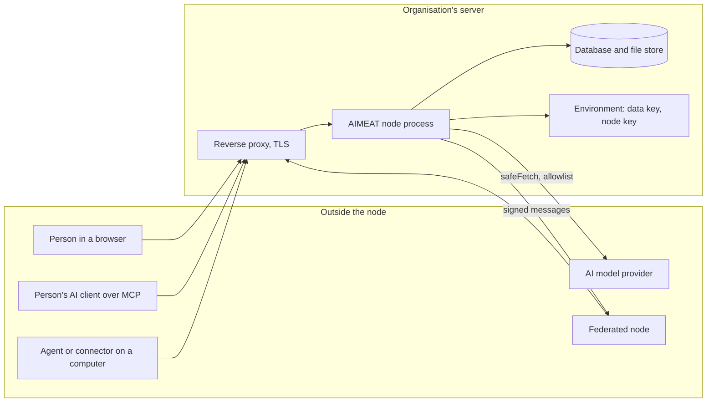

# 08 Threat model

> Checked against AIMEAT node 4.2.0 (commit 959664aab) on 2026-11-02. Maintained with the code: see the README for how.

This page is for the security officer who writes the risk assessment. For each main threat it names the control in AIMEAT with its source, the risk that stays, and what the organisation must do itself. The repository's own map of assets, boundaries and required checks is [docs/security/threat-model.md](../security/threat-model.md); this page builds on it and does not repeat it. The settings named here are explained in [07 Security](07-security.md) and set in [09 Hardening guide](09-hardening-guide.md). Use [templates/risk-assessment.md](templates/risk-assessment.md) to record the decision.

## Trust boundaries

Every arrow into the proxy is an untrusted caller that must authenticate as one principal. The node, its database and its environment share one trust zone: whoever controls the host controls all three ([docs/security/threat-model.md](../security/threat-model.md)).

## Threats, controls and what stays

| Threat | Control in AIMEAT (source) | Residual risk | What the organisation must do |
|---|---|---|---|
| **Account takeover** (stolen or guessed password, stolen session) | Per-address tarpit on the password, code and signature routes (`aimeat/src/middleware/login-tarpit.ts`) and account lockout when the operator turns it on (`AIMEAT_SIGN_IN_LOCKOUT`, off by default); TOTP and passkeys (`AIMEAT_TOTP_ENABLED`, `AIMEAT_PASSKEY_ENABLED`); two-step sign-in required for operators or everyone (`AIMEAT_TWO_STEP_REQUIRED`) and password sign-in limited to operators or off (`AIMEAT_PASSWORD_SIGN_IN`) (`aimeat/src/services/sign-in-policy.ts`); OIDC, SAML and SCIM through the organisation's IdP ([Organisation node sign-in](../organisation-node-sign-in.md)); short owner session access tokens (900 s; agent and ecosystem app tokens last 90 days by default, `AIMEAT_AGENT_JWT_TTL`, `AIMEAT_ECO_JWT_TTL`, `aimeat/src/config.ts`) and a `__Host-` refresh cookie (`aimeat/src/services/owner-session.ts`); reuse of a refresh token recorded as `session_token_reused` (`aimeat/src/storage/types/account-events.ts`); session revocation ([Incident response](../security/incident-response.md)) | On the defaults, two-step sign-in is required for nobody and every password account signs in with its password, even when SSO is on. No account locks after wrong attempts, so guesses at one account from many addresses are bounded per address only. An emailed sign-in link has no node-wide switch. On an IdP sign-in the MFA is the IdP's, and the node does not check it. A phished session works until it expires or is revoked | Use SSO with the IdP's MFA and conditional access; set `AIMEAT_REGISTRATION_MODE` to `oauth` or `invite`; set `AIMEAT_TWO_STEP_REQUIRED=operators` (or `everyone`) and `AIMEAT_PASSWORD_SIGN_IN=operators`, `AIMEAT_SIGN_IN_LOCKOUT=on` where your policy requires a lockout, and check two-step use on the Security page; shorten `AIMEAT_AGENT_JWT_TTL`; alert on the refusal log ([10 Logging and monitoring](10-logging-monitoring.md)) |
| **Agent misuse** (an agent does more than its owner wanted, or a stolen agent token is used) | Scopes on every route and MCP tool, the same on REST, MCP and CLI ([Security DNA](../coding-guidelines/security-development-dna.md), invariants 4 and 15); powerful scopes never in the default (`aimeat/src/config-posture.ts`); delete goes to a restorable bin for `AIMEAT_MEMORY_DELETE_GRACE_DAYS`; scheduled and approved actions re-check the principal and run only what was approved (invariant 17); revocation reaches every derived token and grant (invariant 19); the owner sees what an agent did (`aimeat_trail_list`); morsels pace how fast agents may push data into the store ([Identity model](../coding-guidelines/identity-model.md)) | Within its scopes an agent acts as its owner, and the node cannot judge intent. The shipped default scopes allow memory writes, message sending and file storage | Set a minimal `AIMEAT_DEFAULT_AGENT_SCOPES`; with classification on, set `AIMEAT_AGENT_CLEARANCE_DEFAULT`; tell people to review agents on their profile and remove unused ones; monitor agent activity ([13 Apps, agents and endpoints](13-apps-agents-endpoints.md)) |
| **Prompt injection** (text in a record, document, mail or tool answer steers an AI) | Content written by one principal is never another principal's authority: a side door that writes content another principal's agent loads passes the same write gate as the main door ([Security DNA](../coding-guidelines/security-development-dna.md), invariant 18); approval binds principal, target and arguments (invariant 17); a secret goes to a new address only after the owner's one-press approval (`aimeat_secret_host_ask`); scopes cap what an injected instruction can reach | The node cannot stop a model from following injected text inside the scopes it already holds. A guardrail prompt is calibration, not a control (invariant 18). The person's own AI client is outside AIMEAT | Grant agents only the scopes their task needs; keep powerful scopes explicit; train people to read approval requests; treat AI clients as part of the organisation's own endpoint policy ([06 AI and models](06-ai-and-models.md)) |
| **Data leaking to an AI provider** | `AIMEAT_AI_PROVIDER_ALLOWLIST` limits which hosts a decrypted AI key and its prompts may go to; fixed provider types are reached only at their official address on a `public` node (`aimeat/src/config-posture.ts`); classification can hide a level from AI or allow only a local model (`externalAi: refused`, enforced in `aimeat/src/services/classification/reader.ts`); the OpenRouter region can be pinned to the EU ([OpenRouter region](../operations/openrouter-region.md)); the compliance report lists the providers whose prompts leave the machine ([Data classification](../data-classification.md)) | Classification is off by default, and the four shipped levels let an AI read everything: Confidential and Highly confidential content (credentials, keys, identity codes) reaches an AI with a warning, and no shipped level refuses an outside model (`aimeat/src/services/classification/defaults.ts`). A person's own AI client sends what it reads to its own vendor, outside the node's control. The local-model claim of an agent is recorded and cannot be checked ([Data classification](../data-classification.md)) | Turn classification on (`AIMEAT_CLASSIFICATION`); decide which levels refuse outside models; set the provider allowlist; sign DPAs with the providers ([Data processing agreement template](../data-processing-agreement-template.md)); restrict egress at the firewall |
| **Malicious app** (a published app tries to read the session or other data) | Each app on its own origin (`AIMEAT_APP_ORIGIN_ENABLED`), so it cannot read the sign-in of the person who opens it; a scoped app grant, never the session token; an app CSP of its own (`aimeat/src/routes/apps/read.ts`); reserved-key denylist so an app cannot redirect the owner's AI key or budget ([Security DNA](../coding-guidelines/security-development-dna.md), invariant 2); the Security page reports how apps are kept apart (`aimeat_admin_security_overview`) | An app the owner granted can do everything its scopes allow in the owner's name. Without the app origin, apps on a shared node run in an isolated frame, which is weaker | Provide wildcard DNS and a certificate so the app origin is on; on a closed node use `AIMEAT_CONTENT_ACCESS=signed-in` and keep internet openings behind operator approval ([07 Security](07-security.md)) |
| **Connector commands on a user's computer** (`aimeat connect serve` runs an agent's runner or wake command) | A command runs only when the connector's own connect flow wrote it, or it existed at the first start after the update; a command that arrives in a folder later is held back and named until `aimeat connect` there approves it. The trust record is a hash kept outside every connector home, so a folder cannot bring its own (`aimeat/src/cli/connect/command-trust.ts`) | The connector runs with the person's OS rights. A command the person approved runs whatever it does. Loopback clients attach to the connector's local daemon ([Connector forward tunnel](../connector-forward-tunnel.md)) | Manage which computers may run the connector under endpoint policy; run it under a normal user account; review the commands people approve ([13 Apps, agents and endpoints](13-apps-agents-endpoints.md)) |
| **Insider: operator** | An operator's reads and acts in another person's account write a usage row in the operator's own stream and an event on that person's account (`aimeat/src/services/operator-access-audit.ts`; `memory_accessed_by_operator`, `operator_acted` in `aimeat/src/storage/types/account-events.ts`); setting changes are recorded as `config.set` usage rows ([Incident response](../security/incident-response.md)); an SSO connection cannot deactivate an operator account ([Organisation node sign-in](../organisation-node-sign-in.md)); `AIMEAT_SEALED_CONFIG_KEYS` freezes chosen settings against any operator session | The operator role and host or database access are different boundaries: application permissions cannot protect against unrestricted host access ([docs/security/threat-model.md](../security/threat-model.md)). An operator with host access can read the database and the `.env` | Keep the operator group small; separate host administration from the operator role where possible; export the operator trail to a store the operator cannot change ([10 Logging and monitoring](10-logging-monitoring.md)); review it ([15 Operations runbook](15-operations-runbook.md)) |
| **Insider: organism admin** (an organism is a shared organisation space with members and workspaces) | Membership and roles are checked on every door; a permission word is enforced on every door ([Security DNA](../coding-guidelines/security-development-dna.md), invariant 15); a member's private records stay behind the cross-owner wall (section 1 of the same document); removing a member reaches derived grants and subscriptions (invariant 19) | An organism owner controls who joins and sees all content shared into the organism. Under `oauth` and `invite`, any member can mint an invitation ([Organisation node sign-in](../organisation-node-sign-in.md), section 6) | Name organism owners by role; review membership; decide who may invite |
| **Server compromise** (host, container or database taken over) | Secrets are AES-256-GCM encrypted at rest (`aimeat/src/services/encryption.ts`); the database copy of the node key is encrypted with `AIMEAT_KEY_PASSPHRASE`, else `AIMEAT_ENCRYPTION_KEY`; with neither set it is stored in plain text (`aimeat/src/storage/node-key-at-rest.ts`); dotfile paths are refused by the node (`aimeat/src/server-bootstrap/static-files.ts`); the systemd unit runs as a non-root user with `NoNewPrivileges` (`aimeat/deploy/aimeat.service`) | The key that decrypts the secrets sits in the same environment as the process. Record and file content is not encrypted by the node. A host takeover is a full compromise | Harden the host; encrypt disks and backups; keep the `.env` readable only by the service account; restrict inbound and outbound traffic; rotate keys after an incident ([Incident response](../security/incident-response.md)) |

Threats the repository's own map names in addition ([docs/security/threat-model.md](../security/threat-model.md)):

| Threat | Control in AIMEAT (source) | Residual risk | What the organisation must do |
|---|---|---|---|
| **Another owner reaching data** (IDOR) | Authorization against the resolved identity, never a client-supplied id ([Security DNA](../coding-guidelines/security-development-dna.md), invariant 1); cross-owner and cross-scope tests in the guard tier (`aimeat/test/e2e-security.ts`) | A new route that skips the caller object; the `pnpm check:single-entry` ratchet counts such code and only goes down | Run the newest release; report findings ([Security policy](../../.github/SECURITY.md)) |
| **Unauthenticated abuse and load** | Rate limits per area and per caller, body limits, bounded refusal log ([Security practices](../coding-guidelines/security.md); `aimeat/src/services/auth-audit.ts`) | Limits are per node process; a distributed attack needs network protection | Put a WAF or rate limiting at the proxy if the node is public |
| **A receiver key leaks, or a program sends junk** (a receiver is an address and key an outside program writes into one place of an owner's data with) | The key reaches exactly one key, key prefix or row space chosen when the receiver was made, never from the request; it is stored as its SHA-256, refused in the address and on every other route, and the same 401 answers a wrong key and a receiver that does not exist. Reserved and server-trusted keys are refused as targets. A CSM shape refuses a message that does not match before anything is written, and the node's own write checks (size, depth, quotas, schema locks, a row space's schema) apply to every receiver write. Limits per minute, per day, per message and per prefix; Idempotency-Key replaces instead of adding. An agent makes a receiver only with `receivers:manage`, outside every wildcard. Who may make receivers is `AIMEAT_RECEIVERS_MODE`; the operator stops any receiver; five wrong keys in an hour open a security incident (`aimeat/src/services/receivers/`) | A leaked key writes whatever its target and shape allow until it is rotated, paused or stopped. Without a CSM any JSON is taken. The day limit is counted per server process | On a closed node keep `AIMEAT_RECEIVERS_MODE` at `auto` or `operator`; ask owners to give every receiver a CSM; review receivers and their refusals on the admin Receivers page |
| **Federated visitor with a local namesake** | A session from another node gets role `federated` and its home identity, never the local account (`.claude/rules/security.md`) | Depends on which peers the operator approves | Approve no peers unless needed; keep `AIMEAT_FEDERATION_AUTH_POLICY=disabled` (the default, `aimeat/src/config.ts`) unless visitors from peers must sign in |
| **Malicious federation peer** | Ed25519 signatures verified unconditionally, operator approval for every peer, emergency de-peer (`aimeat_admin_federation_peer_remove`; [Federation](../operations/federation.md)) | An approved peer can send what its tier allows | Approve only peers you have a contract with |
| **Extension code** | QuickJS-WASM sandbox with memory, CPU and call limits; network through `safeFetch`, limited to the declared hosts when the manifest declares `network.hosts` and otherwise open to any public address (the built-ins `vocab-finto` and `living-hooks` declare none) (`aimeat/src/services/extension-runtime.ts`, `aimeat/src/services/extension-capability-declaration.ts`); `AIMEAT_EXT_INSTALL_ROLE` | Default install role is `owner` | Set `AIMEAT_EXT_INSTALL_ROLE=operator` |
| **Outbound URL abuse (SSRF)** | `safeFetch` checks every address and redirect hop; private, link-local and metadata addresses always blocked (`aimeat/src/utils/url-validator.ts`) | Loopback is allowed on a `local` profile node | Set `AIMEAT_SECURITY_PROFILE=public` on a shared node; restrict egress at the firewall |
| **Concurrent balance or version update** | Atomic operations and conflict handling; money paths asserted in the guard tier ([Verification matrix](../security/verification-matrix.md)) | None known beyond [Known gaps](../known_gaps.md) | None |
| **Disabled account or revoked credential still working** | Revocation reaches sessions, agent tokens, access tokens, app grants and tunnels ([Organisation node sign-in](../organisation-node-sign-in.md), section 7; `aimeat/test/e2e-agent-token-revocation.ts`) | A tunnel or token issued by a peer node is outside this node's revocation | Deprovision through SCIM so leaving staff lose access at once |
| **Hook gate fails closed** (a bound `pre_` hook whose address stops answering refuses everything it guards) | `aimeat_admin_hooks` names a failing gate (`aimeat/src/services/hooks.ts`) | Availability, not confidentiality | Bind gate hooks only to services you monitor |

## Limits

- The threat model covers the node process. The person's AI client, its vendor and the person's computer are outside it.
- No control in AIMEAT protects against someone with unrestricted host or database access.
- Prompt injection is limited by scopes and approvals, not prevented.
- An agent's statement that its model runs locally is recorded and cannot be verified by the node.
- Classification, the AI provider allowlist and a minimal default scope list are off or permissive by default, so the AI-related controls in this table need the operator's action.
- Required two-step sign-in and limited password sign-in are off by default (`AIMEAT_TWO_STEP_REQUIRED=off`, `AIMEAT_PASSWORD_SIGN_IN=on`), so the account takeover controls above need the operator's action (`aimeat/src/config-types-account-security.ts`).

## Open questions

- OPEN: Does the maintainer have a formal threat model (for example STRIDE per component) beyond `docs/security/threat-model.md`, and is it shareable under NDA? (the maintainer named in `.github/SECURITY.md`)
- OPEN: What exactly can an organism owner see and change in a member's content that is shared into the organism, as a role-by-role table? (the maintainer)
- OPEN: Can the connector's local daemon be reached by other local users on a shared multi-user computer, and what authenticates them? (the maintainer)
