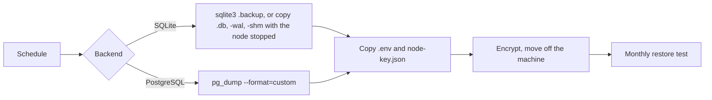

# 11 Backup and recovery

> Checked against AIMEAT node 4.2.0 (commit 2d94bf903) on 2026-11-04. Maintained with the code: see the README for how.

This page is for the sysadmin who owns backups and the continuity planner who sets recovery targets. It lists what must be backed up for a node to come back as the same node, gives the procedure in short, proposes RTO and RPO values for the organisation to decide, and describes the restore test. The commands for each storage backend are in [Backup and restore](../operations/backup-and-restore.md), which stays the single home for them.

## What must be backed up

A node is its data, its secrets and its identity key. Back up all three at the same time and keep them together ([Backup and restore](../operations/backup-and-restore.md)).

| Part | Where it is | What is lost without it | Source |
|---|---|---|---|
| Database | SQLite: the file `AIMEAT_SQLITE_PATH` names, with its `-wal` and `-shm` files. PostgreSQL: the database `DATABASE_URL` names | Every account, record, workspace, app, setting and log record kept in the database | [Backup and restore](../operations/backup-and-restore.md) |
| Stored file bytes | In the database when `AIMEAT_FILE_STORE=database` (the default). In an S3 bucket or Azure container when set to `s3` or `azure`, and in a person's own storage when `AIMEAT_OWNER_FILE_STORES` allows it | The content of uploaded files | `aimeat/.env.example` |
| Data key | `AIMEAT_ENCRYPTION_KEY` (or `AIMEAT_TOTP_ENCRYPTION_KEY` when the first is not set), in `.env` or the process manager | Every stored secret becomes unreadable: AI provider keys, the secrets vault, extension and MCP server secrets, two-step sign-in secrets, secret Config settings | `aimeat/.env.example`, [Backup and restore](../operations/backup-and-restore.md) |
| Key passphrase | `AIMEAT_KEY_PASSPHRASE` | The sealed copy of the node key in the database and the encrypted key file cannot be opened | `aimeat/.env.example` |
| Node identity key | `AIMEAT_NODE_KEY_PATH`, default `~/.aimeat/nodes/<node id>/node-key.json` | The node's identity. A node whose sealed copy does not open and that finds no key file refuses to start rather than make a new identity, which would break every issued token and every federation peer | [Backup and restore](../operations/backup-and-restore.md) |
| The rest of `.env` | The working directory or the process manager | Every other setting: base URL, sign-in providers, SMTP, file store credentials | [Backup and restore](../operations/backup-and-restore.md) |
| Refusal log | `AIMEAT_AUTH_LOG_PATH` | Refusal history (optional; it is a log, not state) | `aimeat/src/config-security.ts` |

Rules that follow from this:

- Never change `AIMEAT_ENCRYPTION_KEY`, `AIMEAT_TOTP_ENCRYPTION_KEY` (the data key when the first is not set, which is the case after `aimeat init`) or `AIMEAT_KEY_PASSPHRASE` on a running node, and never restore a database under different values ([Backup and restore](../operations/backup-and-restore.md), `aimeat/.env.example`, `aimeat/src/cli/init-wizard.ts`).
- Adding `AIMEAT_ENCRYPTION_KEY` later to a node that ran on `AIMEAT_TOTP_ENCRYPTION_KEY` (as `aimeat init` sets up) is safe while the TOTP key stays set: new secrets are written under the data key, and every secret stored before still opens, because the node tries the TOTP key when the data key does not open a value (`aimeat/src/services/encryption.ts`). The node re-encrypts nothing, so keep `AIMEAT_TOTP_ENCRYPTION_KEY` set and backed up for as long as secrets written before the change are in use; removing it leaves those unreadable.
- The node holds its data keys in a key ring, and a secret sealed under any key but the first names that key's number. Every node has one data key today, and no setting adds a second one yet, so the rule above stands: replacing the data key is not possible yet ([Key rotation](../operations/key-rotation.md), `aimeat/src/services/encryption.ts`).
- Store the database backup and the secrets apart, or encrypt the set: the database holds people's data and the `.env` holds the key to their secrets ([Backup and restore](../operations/backup-and-restore.md)).
- Docker: neither compose file keeps the node key directory on a volume. Mount one or set `AIMEAT_NODE_KEY_PATH` to a file on a volume, and back it up ([Production deployment](../operations/production-deployment.md)).

What is **not** a backup: `GET /v1/admin/backup`, the admin Maintenance tab's backup and `aimeat backup` write a JSON export of accounts, agents and some rows. They leave out the records people keep in their own accounts, organisms, workspaces, apps and files, and carry no credential ([Backup and restore](../operations/backup-and-restore.md)).

## Procedure in short

1. Take the database backup with the method for the backend ([Backup and restore](../operations/backup-and-restore.md), sections SQLite and PostgreSQL). Do not copy a live SQLite `.db` file alone: recent writes may be in the `-wal` file.
2. Copy `.env` and the node key file with it.
3. If files are in S3 or Azure, back up the bucket or container at the same moment, or turn on object versioning there (see Limits).
4. Encrypt the set and move it off the machine.
5. Take an extra backup before every update ([Upgrading](../operations/upgrading.md)).
6. Restore: stop the node, put the database, `.env` and key file back, start. The node applies any migration the backup lacks, in order; restoring a newer backup onto an older version is not supported ([Backup and restore](../operations/backup-and-restore.md)).

The online SQLite backup, the stopped-node copy and the PostgreSQL dump and restore are run end to end by `aimeat/test/e2e-backup-restore.ts`: a record, a stored file and a sealed secret come back, and a session issued before the backup still works. The PostgreSQL half runs only where `pg_dump` and `pg_restore` are installed ([Backup and restore](../operations/backup-and-restore.md)).

## Proposed RTO and RPO

These are proposals. The organisation decides them from its own business impact analysis and records them in [templates/organization-profile.md](templates/organization-profile.md). The repository contains no restore-time measurement at production size, so measure RTO in the first restore test ([Database high availability](../operations/database-high-availability.md#time-a-restore-at-production-size) gives the steps).

| Tier | RPO (data loss) | How it is reached | RTO (time to service) | Reasoning |
|---|---|---|---|---|
| Basic | 24 h | One nightly backup: `pg_dump` or `sqlite3 .backup`, plus `.env` and the key file | 4 h | Restore of one dump onto a prepared host, then the checks below. Suits a node where a day of new knowledge can be entered again |
| Standard | 1 h | PostgreSQL: hourly dumps, or nightly base backup with continuous WAL archiving. SQLite: hourly online backups | 2 h | Fits a node used for daily work by a team. WAL archiving is PostgreSQL's own point-in-time recovery ([PostgreSQL documentation, continuous archiving](https://www.postgresql.org/docs/current/continuous-archiving.html)) |
| High | 15 min or less | PostgreSQL with continuous WAL archiving, or a streaming standby ([PostgreSQL documentation, warm standby](https://www.postgresql.org/docs/current/warm-standby.html)) | 1 h | For a node others depend on through apps or federation. Needs a prepared standby host with the same `.env` and key file |

The AIMEAT documentation describes `pg_dump` and SQLite backups in [Backup and restore](../operations/backup-and-restore.md), and a streaming standby with automatic failover, WAL archiving with point-in-time recovery, a timed restore and a failover drill in [Database high availability](../operations/database-high-availability.md). The standby and the archiving are standard PostgreSQL operation that the repository's tests do not exercise. What the tests cover is the node's side of a failover: a read built by the node's query builder outside a transaction is asked once more on a new connection when its connection was lost, a write fails to its caller, and the event bus between the node's processes reads its registries again after its connection dropped (`aimeat/src/storage/providers/postgres-kysely/read-retry.ts`, `aimeat/src/server-bootstrap/bus-relay-start.ts`). Whatever the tier, the secrets and the key file change rarely: back them up when they change and keep them with every database generation.

Retention of backups is a privacy decision as well: a record or account a person erased stays in every older backup until that backup is destroyed, and a restore brings it back. State the backup retention in the privacy notice ([Backup and restore](../operations/backup-and-restore.md)); see [05 Data protection](05-data-protection.md).

## Restore test

Once a month, and after every change to how the node is installed ([Backup and restore](../operations/backup-and-restore.md)):

- [ ] Restore the newest backup onto a separate machine, or the same machine on another port with `AIMEAT_PORT`, with the same `.env` values and the same key file.
- [ ] Do not let the test node reach the real node's federation peers or send mail under the same identity: block its egress, or change SMTP settings in the test copy.
- [ ] `GET /v1/health` answers `status: healthy` with `subsystems.storage.healthy: true`.
- [ ] `GET /v1/build` shows the expected version.
- [ ] Sign in as an operator and read a record you know was written before the backup.
- [ ] Open one stored file written before the backup (this proves the file bytes came back, from the database or the bucket).
- [ ] Use one stored secret, for example an AI call on a key kept on the node (this proves the data key matches).
- [ ] Open the admin Security page, `<node>/v1/admin?tab=security`, and check for new incidents.
- [ ] Record the time from start of restore to the first healthy check. That is the measured RTO.
- [ ] Stop and delete the test node.

The repository records one exercised restore, on 2026-10-12 on SQLite with a sandbox node ([Backup and restore](../operations/backup-and-restore.md)).

## Limits

- With `AIMEAT_FILE_STORE=s3` or `azure`, or a person's own storage, the file bytes are outside the database, and the database backup does not carry them ([Backup and restore](../operations/backup-and-restore.md#what-a-node-is)).
- With a bucket file store, the daily sweep (03:37) removes objects in the node's folder that no file of the node names and that are older than one day; a store with no folder set is not swept (`aimeat/src/services/file-store/file-store-sweep.ts`, `SWEEP_MIN_AGE_MS`; `aimeat/src/services/job-seeding.ts`). After a restore of an older database, objects for files written after that backup are no longer named, and the next sweep deletes each one older than a day. Object versioning in the bucket protects against this.
- The node has no built-in backup scheduler; the schedule, encryption and off-site copy are the operator's.
- `GET /v1/admin/backup` and `aimeat backup` are partial exports and do not restore a node.
- Restoring a newer backup onto an older node version is not supported.
- Losing `AIMEAT_ENCRYPTION_KEY` makes every stored secret unreadable, with no recovery path in the node.
- Losing both the key passphrase and the key file stops the node from starting as the same node.
- No restore-time figure at production size exists in the repository; RTO values here are proposals until measured.
- PostgreSQL WAL archiving and standby replication are described in [Database high availability](../operations/database-high-availability.md) and not exercised by the repository's tests. The project records no failover drill.
- During a database failover, writes fail and the node does not retry them; a read is retried once, and only one built by the node's query builder outside a transaction (`aimeat/src/storage/providers/postgres-kysely/read-retry.ts`).
- The node knows one database address (`DATABASE_URL`), sends no read to a replica, and does not support a connection pooler in transaction mode in that address ([Database high availability](../operations/database-high-availability.md#a-connection-pooler)).
- A restore brings back data that people erased after the backup was taken.

## Open questions

- OPEN: Has a restore been timed on a PostgreSQL database of production size, and what did it take? (the maintainer named in `.github/SECURITY.md`)
