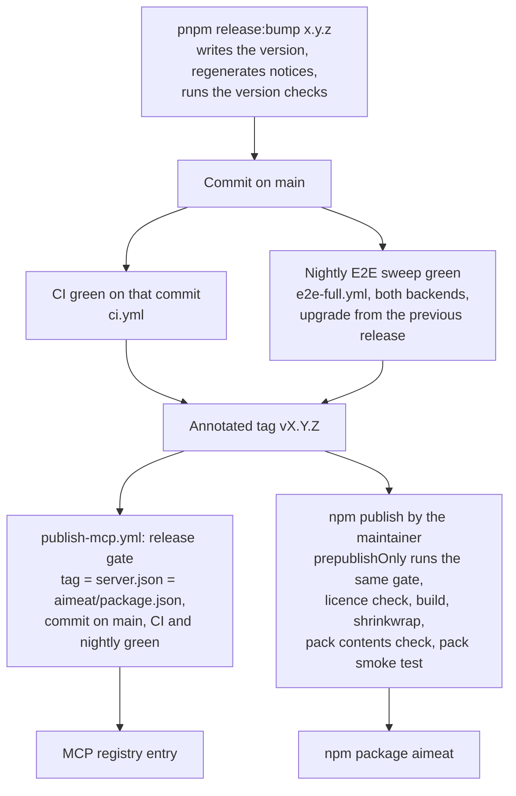

# 12 Updates and releases

> Checked against AIMEAT node 4.2.0 (commit 2d94bf903) on 2026-11-04. Maintained with the code: see the README for how.

This page is for the people who approve and apply updates: the system owner, the sysadmin and the security officer. It says how the project makes a release, what a release consists of, what you can verify about its integrity and what you cannot, how an update and a rollback work, and how security fixes are announced. The step-by-step procedure stays in [Upgrading](../operations/upgrading.md).

## How a release is made

| Step | What it does | Source |
|---|---|---|
| Version bump | `pnpm release:bump <x.y.z>` writes the version into `package.json`, `aimeat/package.json`, `openapi.yaml` and `server.json`, regenerates the third-party notices and the capability map, and runs the tests that read the version. It never commits | `aimeat/scripts/release-bump.ts` |
| Release gate | Refuses a release unless the commit is on the remote main branch and CI and the nightly E2E sweep each have a green run of it (a green nightly of an earlier commit started within 24 hours also counts). Without network it refuses | `aimeat/scripts/release-ready.mjs` |
| Security release exception | A security release may go out over a red, missing or running nightly sweep when it names its reason (a `Red-Nightly:` line in the annotated tag message, or `AIMEAT_RELEASE_RED_REASON`). CI must still be green | `aimeat/scripts/release-ready.mjs` |
| MCP registry | On a `v*` tag, the workflow checks that the tag, `server.json` and `aimeat/package.json` name the same version, runs the gate, then publishes `server.json` with a pinned, checksum-verified publisher. The registry key is an environment secret that only `v*` tags reach | `.github/workflows/publish-mcp.yml`, `server.json` |
| npm package | `npm publish` runs `prepublishOnly`: the release gate, `pnpm check:licenses`, `pnpm gen:notices`, `pnpm build`, `pnpm gen:shrinkwrap`, `pnpm check:pack-contents` and a smoke test that installs the packed tarball in an empty folder and starts it | `aimeat/package.json`, `aimeat/scripts/check-pack-contents.mjs`, `aimeat/scripts/pack-smoke.mjs` |
| Change record | Shipped features, and fixes the maintainer chooses, have an entry in `aimeat/public/changelog.json` with a kind (`feature`, `fix`, `security`, `notice`). The maintainer decides which changes get one, so not every fix, security fixes included, has an entry. Fix and security entries carry an impact sentence | `aimeat/public/changelog.json`, `.claude/rules/feature-documentation.md` (row 6) |

## What a release consists of

| Artefact | Where | Notes | Source |
|---|---|---|---|
| Node package `aimeat` | npm registry | Carries `npm-shrinkwrap.json`, so `npm install -g aimeat` and `npx aimeat` install the exact dependency versions the lock file pins, each checked against its integrity hash | `aimeat/scripts/gen-shrinkwrap.mjs` |
| Source | Git tag `vX.Y.Z` on GitHub | Build from source with `pnpm install` and `pnpm build` in the aimeat folder | [Upgrading](../operations/upgrading.md#the-update) |
| MCP registry entry | The name in `server.json` | Points at the project's demo node, not at your node; it is not an installable artefact | `server.json` |
| Docker image | Not published | Build it yourself from `aimeat/Dockerfile`; the base image is pinned by digest | `aimeat/Dockerfile` |
| CrewAI package `aimeat-crewai` | PyPI | Published with PyPI trusted publishing (OIDC, no stored token); the log prints the SHA256 of each uploaded file | `.github/workflows/publish-aimeat-crewai.yml` |
| Desktop app installers | GitHub Releases on `desktop-v*` tags | The files the in-app updater installs are signed with the Tauri updater key (minisign). The installers are not code-signed for Windows or macOS | `.github/workflows/release-desktop.yml` |

## Release integrity: what exists and what does not

| Control | Status | Source |
|---|---|---|
| Release gate on test results | Exists: a release needs green CI and a green nightly sweep on its commit | `aimeat/scripts/release-ready.mjs` |
| Pinned dependency tree in the npm package | Exists (`npm-shrinkwrap.json`) | `aimeat/scripts/gen-shrinkwrap.mjs` |
| Check that the published files all come from git | Exists | `aimeat/scripts/check-pack-contents.mjs` |
| Smoke test of the packed tarball | Exists | `aimeat/scripts/pack-smoke.mjs` |
| SBOM | Exists as a generator: `pnpm sbom` writes a CycloneDX 1.6 file covering the npm production tree and the browser libraries the node serves (`aimeat/public/lib/vendored-assets.json` and the committed library files). The weekly scan keeps one as a workflow artefact. It is not attached to npm releases | `aimeat/scripts/gen-sbom.ts`, `.github/workflows/vulnerability-scan.yml` |
| Pinned CI actions and checksum-verified tools | Exists: workflow actions are pinned by commit, downloaded scanners and publishers are checked by sha256 | `.github/workflows/vulnerability-scan.yml`, `.github/workflows/publish-mcp.yml` |
| npm provenance attestation | Does not exist: no workflow publishes to npm and no `--provenance` flag is used. `npm publish` runs on the machine that publishes | `aimeat/package.json` |
| Signatures or checksum files for the node release | Do not exist: the workflows hold no cosign, Sigstore or attestation step for the node | `.github/workflows/publish-mcp.yml` |
| Signed git tags | Not stated in the repository | none |
| Published Docker image | Does not exist | `aimeat/Dockerfile` |

What you can verify yourself:

- **The registry's signature.** The npm registry signs the packages it serves; `npm audit signatures` checks those signatures for an installed tree ([npm: verifying registry signatures](https://docs.npmjs.com/verifying-registry-signatures)). This proves the tarball came from the registry, not that it was built from a given commit.
- **Source against tarball.** Build the tag from source and compare the result with the dist folder of the published package, or install from source and skip npm.
- **Your own SBOM.** Run `pnpm sbom` on the tag you install and feed the file to your own scanner.

## Continuous checks on the code

| Check | When | Source |
|---|---|---|
| CI: static checks, unit tests, guard-tier E2E suites on both backends, CodeQL | Every push and pull request | `.github/workflows/ci.yml` |
| CodeQL | Every push, pull request and weekly | `.github/workflows/codeql.yml` |
| Dependency review (licences and advisories of new dependencies) | Every pull request | `.github/workflows/dependency-review.yml` |
| Semgrep semantic audit | Every push and pull request | `.github/workflows/semantic-audit.yml` |
| OpenSSF Scorecard | Weekly and on push | `.github/workflows/scorecard.yml` |
| Vulnerability scan: `pnpm audit`, OSV over the npm tree and the browser libraries, and Trivy, Grype and OSV-Scanner over the SBOM; fails on a finding | Weekly (Mondays) | `.github/workflows/vulnerability-scan.yml`, `aimeat/scripts/scan-vulns.ts` |
| Library freshness | Monthly | `.github/workflows/library-freshness.yml` |
| Full E2E sweep on both backends, and the upgrade test from the previous release | Nightly | `.github/workflows/e2e-full.yml`, `aimeat/test/upgrade-from-release.ts` |

## Learning that an update exists

| Channel | What it gives | Source |
|---|---|---|
| Notice in the node | An operator sees a header notice when npm has a newer version. `aimeat_admin_node_update` (`GET /v1/admin/node-update`) gives the running and newest versions, what is new, the detected install method and the steps for it | [Upgrading](../operations/upgrading.md#find-out-what-is-available), `aimeat/src/services/node-update-check.ts` |
| Turning it off | `AIMEAT_UPDATE_CHECK=false`; `AIMEAT_UPDATE_CHECK_SOURCE` points it at an internal mirror | `aimeat/src/config-update-check.ts` |
| Change log | `/changelog.json` and `/v1/changelog` on every node; entries of kind `security` carry an impact sentence | `aimeat/public/changelog.json` |
| npm | `npm view aimeat version` | `.github/SECURITY.md` |

## Update procedure

The procedure is in [Upgrading](../operations/upgrading.md#the-update). In short: back up the database, `.env` and the node key; tell the users; install the new version the same way as before (npm, source or Docker); start it with the same `.env`; check `GET /v1/build`, `GET /v1/health` and the admin Security page (`aimeat_admin_security_overview`). Read the version's change log entries first, and for a major version read the removal table in the same guide.

## Database changes and rollback

| Question | Answer | Source |
|---|---|---|
| Who runs schema changes | The node, at start, by itself. Nobody runs a script by hand | [Upgrading](../operations/upgrading.md#the-update) |
| PostgreSQL | Ordered SQL files, each applied once in its own transaction and recorded in the `_kysely_migrations` table. A file on `main` never changes: the repository gate (`pnpm check:migration-hashes`) holds each file to its hash in `aimeat/security/migration-hashes.json`. The node itself does not check the hash at start | `aimeat/src/storage/providers/postgres-kysely/migrate.ts`, `aimeat/security/migration-hashes.json` |
| SQLite | The schema and its column additions are applied in code at start | `aimeat/src/storage/providers/sqlite/methods/schema.ts` |
| Data changes | One-time data steps (for example the permission words kept for existing agents and apps in 4.0.0) run once per node at start and record that they ran | `aimeat/src/services/rest-scope-keep-working-migration.ts`, `aimeat/src/services/once-only-step.ts` |
| A failing change | Rolled back; the start stops with the file named; the database stays as before that change | `aimeat/src/storage/providers/postgres-kysely/migrate.ts` |
| Are changes reversible | No. There are no down migrations, and an older version does not undo what a newer one changed | [Upgrading](../operations/upgrading.md#the-update) |
| Rollback | Restore the backup taken before the update and start the old version. Without that backup, going back is not supported. A version from before 2026-11-04 refuses the tokens a newer version issued, so after going back to it people sign in again and agents connect again ([Key rotation](../operations/key-rotation.md)) | [Upgrading](../operations/upgrading.md#the-update), [Backup and restore](../operations/backup-and-restore.md) |
| What is tested | Each new build starts on a database that the previous release wrote, on SQLite and PostgreSQL, nightly | `aimeat/test/upgrade-from-release.ts` |

The rollback point is the backup. Its recovery point is the moment you took it: anything people wrote on the new version after that is lost on rollback. Plan the window with that in mind ([11 Backup and recovery](11-backup-recovery.md)).

## Security fixes

| Question | Answer | Source |
|---|---|---|
| How to report | Privately: GitHub private vulnerability reporting, or the e-mail address in the policy. Not in a public issue | `.github/SECURITY.md` |
| Response aim | Acknowledge within 48 hours, assess within a week, fix within two weeks | `.github/SECURITY.md` |
| How a fix ships | In a new release; only the newest release receives fixes | `.github/SECURITY.md` |
| How it is announced | A change log entry of kind `security` in `aimeat/public/changelog.json` when the maintainer writes one, shown on every node that has the version. The update notice tells operators of older nodes that a newer version exists | `aimeat/public/changelog.json`, `aimeat/src/services/node-update-check.ts` |
| A release that cannot wait | May go out over a red nightly sweep with a named reason; CI must be green | `aimeat/scripts/release-ready.mjs` |

## Limits

- Only the newest release receives security fixes, so every fix means moving to the newest version, including its other changes (`.github/SECURITY.md`).
- The node release carries no signature, checksum file or provenance attestation; the npm package is published from the maintainer's machine, not from a CI workflow.
- No Docker image is published; you build it from `aimeat/Dockerfile`.
- The SBOM is generated on demand and kept as a weekly scan artefact; it is not attached to a release.
- Database changes are forward only; rollback needs the backup taken before the update, and loses what was written after it.
- The upgrade test covers one step, from the previous release to the new build; a jump over several releases is not tested in the repository (`aimeat/test/upgrade-from-release.ts`).
- The update check is on by default and calls `registry.npmjs.org` and `unpkg.com`.
- The desktop installers are not code-signed for Windows or macOS; only the updater files are signed (`.github/workflows/release-desktop.yml`).
- The repository describes no process for publishing GitHub security advisories or CVE identifiers for fixed vulnerabilities.

## Open questions

- OPEN: Are fixed vulnerabilities published as GitHub security advisories or CVE records, and is there a list that operators can subscribe to? The maintainer named in `.github/SECURITY.md` can answer.
- OPEN: Are the `v*` release tags signed, and with which key? The maintainer can answer.
- OPEN: Will npm releases be published from CI with provenance attestations, and will the SBOM be attached to each release? The maintainer can answer.
- OPEN: How much notice does an operator get before a release that removes something (a major version)? The repository shows the removal table per major version but no notice period; the maintainer can answer.
