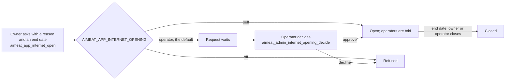
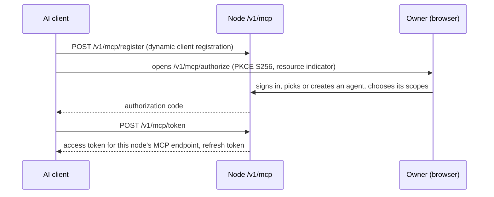

# 13 Apps, agents and endpoints

> Checked against AIMEAT node 4.2.0 (commit ddec0f144) on 2026-11-04. Maintained with the code: see the README for how.

This page covers the code that runs on behalf of people: apps published on the node, extensions and packages installed into it, the connector on a person's own computer, AI chats that connect over MCP, outside MCP servers the node calls, and the `aimeat-crewai` agent runtime. It is for the security officer and the workstation and network owners. Each section says what runs where, who approves it, and how to remove it.

## Apps

An app is a single-file web app that a person publishes on the node.

### Who may publish, and who sees it

| Question | Answer | Source |
|---|---|---|
| Who may publish | Any account. An agent needs `app:write`. An app gets it only when it declares the word and the owner approves it on the app's consent screen. There is no operator approval before publishing. | `aimeat/src/routes/apps/publish.ts`, `aimeat/src/services/app-grant-vocabulary.ts` |
| Who sees it in lists | `listed`, `community` (signed-in accounts) or `unlisted`; new apps start at `AIMEAT_APP_DEFAULT_LISTING` (default `listed`) | `aimeat/.env.example` |
| Who may open it | `anyone` or `signed-in`, or one organism's members (`open_to`), optionally with an access code; new apps start at `AIMEAT_APP_DEFAULT_ACCESS` (default `anyone`) and `AIMEAT_APP_DEFAULT_ACCESS_CODE` | [Organisation node sign-in](../organisation-node-sign-in.md), section 6a |
| On a closed node | With `AIMEAT_CONTENT_ACCESS=signed-in`, no app opens to a visitor without an account of this node | [Organisation node sign-in](../organisation-node-sign-in.md), section 6a |
| Making it public through an agent or app | With `AIMEAT_PUBLISH_GATE=agents-and-apps`, an agent or app without `publish:public` files a request the owner approves (`aimeat_publish_requests`). The code default is `off`. | `aimeat/.env.example` |
| Classification | A classified app cannot be listed or opened wider than its classification allows (409 `LABEL_CAPS_AUDIENCE`) | [Organisation node sign-in](../organisation-node-sign-in.md), section 6b step 8 |
| Audit | Each app keeps an audit log; `AIMEAT_APP_AUDIT_KEEP` sets how many entries an owner keeps by default (0 keeps all) | `aimeat/.env.example` |

For an organisation node, set `AIMEAT_APP_DEFAULT_ACCESS=signed-in`, `AIMEAT_APP_DEFAULT_LISTING=community` and `AIMEAT_PUBLISH_GATE=agents-and-apps` ([Organisation node sign-in](../organisation-node-sign-in.md), section 6b step 5).

### App origin isolation

- Each app runs on its own origin, `<app>.apps.<host>`, so its code cannot read the session of the person who opens it. It is on by default when `AIMEAT_SECURITY_PROFILE=public`, and needs a wildcard DNS name and certificate ([Production deployment](../operations/production-deployment.md)).
- `AIMEAT_APP_HOST` names the app host; `AIMEAT_APP_ORIGIN_ENABLED` turns isolation on or off (`aimeat/.env.example`).
- An app reaches the person's data only through an app grant: the owner approves named scopes on a consent screen, and the app gets a short access token with role `app` and a rotating refresh token. The scopes are enforced on every request, and the owner can narrow or revoke the grant (`aimeat/src/routes/app-grants.ts`).
- An app can never hold `account:security` (`aimeat/src/auth/account-security.ts`). It holds `app:write` only when the owner approved that word on the app's consent screen (`aimeat/src/services/app-grant-vocabulary.ts`, `APP_GRANTABLE_SCOPES`).
- When an app goes away, its address stays held for its owner for `AIMEAT_APP_HELD_LABEL_DAYS` (90), because its visitors' browser data lives on that origin (`aimeat/.env.example`).

### Opening one app to the internet on a closed node

On a node with `AIMEAT_CONTENT_ACCESS=signed-in`, an owner can open one app and the intake forms it declares to everyone on the internet, for a limited time. Its other data calls stay closed (`aimeat/src/services/internet-opening/opening-service.ts`).

| Control | Tool or setting | Source |
|---|---|---|
| Who opens | `AIMEAT_APP_INTERNET_OPENING`: `operator` (default), `self`, `off` | `aimeat/.env.example` |
| Longest opening | `AIMEAT_APP_INTERNET_OPENING_MAX_DAYS` (90, at most 365) | `aimeat/.env.example` |
| The owner's view and close | `aimeat_app_internet_opening_get`, `aimeat_app_internet_close` | `aimeat/src/routes/internet-opening.ts` |
| The operators' list and decision | `aimeat_admin_internet_openings`, `aimeat_admin_internet_opening_decide` | `aimeat/src/routes/internet-opening.ts` |
| Owners trusted to open without asking | `aimeat_admin_internet_opener_set` | `aimeat/src/routes/internet-opening.ts` |
| Which apps qualify | Its own setting lets anyone open it, it has no access code, it is not parked and no operator hid it | `aimeat/src/services/internet-opening/opening-service.ts` |
| Record | Every opening has a reason, a requester, a time and an end date; every change is an event in its history | `aimeat/src/services/internet-opening/opening-service.ts` |

### App data maps

An app's data map says what the app is for, what data it holds and where, who reads and writes it, whether it holds personal data, how long it is kept, and the maker's EU AI Act answers. Read it with `aimeat_datamap_get` and write it with `aimeat_datamap_set`; both need only `memory:read` or `memory:write`, because the map is a memory record (`aimeat/src/tool-catalog/definitions/data-map.ts`). An app without a map says so. IT can use the map as the source for an [application register entry](templates/application-register-entry.md).

## Extensions

An extension is server-side JavaScript that runs inside the node, in a QuickJS sandbox compiled to WebAssembly ([Extension memory architecture](../coding-guidelines/extension-memory-architecture.md)).

| Control | Default | Source |
|---|---|---|
| Extensions on or off | `AIMEAT_EXTENSIONS_ENABLED=true` | `aimeat/.env.example` |
| Who installs and changes extension code | `AIMEAT_EXT_INSTALL_ROLE=owner`; set `operator` so that only the operator's account (and its agents) can. The start-up self-check warns about `owner` on a public node. | `aimeat/src/services/extension-install-role.ts`, `aimeat/.env.example` |
| Memory and CPU per action | 64 MB, 5000 ms | `AIMEAT_EXT_MAX_MEMORY_MB`, `AIMEAT_EXT_TIMEOUT_MS` |
| Installed on the node, per owner | 20, 10 | `AIMEAT_EXT_MAX_INSTALLED`, `AIMEAT_MAX_EXTENSIONS_PER_OWNER` |
| Capabilities | An extension reaches the internet, starts AI jobs, sends email or buys only when its manifest declares `network`, `ai`, `email` or `payments`. The approval shows that list and the sandbox enforces the same list. | `aimeat/src/services/extension-capability-declaration.ts` |
| Network | `ctx.fetch` reaches only the hosts the manifest names, through the SSRF guard, checked again on every redirect | `aimeat/src/services/extension-ctx.ts`, `aimeat/src/services/extension-network-hosts.ts` |
| Secrets | The extension never reads the owner's vault; `ctx.fetch` puts a secret into an outbound header on the way out | [Extension memory architecture](../coding-guidelines/extension-memory-architecture.md) |
| Email | `AIMEAT_EXT_EMAIL_PER_HOUR` (200) per account | `aimeat/.env.example` |
| Its own data | Writes only its own namespace `ext:<name>`, readable by anyone without sign-in | `.claude/rules/namespaces-memory.md` |

## Packages and install approval

- A package bundles apps, extensions, skills and other parts. `AIMEAT_PACKAGE_CREATE_ROLE` (`owner` by default) decides who may create one; a package starts private (`aimeat/.env.example`).
- When an agent or app installs a package, the install becomes a request. The owner in person decides; another of the owner's agents may approve only when it did not file the request and holds `packages:write`, `memory:write` and `memory:write-as-owner`. A request expires after seven days and fails closed (`aimeat/src/services/packages/install/package-install-request-policy.ts`, `aimeat_package_install_requests`).
- This is the owner's approval, not IT's. Operator control is the install role for extensions and `AIMEAT_PACKAGES_ENABLED` (`aimeat/.env.example`).

## The connector on a person's computer (`aimeat connect`)

The connector is the `aimeat` command-line program run on a workstation or server. It registers local AI agents with the node, writes the MCP settings of local AI tools, and keeps agents connected.

### What runs

| Item | Detail | Source |
|---|---|---|
| Program | The `aimeat` npm package, run with `npx aimeat connect ...`; needs Node.js 24.22.1 or later | `aimeat/package.json`, `README.md` |
| Process | `node` running `aimeat connect serve`, one daemon per connector folder | [Connector forward tunnel](../connector-forward-tunnel.md) |
| Local listener | `127.0.0.1` on a random port. It admits only a loopback Host header, no `Origin` header, and the per-start secret from `serve.json` | `aimeat/src/cli/connect/mcp/local-server.ts`, [Connector forward tunnel](../connector-forward-tunnel.md) |
| Network | Outbound only, to the node: one WebSocket per agent to `/v1/connect/tunnel` when the node has `AIMEAT_CONNECT_TUNNEL_ENABLED=true` (off by default), else HTTPS calls | [Connector forward tunnel](../connector-forward-tunnel.md), `aimeat/.env.example` |
| Credentials | Agent tokens and keys in the connector folder: `AIMEAT_HOME`, else `.aimeat` in the folder the command ran in. Files 0600, folders 0700, a `.gitignore` of `*` | `aimeat/src/cli/connect/home-dir.ts`, `aimeat/src/cli/connect/keychain.ts` |
| Trust record | `~/.config/aimeat/trusted-commands.json`, outside every connector folder | `aimeat/src/cli/connect/command-trust.ts` |
| Name reported to the node | `AIMEAT_INSTALL_NAME`, else the computer's host name | `aimeat/src/cli/connect/install-id.ts` |
| Local AI tool settings | `aimeat connect client <goose, claude-code, cursor, vscode, claude-desktop>` writes the tool's MCP settings and a launcher that supplies the token at run time; the settings file holds no token | `aimeat/src/cli/connect/clients/index.ts` |

### Local commands and their approval

An agent's configuration can name a `runner` (started for each task) and a `wake.command` (started on new work). These start local programs with the agent's token in their environment.

- A command that the connector's own connect flow wrote is trusted by that act. A command that arrived in a folder from somewhere else (a cloned project, an archive) does not run; the connector names it and says that `aimeat connect` in that folder takes it into use (`aimeat/src/cli/connect/command-trust.ts`).
- The connector reports each agent's programs to the node. On the node, the owner, or an agent of the owner holding `agent:write`, allows or stops each one (`aimeat_connector_program_set`, `aimeat/src/routes/agents-v2/connectors.ts`). The node sends no command: the computer acts only on a hash of a command it holds itself (`aimeat/src/cli/connect/command-trust.ts`).

### What IT needs to know about workstations

- **No administrator rights.** `npx` runs the package from the user's npm cache. No code that installs a system service, a scheduled task or an autostart entry was found under `aimeat/src/cli/`.
- **No inbound port.** The only listener is on loopback.
- **One folder, one trust domain.** Every program that can read the connector folder can act as every agent in it. On Windows a folder below the drive root inherits the drive's access list and can be readable by every account that signs in; the daemon warns at start and prints the `icacls` or `chmod` command, but changes no permission itself ([Connector forward tunnel](../connector-forward-tunnel.md), Security model).
- **Removal.** `aimeat connect remove <agent-name>` removes one agent, `aimeat connect logout` removes the stored credentials (`aimeat/src/index-help.ts`). Then delete the connector folder and `~/.config/aimeat/`. Also remove the `aimeat` entry that `aimeat connect client` wrote into each local AI tool: `~/.claude.json` (written through Claude Code), `~/.cursor/mcp.json`, VS Code's user `mcp.json`, Claude Desktop's `claude_desktop_config.json` and Goose's `config.yaml` (`aimeat/src/cli/connect/clients/`). On the node, the owner deletes the agent, which revokes its sessions (`aimeat/src/routes/agents/management.ts`), and forgets the computer in person (`aimeat/src/routes/agents-v2/connectors.ts`). Deactivating the account closes every live tunnel (`aimeat/src/services/owner-lifecycle.ts`).

## AI chats connected over MCP

AI chats and coding tools that speak MCP connect to `<node>/v1/mcp`. The project's own list of clients that can and cannot connect is in `README.md`.

- **Protocol.** OAuth 2.1 with dynamic client registration, PKCE (S256) and the resource indicator (RFC 8707), required from node 4.0.0; every access token names this node's MCP endpoint as its audience (`aimeat/src/mcp/oauth.ts`, [MCP specification](https://modelcontextprotocol.io/specification)). The node serves MCP revision 2026-07-28 (`aimeat/src/mcp/protocol-version.ts`).
- **Signing in first.** The consent page and the device approval page sign nobody in. An owner with no session goes to the front page, which signs in or registers by the node's own settings (password policy, emailed link, passkey, SSO, registration mode), and returns to the page with the request in its address (`aimeat/public/js/sign-in-return.js`). The front page returns a person only to these two pages.
- **Identity and scopes.** Each connection is an agent of the owner. On the consent page the owner picks an existing agent or creates one, and keeps its scopes or chooses read only, standard, full or custom (`aimeat/public/oauth-consent.html`, `aimeat/public/views/profile/agents/scope-model.js`). The consent page shows the client name the server checked, never a name the link carries (`aimeat/src/mcp/oauth.ts`).
- **See and revoke.** The owner sees every connected AI on the Connect your AI page of their settings (`/v1/profile?tab=mcp`) and disconnects any of them (`README.md`). Deleting the agent ends its sessions and MCP sessions (`aimeat/src/routes/agents/management.ts`); a client can revoke its own token at `POST /v1/mcp/token/revoke`.
- **Housekeeping.** A client registration that nobody signed in with is deleted after `AIMEAT_MCP_UNUSED_CLIENT_DAYS` (30); an idle MCP session closes after `AIMEAT_MCP_SESSION_IDLE_MINUTES` (60); one AI or person keeps at most `AIMEAT_MCP_LEGACY_SESSIONS_PER_PRINCIPAL` (100) open sessions of the 2025-era protocol and the node `AIMEAT_MCP_LEGACY_SESSIONS_TOTAL` (1000), and past either a new session closes the least recently used one, whose client connects again (`aimeat/.env.example`).
- **Where the calls come from.** A client that runs in the vendor's cloud (a web chat's custom connector) calls the node from the vendor's network; a desktop or IDE client calls from the workstation. A node that only the internal network can reach serves only the second kind.
- **An AI that cannot use MCP** uses the prompt-driven path: the page composes a prompt, the person runs it in their own chat and pastes the answer back (`README.md`).

## Outside MCP servers the node calls

| Kind | Who attaches it | Control | Source |
|---|---|---|---|
| A person's own server (an issue tracker, a wiki) | The person, or an agent with `mcp:manage`, which no wildcard carries | `mcp:read` lists, `mcp:use` calls; the node holds the credential and never returns the server's address or credential. `aimeat_mcp_grant_list` shows which agents and apps may use which servers and tools. | `aimeat/src/routes/mcp-servers.ts`, `aimeat/src/tool-catalog/definitions/mcp-proxy.ts` |
| A node-wide server offered to every account | The operator | `aimeat_mcp_registry_list`, `aimeat_mcp_registry_set`: availability (all owners or an allowlist; an empty allowlist means nobody), on or off | `aimeat/src/tool-catalog/definitions/mcp-proxy.ts` |
| A group's server | An owner or admin of the organism | Organism membership, or the workspace's roles when it is bound to one workspace | `aimeat/src/services/mcp-client/registry.ts` |
| A node or group server where each person signs in with their own account (`auth: per-user-oauth`) | The operator (node server) or an organism owner or admin (group server) | The node holds no shared credential for it. Each admitted person signs in at the far side with their own account (OAuth, the round bound to their browser), so the far side's own permissions and audit apply per person. Each sign-in is stored sealed with `AIMEAT_ENCRYPTION_KEY` in its own row, removed by the person's sign-out, by detaching the server and by account erasure. A person who has not signed in is refused (`SIGN_IN_REQUIRED`); one person's failed renewal stops only that person. A capability another account published over such a server acts as the person who uses it, so `AIMEAT_MCP_CAPABILITY_USE_APPROVAL` (Config `mcp.capability_use_approval`, read on every call) decides who is asked first with one press: `ask` asks for every other account's capability, the operator's included; `operators` (default) lets an operator account's capability run unasked and asks for every other account's; `off` asks nobody. Until the person allows it, nothing is sent (403 `MCP_CAPABILITY_NEEDS_APPROVAL`). An AI credential may make the setting stricter and is refused a more open value (`PERSON_REQUIRED`). | `aimeat/src/services/mcp-client/personal-sign-in.ts`, `aimeat/src/services/mcp-client/invoke.ts`, `aimeat/src/services/owner-erasure.ts`, `aimeat/src/services/mcp-client/capability-consent.ts`, `aimeat/src/services/mcp-client/capability-use-setting.ts` |
| A local `stdio` server (a program on the node's host) | The operator in person | Off by default (`AIMEAT_MCP_STDIO_ENABLED=false`); only commands named whole in `AIMEAT_MCP_STDIO_ALLOWED_COMMANDS` run; both settings need a restart | `aimeat/.env.example` |

Outbound calls to remote servers go through the SSRF guard (`aimeat/src/services/mcp-client/transport.ts`).

## The `aimeat-crewai` agent runtime

`aimeat-crewai` (version 0.39.0) is a Python package that connects CrewAI crews to the node as AIMEAT agents (`python/aimeat-crewai/pyproject.toml`).

- **Install.** `pip install aimeat-crewai`; Python 3.11 or later, CrewAI 0.80 or later (`python/aimeat-crewai/README.md`).
- **Identity.** The crew is registered as an agent with `npx aimeat connect add` and approved by its owner, so it holds that agent's scopes and nothing more (`python/aimeat-crewai/README.md`).
- **Transports.** The local `aimeat connect serve --http` daemon on loopback (it sends the per-start secret), `aimeat connect serve` over stdio, or HTTPS directly to the node with the agent token in an environment variable (`python/aimeat-crewai/README.md`).
- **What it reports.** The model name and token counts of each LLM call the crew makes, to the node's usage ledger, attributed to the agent (`python/aimeat-crewai/README.md`).
- **Keys for outside services.** The owner's vault on the node holds them, not the crew's environment (`python/aimeat-crewai/README.md`).
- **The node wins.** When the package and the node schema disagree, the node schema is the reference (`.claude/rules/tool-surfaces.md`).

## Limits

- Any account can publish an app, and with the code defaults (`AIMEAT_APP_DEFAULT_ACCESS=anyone`, `AIMEAT_APP_DEFAULT_LISTING=listed`, `AIMEAT_PUBLISH_GATE=off`) a new app is open to anyone and listed. There is no operator review of an app's code before it is published.
- App origin isolation is off by default on the local security profile and needs wildcard DNS and a wildcard certificate on a public one. With it off, apps share the node's origin.
- `AIMEAT_APP_ORIGIN_SIGN_IN_REFUSE` is `false` by default: a sign-in request from an app origin is logged, not refused, until the operator turns refusal on (`aimeat/.env.example`).
- `AIMEAT_MCP_CAPABILITY_USE_APPROVAL` defaults to `operators`: a capability an operator account published over a server where each person signs in with their own account runs on the person's own sign-in there without asking. Set `ask` when every such use should be confirmed by the person.
- `AIMEAT_EXT_INSTALL_ROLE` defaults to `owner`: every account can install server-side extension code unless the operator sets `operator`.
- An extension's own namespace `ext:<name>` is readable by anyone without sign-in.
- Package install approval is the owner's decision; IT has no approval step for a package an owner installs.
- An agent of the owner holding `agent:write` can allow a program on the owner's computer that the computer already holds; allowing does not need the owner in person.
- The connector reports the computer's host name to the node unless `AIMEAT_INSTALL_NAME` is set.
- On Windows the connector folder inherits the parent folder's access list; the connector warns but does not fix it.
- An adopted command whose files kept old timestamps (for example from an archive) can be adopted as an existing install would be (`aimeat/src/cli/connect/command-trust.ts`, known residual).
- The forward tunnel is off by default on the node (`AIMEAT_CONNECT_TUNNEL_ENABLED=false`); connectors then use one HTTPS request per call.
- A web chat that runs in a vendor's cloud can connect only to a node reachable from the internet.
- A node-wide MCP server with a price refuses its calls, because a proxied call cannot take payment yet (`aimeat/src/tool-catalog/definitions/mcp-proxy.ts`).

## Open questions

- OPEN: Which source address ranges do the cloud-hosted MCP clients of each AI vendor use, so that an inbound allowlist in front of `/v1/mcp` can be written? Each vendor's documentation answers; the repository does not.
- OPEN: Does the connector need any file outside the connector folder, `~/.config/aimeat/` and the npm cache (for example a shell profile or a local AI tool's settings file written by `aimeat connect client`) to be removed for a full uninstall? The maintainer named in `.github/SECURITY.md` can answer.
- OPEN: Is there an operator-level switch that limits which outside MCP server addresses people may attach to their own accounts, beyond the SSRF guard? The maintainer can answer.
- OPEN: Can an operator review or block one app's code before it is published, or only hide it afterwards? The maintainer can answer.
