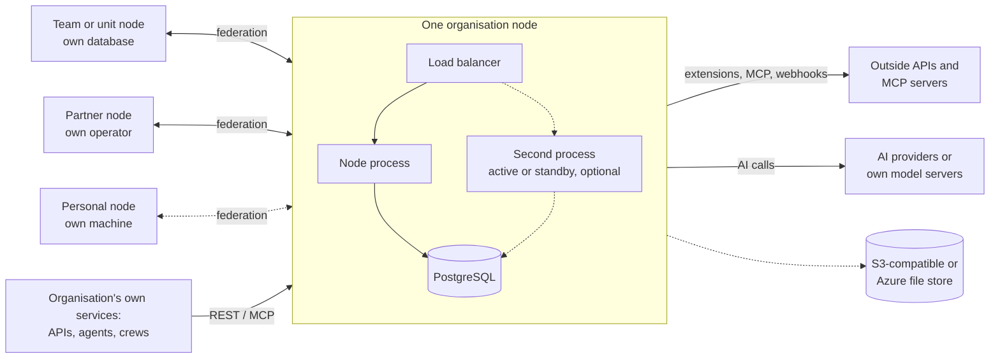

# 18 Scope and deployment patterns

> Checked against AIMEAT node 4.2.0 (commit 86549b2ae) on 2026-11-08. Maintained with the code: see the README for how.

This page is for the architect, IT and the system owner of the adopting organisation. It says what an AIMEAT node is built to do and what it leaves to other systems, and the deployment patterns that follow from that: one node, several node processes on one database, many separate nodes, a node of one's own, and the services that run beside a node. It then states availability and operator access from that architecture. Read it before [02 Architecture](02-architecture.md) when the question is "how big must this be, and how many".

## What a node is for

A node is the place where people and their agents keep the knowledge they have refined, and share it. It is a source of record for that knowledge and a place for the apps that show its state. It is a small system on purpose.

| A node holds and does | What that means | Source |
|---|---|---|
| Knowledge people and agents bring and own | Memory records, workspace documents and rows, stored files. Everything an agent writes belongs to its owner, and a person can take all of it out | [Data ownership](../data-ownership.md) |
| Identity | People (GHII, `alice@node-id`), agents that act for one person with scoped permissions (GAII), and outside applications onboarded with a scope allowlist (GEAI) | [Identity model](../coding-guidelines/identity-model.md) |
| Consent and provenance | Who may read what, and who wrote each record and with which AI | [Data ownership, section 4](../data-ownership.md#4-every-record-can-say-who-wrote-it), [AI transparency](../ai-transparency.md) |
| Agents as users | An agent connects through device authorization (RFC 8628) and the owner approves it and picks its scopes; a CrewAI crew connects through the `aimeat-crewai` package | `aimeat/src/routes/agents/device-auth.ts`, `python/aimeat-crewai/README.md`, [Building an agent](../building-an-aimeat-compatible-agent.md) |
| Sharing between people whose AIs come from different vendors | AI clients from any vendor connect over MCP; people share in organisms (a group with members) and workspaces (a shared space inside an organism) | [01 Overview](01-overview.md), [13 Apps, agents and endpoints](13-apps-agents-endpoints.md) |
| Apps that show the state | Single-file web apps published on the node, each on its own origin | [13 Apps, agents and endpoints](13-apps-agents-endpoints.md) |

### What a node is not built for

High-volume data processing, high-throughput transactions, bulk data lakes and analytics over large raw data sets. The storage limits show the intended size of what one identity keeps: by default 1024 kB per value (`AIMEAT_MEMORY_MAX_VALUE_SIZE_KB`), 1000 keys (`AIMEAT_MEMORY_MAX_KEYS`) and 10 MB (`AIMEAT_MEMORY_QUOTA_MB`) per identity, and 50 000 rows per workspace (`AIMEAT_WS_ROWS_MAX_PER_WORKSPACE`) (`aimeat/src/config.ts`, `aimeat/.env.example`). There is no message queue, no search cluster and no shared cache; the cache is a map in the process (`aimeat/src/services/cache.ts`).

Heavy work runs as separate services that read from and write to the node: model inference at an AI provider or on the organisation's own model servers, and the organisation's own processing as its own APIs, agents or extensions. The section [Services around a node](#services-around-a-node) lists the ways in.

## The patterns at a glance

Each box with its own database is a separate node with its own data, its own operator and its own settings. Lines marked federation are signed traffic between nodes whose operators approved each other; they do not copy one node's private data into another.

| Pattern | Use it when | Section |
|---|---|---|
| One node | One organisation, one operator, one set of rules | [One node for an organisation](#one-node-for-an-organisation) |
| Several processes on one database, active or standby | One node must survive the loss of one process or host, or needs more than one process | [Several node processes on one database](#several-node-processes-on-one-database) |
| Many nodes | Units, partners or people need their own data, operator or rules | [Many nodes](#many-nodes) |
| A node of one's own | A person or a small team needs content no other operator can read | [A personal or local node](#a-personal-or-local-node) |
| Services around a node | The work is heavy, or belongs to a system the organisation already runs | [Services around a node](#services-around-a-node) |

## One node for an organisation

**When.** One organisation with one IT function and one set of sign-in, classification and AI rules.

**What it gives.** One node process behind a reverse proxy, on PostgreSQL, with the organisation's identity provider ([02 Architecture](02-architecture.md), [Organisation node sign-in](../organisation-node-sign-in.md)). The process manager restarts the process after a crash (`aimeat/deploy/aimeat.service`: restart after 5 s). Every feature works in this shape, and it is the shape the guides describe ([Production deployment](../operations/production-deployment.md)).

**What it does not give.** A host or database failure is an outage until the process runs again or the database is restored ([11 Backup and recovery](11-backup-recovery.md)). Every team on the node shares one operator and one set of node settings.

## Several node processes on one database

**What is supported.** Two shapes, both on one PostgreSQL database. One active process and a standby: the load balancer sends all traffic to one process, and a second process with the same `.env` waits on a second host and takes the traffic when the first stops. Several active processes: the load balancer spreads the traffic over them, and what the first table below lists holds for the node as a whole. What the second table lists stays in each process, and each row says what follows and what to do. The maintainer ruled on 2026-11-04 that several active processes become supported when tests with two processes on one database prove the shared state; those tests pass (`aimeat/test/e2e-two-process-bus.ts`, `aimeat/test/e2e-two-process-leases.ts`, `aimeat/test/unit/ephemeral-claims-two-process.test.ts`). Every new piece of per-process state or timer in the code is counted by `pnpm check:process-local` against `aimeat/security/process-local-baseline.json`, which asks each new one what breaks with a second process.

Several processes of one node can run against one PostgreSQL database with the same settings, and they see the same data. The code records that aimeat.io has run two processes on one database: the same workflow fire started twice, 1 ms and 15 ms apart, on 2026-10-02 and 2026-10-03, and the scheduler claim below was written for it (`aimeat/src/services/scheduler-fire-claim.ts`, `aimeat/src/services/once-only-step.ts`).

**One process is the default; switch several on.** The setting `AIMEAT_NODE_PROCESSES` (`node.processes` on the admin Config page, "Server processes", read at start) is `single` by default. With `single` no other live process can exist, so a process that starts takes all of the node's work at once: it runs the `@activate` schedules, takes the AI jobs left queued or running and runs every sweep round, also when its container was recreated with a new host name. A process is named by its host name and port, so a recreated container is a process of a new name, and with `multiple` it waits for the previous process's lease to run out (30 s) before it takes that work over. Set `AIMEAT_NODE_PROCESSES=multiple` on every process before a standby or a second active process starts: two processes with `single` on one database both run the same work, as before 2026-11-04 (`aimeat/src/services/process-lease.ts`, `aimeat/src/config-runtime.ts`; decided by the maintainer on 2026-11-05). A process stopped normally hands its work over at once in either mode.

**What every process must share.** The same `.env`: the same `AIMEAT_NODE_ID`, `AIMEAT_BASE_URL`, `DATABASE_URL`, `AIMEAT_ENCRYPTION_KEY`, `AIMEAT_KEY_PASSPHRASE` and `AIMEAT_NODE_PROCESSES=multiple`. A process reads the node key from the database copy first, and that copy opens with `AIMEAT_KEY_PASSPHRASE` or `AIMEAT_ENCRYPTION_KEY`, so a process on a second host takes the same identity without a copy of the key file (`aimeat/src/auth/node-keys.ts`). Use PostgreSQL: SQLite is one file on one machine (`aimeat/src/storage/storage-factory.ts`).

### What holds across processes

| Held in the database | Source |
|---|---|
| Every record, account, setting row, app, workflow run and job record | `aimeat/src/storage/interface.ts` |
| A cron fire of a scheduled job runs once: each process claims the fire in the database before it runs it, and the process that loses skips it | `aimeat/src/services/scheduler-fire-claim.ts` |
| A fire missed while the node was down is caught up once, under the same claim | `aimeat/src/services/scheduler-catch-up.ts` |
| A once-per-node start step runs in one process only | `aimeat/src/services/once-only-step.ts` |
| The node key: two processes that start without a key file adopt one key | `aimeat/src/auth/node-keys.ts` |
| Sign-in through an outside identity provider (the OIDC login round is a stored nonce), device authorization requests, MCP OAuth clients, refresh tokens and approvals, spent upload tokens, spent agent return proofs | `aimeat/src/routes/oauth-login.ts`, `aimeat/src/routes/agents/device-auth.ts`, `aimeat/src/mcp/oauth.ts`, `aimeat/src/routes/upload.ts`, `aimeat/src/services/device-return-proof.ts` |
| Messages and tasks for an agent wait in storage and go out with the backlog when the agent's tunnel connects | `aimeat/src/services/connect-tunnel-push.ts` |
| Processes that start together migrate and seed one after the other: the boot lock is a PostgreSQL advisory lock held by a transaction (never by a session, so it also holds behind a connection pooler), and a process waits for it up to 60 s | `aimeat/src/storage/providers/postgres-kysely/migrate.ts`, `aimeat/src/server-bootstrap/boot-seed-lock.ts` |
| Maintenance mode: a stop switched on by `aimeat maintenance on` or through another process reaches every process over the event bus below, and within 5 s through a poll of storage when the bus is down | `aimeat/src/services/maintenance-cache.ts` |
| The live update bus: a change made on one process reaches the browsers (SSE) and the agent tunnels connected to every process, over PostgreSQL `LISTEN`/`NOTIFY`, and a message or task for an agent reaches it on whichever process holds its tunnel. Work an event starts (a workflow trigger, an intake, a data product) runs only on the process that made the change, so it runs once. SQLite has no bus: one process per database file | `aimeat/src/services/bus-relay.ts`, `aimeat/src/services/event-bus.ts`, `aimeat/src/storage/providers/postgres-kysely/bus-wire.ts` |
| The read cache: a change on any process clears the entries it touches on every process | `aimeat/src/server-bootstrap/process-buffers.ts`, `aimeat/src/services/cache-invalidation.ts` |
| What a process keeps in memory from the operator's decisions: the federation peers, the apps open to the internet on a closed node, maintenance mode and the settings changed on the admin Config page. A change made on one process makes every other process read that list again from storage, before it tells its own browsers, so an emergency removal of a peer is refused on every process. With `AIMEAT_NODE_PROCESSES=multiple` each list also has a stored mark that the changing process moves, and every process compares the marks every 30 s, so a change whose event was lost (a failed send, a crash before the send, a listening connection that stopped hearing) is in force on every process within 30 s. A process that starts reads every list once more when it begins to hear the bus, so a change made on another process while it was starting is in force on it too | `aimeat/src/server-bootstrap/bus-relay-start.ts`, `aimeat/src/services/bus-relay.ts`, `aimeat/src/services/federation-peer-reload.ts`, `aimeat/src/services/config-reload.ts` |
| Agent tunnels: deleting, moving or rekeying an agent, deactivating or deleting its account and revoking its token close its tunnel on whichever process holds it, and stopping or starting an agent and changing its permissions reach that tunnel too, over the event bus. With `AIMEAT_NODE_PROCESSES=multiple` every process also checks the tunnels it holds every 30 s, so a revocation or a stop whose event was lost is in force within 30 s; a token revoked by itself (sign-out of that one token) can take the 60 s of the revocation cache below on top. Deleting an account also closes its agents' open 2025-era MCP sessions on every process | `aimeat/src/services/connect-tunnel/cross-process.ts`, `aimeat/src/services/connect-tunnel/recheck.ts`, `aimeat/src/services/connect-tunnel.ts`, `aimeat/src/services/owner-erasure.ts`, `aimeat/src/mcp/session-registry.ts` |
| AI jobs and workflow runs in flight: each process holds a lease it renews every 10 s and that runs out 30 s after its last renewal. A process that starts leaves alone the jobs of another live process, and takes over the jobs of a process whose lease ran out; a stopping process ends its lease at once, so another takes over without the wait. An AI job is paid for, answered and its `on_done` run at most once: before each of those steps the process checks that it still holds the job and that the job is not cancelled, and a cancel taken by another process reaches the one running the job over the event bus. The lock of a workflow run holds across processes. This row and the two below need `AIMEAT_NODE_PROCESSES=multiple`; with the default `single`, a starting process takes every lease at once and no process looks for another's jobs while it runs | `aimeat/src/services/process-lease.ts`, `aimeat/src/services/ai-jobs/reclaim.ts`, `aimeat/src/services/workflow/engine-lock.ts` |
| The periodic sweeps run in one process per round: the federation book, the memory bin, lapsed memberships, the AI disclosure sweep, the held notifications and the digest, the cache cleanup, the agreements and goals sweeps, the retry of cross-node messages, the tracked responses and the workflow watchdog | `aimeat/src/services/process-lease.ts` (`claimedSweep`) |
| Jobs scheduled `@activate` run once per start of the node: the process that holds the start-up lease runs them, and a process that starts beside a live one does not run them again | `aimeat/src/services/scheduler.ts` |
| The data key's re-encrypt job runs in one process at a time, the one that holds its lease; its progress is a stored record, so after that process stops another takes the job up from the last batch it recorded ([Key rotation](../operations/key-rotation.md)) | `aimeat/src/services/key-reencrypt/job.ts` |
| The pages' build stamp names the code, so a page whose live stream reaches the standby does not reload | `aimeat/src/utils/build-stamp.ts` |
| A stop drains: `GET /v1/health/ready` answers 503, new connections are refused, requests in flight get 5 s, and the process exits 0, so the load balancer moves to the standby | `aimeat/src/server-bootstrap/drain.ts`, `aimeat/src/routes/health.ts` |
| A webhook or mail whose first attempt failed keeps its retries in a stored outbox, each attempt claimed on the record's version, so a restart resumes it and two processes send it once | `aimeat/src/services/outbox.ts`, `aimeat/src/services/email-outbox.ts` |
| The notification digest and the held pushes claim before they send: the digest bookmark and the held marks move on their version first, so two processes send one digest | `aimeat/src/services/notification-sweeps.ts` |
| Consent and classification audit rows are written within 1 s of the decision, and at a stop | `aimeat/src/services/consent-audit-buffer.ts`, `aimeat/src/services/classification/audit.ts` |
| Short sign-in steps and connection tickets: MCP OAuth authorization codes (`/v1/mcp/authorize`, `/v1/mcp/authorize-consent` then `/v1/mcp/token`), app grant codes and pending requests (`/v1/app-grants/*`), passkey ceremonies, WebSocket tickets (60 s) and live stream tickets (30 s). A step begun on one process ends on another, with the same lifetime, and is used once for the node. The table stores a hash of each code or ticket and its contents sealed under a key only the code or ticket opens | `aimeat/src/services/ephemeral-claims.ts`, `aimeat/src/mcp/oauth.ts`, `aimeat/src/routes/app-grants.ts`, `aimeat/src/services/passkeys.ts`, `aimeat/src/services/single-use-tickets.ts` |
| The replay caches: a key-signed sign-in (`/v1/auth/token`, the signed `/v1/mcp/authorize`, an ecosystem app's renewal) and a signed request or message between nodes are accepted once for the node within their 5 minutes, whichever process receives them | `aimeat/src/auth/signed-request.ts`, `aimeat/src/services/request-nonce.ts`, `aimeat/src/services/signed-node-request.ts` |
| The short address of a presigned upload (`upload_url`): one process issues it and any process takes the upload | `aimeat/src/services/upload-token.ts` |
| The per-account limits (mail, invitations, AI calls), the count of wrong admin passwords per address and the sign-in tarpit: one count for the node, so N processes allow each limit once. An admin password is counted before it is compared and a right one is taken off the count again, so wrong passwords sent at the same moment are compared only up to the count | `aimeat/src/services/account-limits.ts`, `aimeat/src/services/admin-password.ts`, `aimeat/src/middleware/login-tarpit.ts` |
| The node's AI allowance per account: a debit or grant is written on the record's version, so two processes settling one account's calls lose none | `aimeat/src/services/ai/allowance.ts` |

### What stays in each process, and what follows

| Held in one process | What follows | What to do | Source |
|---|---|---|---|
| A request answered through a tunnel: a capability call to an agent on a connected computer, or a request to a personal node through its tunnel | It goes through the process the tunnel connected to; on another process the agent or the personal node counts as not connected. Messages and tasks for an agent are not affected: they reach it over the bus | Run one active process when agents on connected computers serve capability calls, or accept that such a call succeeds only on the process holding the tunnel | `aimeat/src/services/connect-tunnel.ts`, `aimeat/src/services/personal-tunnel.ts` |
| Request rate limits and the hold on the node's AI key | Each process counts on its own, so N processes allow up to N times the configured rate, and N calls side by side on the node's AI key | Divide the limits by the number of processes, or limit at the load balancer | `aimeat/src/middleware/rate-limit.ts`, `aimeat/src/services/ai/node-key-hold.ts` |
| MCP sessions of the 2025-era protocol (one transport per session), at most `mcp.legacy_sessions_per_principal` (100) per principal, `mcp.legacy_sessions_per_owner` (300) per account and `mcp.legacy_sessions_total` (1000) in each process; past the node limit the session unused the longest of the account holding the most is closed first. The 2026-07-28 code path is stateless | A request with a session id that another process opened, or that a cap closed, gets 404, and the client starts a new session | Affinity on the `Mcp-Session-Id` header | `aimeat/src/mcp/legacy-sessions.ts`, `aimeat/src/mcp/modern-endpoint.ts` |
| The token revocation cache, 60 s | A revoked token is refused at once by the process that revoked it, and by the others within 60 s | Count on 60 s for a revocation to reach every process | `aimeat/src/auth/jwt.ts` |
| Idempotency keys | A retried request with the same `Idempotency-Key` that lands on another process runs again | Affinity, or retry against the same process | `aimeat/src/middleware/idempotency.ts` |
| The setup code of a node without an operator | Each process prints its own code | Run the first setup with one process | `aimeat/src/services/setup-code.ts` |
| Realtime rooms, chunked uploads in progress, the stop handle of a chat turn, who is online, and the watch list of tracked responses | A room, an upload or a chat turn exists only in the process that opened it; presence counts only that process's streams; a tracked response is watched by the process that created it until the reconciler finds it | Run one active process; a takeover loses rooms and unfinished uploads, and the clients start them again | `aimeat/src/services/realtime-manager.ts`, `aimeat/src/storage/chunked-upload-store.ts`, `aimeat/src/routes/chat.ts`, `aimeat/src/services/presence.ts`, `aimeat/src/services/track-registry.ts` |
| The per-owner ceiling of queued AI jobs, the extension run slots, and the daily mail count per sender (`email.reports_per_sender_day`) | Each process counts on its own, so N active processes allow N times each limit | Run one active process | `aimeat/src/services/ai-jobs/service.ts`, `aimeat/src/services/extension-run-slots.ts`, `aimeat/src/services/mail-gate.ts` |
| A receiver's per-minute and per-day message limits, its count of wrong keys for the security incident, and its delivery log entries not yet written (at most 5 s) | Each process counts on its own, so N active processes allow N times each receiver's limits, and the incident for wrong keys may need more wrong keys in total; a process that stops loses its last seconds of log entries, never the data the receiver wrote | Run one active process, or set each receiver's limits divided by the number of processes | `aimeat/src/services/receivers/deliveries.ts`, `aimeat/src/services/receivers/verify.ts` |
| Whether the chat agent starts: before the chat page says the chat can answer, the process starts its chat agent once and keeps the result, 30 minutes when it started and one minute when it did not | Each process checks its own agent. A host without the agent program, or with a broken one, shows the chat as out of use while another host's chat works, so the same person can see both on two page loads | Install the same chat agent program (`AIMEAT_GOOSE_BIN`) at the same path on every host | `aimeat/src/services/chat/agent-health.ts` |

Where the code's own notes still say "a node runs one process", they describe one of the rows above: the AI key hold is "per process, like every limiter here: a node runs one process" (`aimeat/src/services/ai/node-key-hold.ts`).

### Two ways to use it

| Shape | What it gives | What it does not |
|---|---|---|
| **One active process and a standby (supported).** The load balancer sends all traffic to one process and reads `GET /v1/health/ready`; a second host has the same `.env`, with `AIMEAT_NODE_PROCESSES=multiple` on both, and its process takes the traffic when the first one's readiness fails. A stop drains the active process first (readiness 503, new connections refused, requests in flight finished), so a planned switch loses no request | Recovery from the loss of a host in the time it takes a process to start, with none of the per-process effects above, because one process serves at a time. A standby process that runs while it waits takes its turn at the sweeps and holds a lease, so it takes over the AI jobs of a lost active process once that process's lease has run out, 30 s after its last renewal; a stopped standby does not | Protection against the loss of the database: use PostgreSQL's own standby for that ([11 Backup and recovery](11-backup-recovery.md)) |
| **Several active processes (supported).** The load balancer spreads the traffic over the processes and reads `GET /v1/health/ready` on each. Set `AIMEAT_NODE_PROCESSES=multiple` on every process. Divide the request rate limits by the number of processes, or limit at the load balancer; use affinity on the `Mcp-Session-Id` header for 2025-era MCP clients | Capacity beyond one process, and service through the loss of one process: the others go on serving, and take over its AI jobs when its lease runs out | Everything in the second table above: per-process rate limits and AI key hold, requests through a tunnel, idempotency keys, realtime rooms and uploads in progress, the 60 s revocation reach |

Two processes of one node on one PostgreSQL database are tested without a load balancer: a write on one reaches a live stream on the other, a peer removed on one is refused on the other, a workflow trigger fires once (`aimeat/test/e2e-two-process-bus.ts`); a queued AI job runs once, a sweep runs once per round, and a killed process's job is finished by the other (`aimeat/test/e2e-two-process-leases.ts`); both suites run with `AIMEAT_NODE_PROCESSES=multiple`, and with the default `single` a process of a new name runs the `@activate` schedules and the previous process's queued AI job at once (`aimeat/test/e2e-single-process-lease.ts`); a sign-in step begun on one ends on the other, a spent nonce is refused on the other, and a limit is counted once for both (`aimeat/test/unit/ephemeral-claims-two-process.test.ts`). The scheduler and start-step claims are covered by unit tests (`aimeat/test/unit/scheduler-fire-claim.test.ts`, `aimeat/test/unit/scheduler-catch-up.test.ts`, `aimeat/test/unit/once-only-keep-steps.test.ts`, `aimeat/test/unit/node-key-path.test.ts`). The project records no test behind a load balancer.

## Many nodes

**When.** A unit, a partner, a customer project or a person needs its own data, its own operator, its own sign-in or classification rules, or its own outage boundary. There can be as many nodes as the organisation runs: each is a full node with its own database.

**What it gives.**

- **Separation.** Each node has its own database, its own settings, its own operator and its own node key. An outage, a wrong setting or a breach on one node stays on that node.
- **Federation between nodes.** Two operators approve each other as peers; the peer's tier decides how far it reaches: `contact` (messages only), `visiting` (catalogue, messages, broadcasts, settlement), `member` (also replication and routing) and `genesis` ([Running federation](../operations/federation.md)). Every request between nodes is signed with the sending node's key, carries its audience and is accepted once.
- **Identity stays at home.** A person keeps one home node, and their identity names it (`alice@home-node`). Cross-node sign-in, off by default, lets a person sign in on a peer as `alice@home-node`: the peer asks the home node, which answers yes only when the person allowed that node, the link between the nodes carries sign-ins, and the peer's operator accepts them (`AIMEAT_FEDERATION_AUTH_POLICY`, [Feature list](../AIMEAT-Feature-List.md)). Such a session is a visitor on the peer, named by its home identity (`aimeat/src/routes/federation-auth.ts`, [Identity model](../coding-guidelines/identity-model.md)).
- **What crosses.** Messages between people, the directory and catalogues, records a person published with federation consent, and settlements. A message to a node that is down waits at the sender and is tried again for `AIMEAT_MESSAGE_RETRY_TTL_HOURS` (168 hours by default) (`aimeat/src/config.ts`, `aimeat/src/services/message-delivery.ts`).
- **The same apps and tools on every node.** One node can serve its packages to other nodes, which take updates from it (`AIMEAT_PACKAGE_FEDERATION_ENABLED`, [Feature list](../AIMEAT-Feature-List.md)). Consul can hold the configuration of a fleet of nodes (`AIMEAT_CONSUL_ENABLED`, `aimeat/src/config-consul.ts`).
- **One AI client, several nodes.** A person who works on two nodes connects their AI client to the MCP endpoint of each, as two connections ([13 Apps, agents and endpoints](13-apps-agents-endpoints.md)).

**What it does not give.** Twenty nodes are twenty separate nodes, not replicas of one. Federation does not copy private records, does not fail one node over to another, and does not merge two nodes' accounts. An organism and its workspaces live on one node; moving one is an export and an import, which does not bring its membership or its board (`aimeat_organism_export`, `aimeat_organism_import`, [17 Exit plan](17-exit-plan.md)). The `relay` and `mirror` node types are accepted by configuration, but working replication, stateless operation and a tested resource budget are not established for them ([Environment examples](../coding-guidelines/environment-configs.md#relay-and-mirror-types)).

## A personal or local node

**When.** A person or a small team needs content that no other operator can read, or needs to work without a network.

**What it gives.** A node on the person's own machine: node type `personal` (`AIMEAT_NODE_TYPE`) on SQLite, or the packaged desktop app (`aimeat-desktop/package.json`). The person is its operator. With a private or loopback base URL, or node type `personal`, and `AIMEAT_BIND_HOST` empty or a loopback address, the node takes the `local` security profile when none is set (`aimeat/src/config-private-host.ts`, [Environment examples](../coding-guidelines/environment-configs.md#personal-node)). It can federate with the organisation's node like any other node, and it can anchor to an operator node through a tunnel, which keeps an offline mailbox for it while it is away ([Feature list](../AIMEAT-Feature-List.md)).

**What it does not give.** Mail held in that mailbox sits on the operator node. A remote MCP connector in a vendor's cloud cannot reach a node on a private machine; local AI clients can ([13 Apps, agents and endpoints](13-apps-agents-endpoints.md)). The person backs it up. Exposing it on a network needs the `public` profile, set and checked by hand ([01 Overview](01-overview.md#node-types)).

## Services around a node

The organisation's heavy or specialised work runs in its own services, and the node is where their results become shared, owned and attributed knowledge.

| Way in | What it is for | Example in this repository | Source |
|---|---|---|---|
| REST API | The organisation's own service reads and writes records with an agent token or a personal access token | The documented contract | `openapi.yaml` |
| MCP | AI clients and agents use the node's tools | `/v1/mcp` | `aimeat/src/mcp/index.ts` |
| Agents | A program that acts for one person, approved by that person with the scopes it may use | A CrewAI crew with the liaison agent, run on the organisation's own machines | `python/aimeat-crewai/README.md`, [Building an agent](../building-an-aimeat-compatible-agent.md) |
| The connector on a workstation | Programs on a person's computer that the person allowed, reached from the node through the connector tunnel | `aimeat connect` | [13 Apps, agents and endpoints](13-apps-agents-endpoints.md), [Connector forward tunnel](../connector-forward-tunnel.md) |
| Ecosystem apps (GEAI) | An outside service (a support desk, a table store, an editor) joins with hello, approve and token, and writes in its own namespace | The developer specification | [Building an ecosystem app](../building-an-aimeat-compatible-ecosystem-app.md) |
| Sandboxed extensions | Small actions that run inside the node in a QuickJS WASM sandbox with no Node.js globals, and call outside APIs through the SSRF guard, live or on a schedule | `rest-connector`, a reference connector with an encrypted per-instance API key and a scheduled sync; the built-in `vocab-finto`, which calls `api.finto.fi` | `aimeat/src/services/extension-runtime.ts`, [rest-connector](../extensions/rest-connector/README.md), `aimeat/src/data/builtin-extensions/vocab-finto.ts` |
| App tools | An app's tools, each bound to a capability that runs at once or to an agent of the owner that receives the work as a task | `aimeat_app_tools_publish` | `aimeat/src/tool-catalog/definitions/commerce.ts` |
| Capability webhooks | A capability in the registry that calls the organisation's own endpoint | `AIMEAT_CAPABILITY_WEBHOOKS`, disabled by default | `aimeat/src/services/capability-invoke.ts` |
| Outside MCP servers | The node calls another MCP server that a person, a group or the operator attached | `aimeat_mcp_attach` | `aimeat/src/services/mcp-client/transport.ts` |
| Webhooks and operator hooks | The node tells the organisation's services about events | `aimeat_admin_hook_set` | `aimeat/src/services/webhook-dispatcher.ts`, `aimeat/src/services/hooks.ts` |
| AI models | Inference at a provider, or on the organisation's own model servers (`AIMEAT_AI_PROVIDER_EGRESS`); typed decisions at a separate decision service, also a local one without a key | The decision provider client | [06 AI and models](06-ai-and-models.md), `aimeat/src/services/decide/systemone-client.ts` |
| File bytes | Stored files in an S3-compatible service or Azure Blob instead of the database | `AIMEAT_FILE_STORE` | `aimeat/src/storage/blob/s3-client.ts`, `aimeat/src/storage/blob/azure-client.ts` |

Every outbound call these make is listed, with its setting, on [02 Architecture](02-architecture.md#outbound-traffic-the-egress-allowlist).

## Availability

| Question | Answer from this architecture | Source |
|---|---|---|
| What does an outage of one node stop? | The people and agents of that node lose the web UI, MCP and REST of that node, and its apps. Stored data is not touched. Peers keep working, and messages to the node wait at the senders. Scheduled jobs wait: at the next start a daily or longer core job runs once to catch up, and a person's missed schedule is written to its run log as skipped | `aimeat/src/services/scheduler-catch-up.ts`, `aimeat/src/services/message-delivery.ts` |
| Why does the node stay small? | It holds refined knowledge and the state that apps show. Model inference and heavy processing run in other services, so a heavy job cannot take the knowledge store down with it, and a node outage does not stop those services' own work | [Services around a node](#services-around-a-node) |
| How is one host's loss covered? | A second process on a second host, as a standby or as a second active process; the processes take over each other's AI jobs when a lease runs out | [Several node processes on one database](#several-node-processes-on-one-database) |
| How is the blast radius kept small? | Separate nodes for units, partners or people: an outage, a setting or a breach on one node stays on it | [Many nodes](#many-nodes) |
| How is the database covered? | PostgreSQL's own standby and WAL archiving, and backups with a tested restore; the RTO and RPO tiers are on page 11, and the setup, the timed restore and the failover drill in the database high availability guide | [11 Backup and recovery](11-backup-recovery.md#proposed-rto-and-rpo), [Database high availability](../operations/database-high-availability.md) |

## Operator access is a design decision

The operator answers for what the node holds: the organisation is the controller of the personal data on it, and the operator is its technical arm, who runs exports and erasures, answers data subject requests and handles incidents ([03 Shared responsibility](03-shared-responsibility.md)). To do that, the operator keeps the last access to the content of the node. Application permissions also cannot hide content from whoever runs the host or the database ([threat model](../security/threat-model.md#threats-to-test)).

What the node does with that access is record it:

- An operator's read, search, delete, restore or export of another person's records writes two records: a usage row in the operator's own stream that names the account, and a line on that person's account feed, both written before the answer is sent (`aimeat/src/services/operator-access-audit.ts`, [Data ownership, section 8](../data-ownership.md#8-the-operator-is-accountable)).
- An operator's other acts in a person's account write the same trail (`operator_acted`), and an operator's change to a node setting writes a usage row and a log line (`aimeat/src/services/operator-access-audit.ts`).
- An operator's agent acts as operator only for the permission words the operator gives it, such as `operator:admin` (`aimeat/src/services/operator-principal.ts`).

What the organisation decides: who holds the operator role, how operator duties are separated, how often the trail is reviewed, and what the privacy notice tells people about operator access ([14 Compliance mapping](14-compliance-mapping.md)).

Content that must stay out of every other operator's reach belongs on a node its owner runs: a personal node or a team node with its own operator ([A personal or local node](#a-personal-or-local-node), [Many nodes](#many-nodes)). The architecture allows any number of them, and federation lets them share what their owners choose.

## Limits

- Several processes need PostgreSQL. SQLite is one file on one machine and has no event bus between processes.
- The project records no test of several node processes behind a load balancer, and no failover test of a standby process under load. Two processes on one PostgreSQL database are tested without a load balancer for the event bus, the leases and the shared one-time values and limits (`aimeat/test/e2e-two-process-bus.ts`, `aimeat/test/e2e-two-process-leases.ts`, `aimeat/test/unit/ephemeral-claims-two-process.test.ts`); two processes starting together on one empty database are tested (`aimeat/test/e2e-boot-lock.ts`), and so is the drain of a stop (`aimeat/test/e2e-graceful-shutdown.ts`).
- With several active processes, these stay in each process: request rate limits and the AI key hold, requests answered through a tunnel, 2025-era MCP sessions, the token revocation cache (60 s), idempotency keys, the setup code, realtime rooms, chunked uploads in progress, presence, the per-owner ceiling of queued AI jobs, the extension run slots and the daily mail count per sender (table above).
- The `relay` and `mirror` node types are not established for replication or redundancy ([Environment examples](../coding-guidelines/environment-configs.md#relay-and-mirror-types)).
- Federation does not fail one node over to another and does not copy private records. An organism lives on one node.
- The operator of a node can read the records of the people on it; the node records each read and does not prevent it.
- The repository gives no sizing figures for a node of a given number of people and agents (see the open question on [02 Architecture](02-architecture.md#open-questions)).

## Open questions

- OPEN: Has the project run one node with two processes, active and standby or both active, under load, and with which load balancer rules? The maintainer named in `.github/SECURITY.md` can answer.
- OPEN: Will the idempotency keys, the request rate limits and the AI key hold move to the database, so that several active processes need no divided limits? The short sign-in steps, the replay caches, the per-account limits, the event bus, the leases of AI jobs and workflow runs, and the sweeps moved on 2026-11-04. The maintainer can answer.
- OPEN: Can a person signed in from a peer node through cross-node sign-in be a member of an organism on this node, and which workspace operations are open to such a member? The maintainer can answer.
